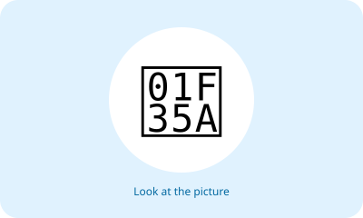

# Bahasa Inggris Kelas 3 — Unit 1: I like Mi Aceh

## MOD-01 — K03-ENG-B01-MOD-01

### Let's talk about food!

Saat istirahat, kamu melihat makanan di kantin. Yuk, belajar menyebutkan makanan dan minuman dalam bahasa Inggris!

**Kosakata:**
- **fried rice** = nasi goreng
- **fried chicken** = ayam goreng
- **noodles** = mi
- **meatballs** = bakso
- **bread** = roti
- **milk** = susu
- **tea** = teh
- **banana** = pisang
- **ice cream** = es krim
- **rice** = nasi
- **water** = air putih
- **orange juice** = jus jeruk

**Pola kalimat penting:**
- **I like fried rice.** = Aku suka nasi goreng.
- **I don't like tea.** = Aku tidak suka teh.
- **Do you like milk?** = Apakah kamu suka susu?
- **Yes, I do.** = Ya, aku suka.
- **No, I don't.** = Tidak, aku tidak suka.

**Percakapan singkat:**
- A: Do you like bread?
- B: Yes, I do. I like bread.
- A: Do you like tea?
- B: No, I don't. I like milk.

**Coba praktik:** Sebutkan tiga makanan yang kamu suka dalam bahasa Inggris. Tanyakan kepada anggota keluarga, “Do you like ...?”

---

## MOD-02 — K03-ENG-B01-MOD-02

### A day at the canteen

Bayangkan kamu dan temanmu sedang memilih makanan. Kamu bisa bercerita tentang makanan yang disukai dan bertanya kepada teman.

**Kosakata:**
- **fried rice** = nasi goreng
- **fried chicken** = ayam goreng
- **noodles** = mi
- **meatballs** = bakso
- **bread** = roti
- **milk** = susu
- **tea** = teh
- **banana** = pisang
- **ice cream** = es krim
- **rice** = nasi
- **water** = air putih
- **orange juice** = jus jeruk

**Pola kalimat penting:**
- **I like fried rice.** = Aku suka nasi goreng.
- **I don't like tea.** = Aku tidak suka teh.
- **Do you like milk?** = Apakah kamu suka susu?
- **Yes, I do.** = Ya, aku suka.
- **No, I don't.** = Tidak, aku tidak suka.

**Percakapan singkat:**
- A: Do you like bread?
- B: Yes, I do. I like bread.
- A: Do you like tea?
- B: No, I don't. I like milk.

**Coba praktik:** Sebutkan tiga makanan yang kamu suka dalam bahasa Inggris. Tanyakan kepada anggota keluarga, “Do you like ...?”

