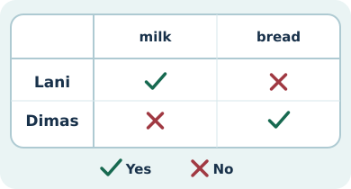
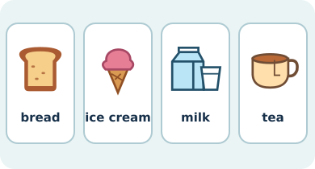

# Bahasa Inggris Kelas 3 — Unit 1: I Like Mi Aceh

## MOD-01 — K03-ENG-B01-MOD-01

### Ngobrol di kantin

Mau bilang kamu suka sesuatu? Mulai dengan **I like**. Contohnya, **I like Mi Aceh.** Kalau mau tahu kesukaan teman, mulai dengan **Do you like ...?**

- A: Do you like milk?
- B: Yes, I do. Do you like fried chicken?
- A: No, I don’t. I like noodles.

**Yes, I do** berarti “Ya, aku suka.” **No, I don’t** berarti “Tidak, aku tidak suka.” Kamu juga bisa menyebut bendanya lagi, seperti **I don’t like tea.** Pada **Do you like it?**, kata **it** merujuk pada makanan atau minuman yang baru disebut. Untuk menambahkan kesukaan yang sama, ucapkan **I like it, too.**

**Food (makanan)** — *rice* (nasi), *fried rice* (nasi goreng), *fried chicken* (ayam goreng), *noodles* (mi), *meatballs* (bakso), *bread* (roti), *bananas* (pisang), dan *ice cream* (es krim).

**Drinks (minuman)** — *milk* (susu), *tea* (teh), dan *coffee* (kopi).

**Coba sendiri.** Tunjuk dua gambar makanan atau minuman. Sebutkan namanya, lalu tanya teman, **Do you like ...?** Beri tanda centang untuk Yes dan silang untuk No. Dengarkan jawabannya sampai selesai. Gambar satu makanan yang kamu suka dan tulis **I like ...** di bawahnya.

---

## MOD-02 — K03-ENG-B01-MOD-02

### Survei menu kelas

Bayangkan kelompokmu sedang mencatat kesukaan teman. Baca menu dan pilih dua hal untuk ditanyakan.

| Food (makanan) | Drinks (minuman) |
| --- | --- |
| rice (nasi), fried rice (nasi goreng), fried chicken (ayam goreng), noodles (mi), meatballs (bakso), bread (roti), bananas (pisang), ice cream (es krim) | milk (susu), tea (teh), coffee (kopi) |

1. Tanya **Do you like ice cream?** (“Kamu suka es krim?”).
2. Jawab **Yes, I do.** atau **No, I don’t.** sesuai kesukaanmu. Pasanganmu mencatat Yes atau No.
3. Tambahkan kesukaanmu dengan **I like Mi Aceh.** atau penolakan dengan **I don’t like coffee.**
4. Kalau satu benda sudah disebut, coba pakai **it**. Contoh percakapan: **I like bread. Do you like it?** Jika kalian sama-sama suka, jawab **I like it, too.**

**Tutup dengan gambar.** Gambar dua item dari menu. Tulis satu kalimat **I like ...** dan satu pertanyaan **Do you like ...?** Tukar hasil dengan teman dan bacakan pertanyaan bergantian. Ingat huruf kapital **I** dan tanda tanya di akhir pertanyaan.

### Acuan Unit 1

- [My Next Words Grade 3, buku siswa, Kemdikbudristek 2022, Unit 1, hlm. 1–12](https://static.perangkat-ajar.belajar.id/Buku%20Murid%20Bahasa%20Inggris%20-%20Bahasa%20Inggris%3A%20My%20Next%20Words%20Buku%20Siswa%20SD%20Kelas%20III%20BAB%201%20-%20Fase%20B.pdf)
- [Teacher’s Book – My Next Words Grade 3, Kemdikbudristek 2022, Unit 1, tujuan pembelajaran](https://fliphtml5.com/wbjhr/dgev/BUKU_GURU_BAHASA_INGGRIS_KELAS_3/16/)
