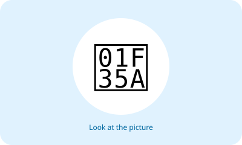
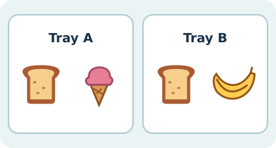
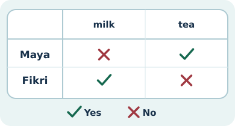
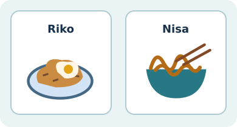
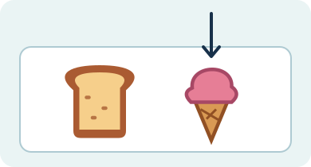
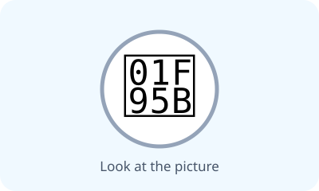
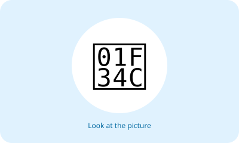
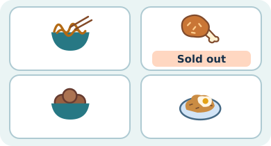
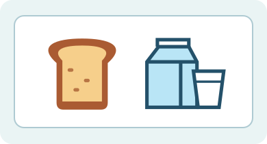
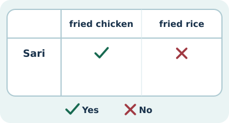

# Unit 1 — 20 soal bergambar

## Soal 51 — K03-ENG-B01-M01-051

**Pertanyaan:** Look at the picture. What food or drink is shown?

**Pilihan jawaban:**
- fried rice
- fried chicken
- noodles
- meatballs

**Kunci Jawaban:** fried rice

**Pembahasan:** Gambar menunjukkan nasi goreng (fried rice).

---

## Soal 52 — K03-ENG-B01-M01-052

**Pertanyaan:** Look at the picture. What food or drink is shown?

**Pilihan jawaban:**
- fried rice
- noodles
- meatballs
- fried chicken

**Kunci Jawaban:** fried chicken

**Pembahasan:** Gambar menunjukkan ayam goreng (fried chicken).

---

## Soal 53 — K03-ENG-B01-M01-053

**Pertanyaan:** Look at the picture. What food or drink is shown?

**Pilihan jawaban:**
- fried chicken
- meatballs
- noodles
- fried rice

**Kunci Jawaban:** noodles

**Pembahasan:** Gambar menunjukkan mi (noodles).

---

## Soal 54 — K03-ENG-B01-M01-054

**Pertanyaan:** Look at the picture. What food or drink is shown?

**Pilihan jawaban:**
- noodles
- meatballs
- fried rice
- fried chicken

**Kunci Jawaban:** meatballs

**Pembahasan:** Gambar menunjukkan bakso (meatballs).

---

## Soal 55 — K03-ENG-B01-M01-055

**Pertanyaan:** Look at the picture. What food or drink is shown?

**Pilihan jawaban:**
- bread
- fried rice
- fried chicken
- noodles

**Kunci Jawaban:** bread

**Pembahasan:** Gambar menunjukkan roti (bread).

---

## Soal 56 — K03-ENG-B01-M01-056

**Pertanyaan:** Look at the picture. What food or drink is shown?

**Pilihan jawaban:**
- fried rice
- fried chicken
- noodles
- milk

**Kunci Jawaban:** milk

**Pembahasan:** Gambar menunjukkan susu (milk).

---

## Soal 57 — K03-ENG-B01-M01-057

**Pertanyaan:** Look at the picture. What food or drink is shown?

**Pilihan jawaban:**
- fried chicken
- noodles
- tea
- fried rice

**Kunci Jawaban:** tea

**Pembahasan:** Gambar menunjukkan teh (tea).

---

## Soal 58 — K03-ENG-B01-M01-058

**Pertanyaan:** Look at the picture. What food or drink is shown?

**Pilihan jawaban:**
- noodles
- banana
- fried rice
- fried chicken

**Kunci Jawaban:** banana

**Pembahasan:** Gambar menunjukkan pisang (banana).

---

## Soal 59 — K03-ENG-B01-M01-059

**Pertanyaan:** Look at the picture. What food or drink is shown?

**Pilihan jawaban:**
- ice cream
- fried rice
- fried chicken
- noodles

**Kunci Jawaban:** ice cream

**Pembahasan:** Gambar menunjukkan es krim (ice cream).

---

## Soal 60 — K03-ENG-B01-M01-060

**Pertanyaan:** Look at the picture. What food or drink is shown?

**Pilihan jawaban:**
- fried rice
- fried chicken
- noodles
- rice

**Kunci Jawaban:** rice

**Pembahasan:** Gambar menunjukkan nasi (rice).

---

## Soal 61 — K03-ENG-B01-M01-061

**Pertanyaan:** Look at the picture. Which sentence describes what you see?

**Pilihan jawaban:**
- I like noodles.
- I like meatballs.
- I like fried rice.
- I like fried chicken.

**Kunci Jawaban:** I like fried rice.

**Pembahasan:** Kalimat yang sesuai adalah "I like fried rice."

---

## Soal 62 — K03-ENG-B01-M01-062

**Pertanyaan:** Look at the picture. Which sentence describes what you see?

**Pilihan jawaban:**
- I like meatballs.
- I like fried chicken.
- I like fried rice.
- I like noodles.

**Kunci Jawaban:** I like fried chicken.

**Pembahasan:** Kalimat yang sesuai adalah "I like fried chicken."

---

## Soal 63 — K03-ENG-B01-M01-063

**Pertanyaan:** Look at the picture. Which sentence describes what you see?

**Pilihan jawaban:**
- I like noodles.
- I like fried rice.
- I like fried chicken.
- I like meatballs.

**Kunci Jawaban:** I like noodles.

**Pembahasan:** Kalimat yang sesuai adalah "I like noodles."

---

## Soal 64 — K03-ENG-B01-M01-064

**Pertanyaan:** Look at the picture. Which sentence describes what you see?

**Pilihan jawaban:**
- I like fried rice.
- I like fried chicken.
- I like noodles.
- I like meatballs.

**Kunci Jawaban:** I like meatballs.

**Pembahasan:** Kalimat yang sesuai adalah "I like meatballs."

---

## Soal 65 — K03-ENG-B01-M01-065

**Pertanyaan:** Look at the picture. Which sentence describes what you see?

**Pilihan jawaban:**
- I like fried chicken.
- I like noodles.
- I like bread.
- I like fried rice.

**Kunci Jawaban:** I like bread.

**Pembahasan:** Kalimat yang sesuai adalah "I like bread."

---

## Soal 66 — K03-ENG-B01-M01-066

**Pertanyaan:** Look at the picture. Which sentence describes what you see?

**Pilihan jawaban:**
- I like noodles.
- I like milk.
- I like fried rice.
- I like fried chicken.

**Kunci Jawaban:** I like milk.

**Pembahasan:** Kalimat yang sesuai adalah "I like milk."

---

## Soal 67 — K03-ENG-B01-M01-067

**Pertanyaan:** Look at the picture. Which sentence describes what you see?

**Pilihan jawaban:**
- I like tea.
- I like fried rice.
- I like fried chicken.
- I like noodles.

**Kunci Jawaban:** I like tea.

**Pembahasan:** Kalimat yang sesuai adalah "I like tea."

---

## Soal 68 — K03-ENG-B01-M01-068

**Pertanyaan:** Look at the picture. Which sentence describes what you see?

**Pilihan jawaban:**
- I like fried rice.
- I like fried chicken.
- I like noodles.
- I like banana.

**Kunci Jawaban:** I like banana.

**Pembahasan:** Kalimat yang sesuai adalah "I like banana."

---

## Soal 69 — K03-ENG-B01-M01-069

**Pertanyaan:** Look at the picture. Which sentence describes what you see?

**Pilihan jawaban:**
- I like fried chicken.
- I like noodles.
- I like ice cream.
- I like fried rice.

**Kunci Jawaban:** I like ice cream.

**Pembahasan:** Kalimat yang sesuai adalah "I like ice cream."

---

## Soal 70 — K03-ENG-B01-M01-070

**Pertanyaan:** Look at the picture. Which sentence describes what you see?

**Pilihan jawaban:**
- I like noodles.
- I like rice.
- I like fried rice.
- I like fried chicken.

**Kunci Jawaban:** I like rice.

**Pembahasan:** Kalimat yang sesuai adalah "I like rice."

---
