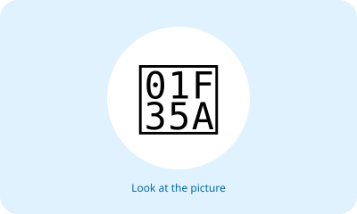
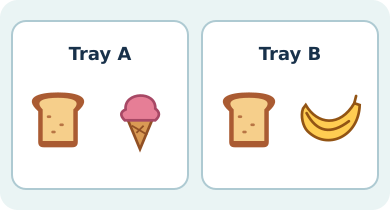
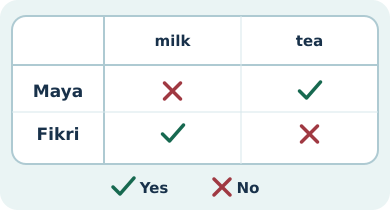
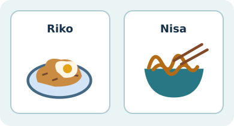
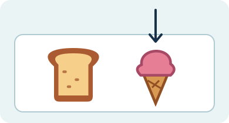
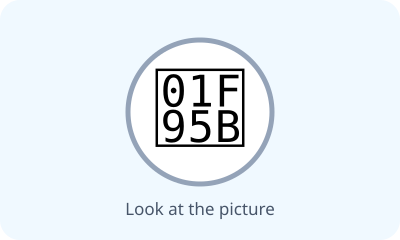
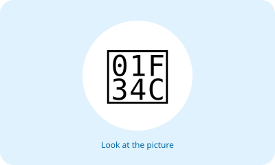
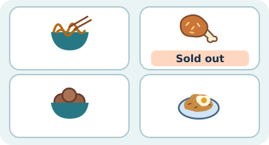
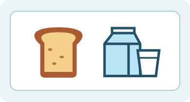
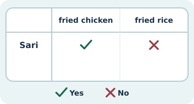

# Unit 1 — 10 Soal Bergambar

## Soal 36 — K03-ENG-B01-M01-036

**Pertanyaan:** Which label goes with the bowl in the picture?

**Pilihan jawaban:**
- noodles
- fried chicken
- bread
- meatballs

**Kunci Jawaban:** noodles

**Pembahasan:** Untaian panjang di dalam mangkuk menunjukkan mi. Tidak terlihat potongan ayam, roti, atau bola bakso.

---

## Soal 37 — K03-ENG-B01-M01-037

**Pertanyaan:** Look at the two trays. Which tray has both bread and bananas?

**Pilihan jawaban:**
- Tray A
- Both trays
- Tray B
- Neither tray

**Kunci Jawaban:** Tray B

**Pembahasan:** Baki B menampilkan roti dan pisang. Baki A menampilkan roti dan es krim.

---

## Soal 38 — K03-ENG-B01-M01-038

**Pertanyaan:** Use the survey card. What is Maya’s answer for milk?

**Pilihan jawaban:**
- Yes.
- Both Yes and No.
- The card leaves milk blank.
- No.

**Kunci Jawaban:** No.

**Pembahasan:** Baris Maya pada kolom milk bertanda silang. Legenda menyatakan silang berarti No.

---

## Soal 39 — K03-ENG-B01-M01-039

**Pertanyaan:** Read the two name cards. Who likes fried rice?

**Pilihan jawaban:**
- Riko
- Nisa
- Both children
- Neither child

**Kunci Jawaban:** Riko

**Pembahasan:** Riko menandai hidangan nasi goreng. Nisa menandai hidangan mi.

---

## Soal 40 — K03-ENG-B01-M01-040

**Pertanyaan:** Look at the arrow. Which question asks about the item it points to?

**Pilihan jawaban:**
- Do you like bread?
- Do you like ice cream?
- Do you like bananas?
- Do you like noodles?

**Kunci Jawaban:** Do you like ice cream?

**Pembahasan:** Ujung panah menunjuk es krim dalam cone. Pertanyaan yang sesuai menyebut ice cream.

---

## Soal 41 — K03-ENG-B01-M01-041

**Pertanyaan:** Which English word is missing from the menu’s Drinks section?

**Pilihan jawaban:**
- bread
- banana
- noodles
- milk

**Kunci Jawaban:** milk

**Pembahasan:** Gambar pada baris kosong menunjukkan karton dan gelas susu. Baris tea sudah terisi.

---

## Soal 42 — K03-ENG-B01-M01-042

**Pertanyaan:** Which food do both children mark with a tick?

**Pilihan jawaban:**
- ice cream
- bananas
- bread
- noodles

**Kunci Jawaban:** bread

**Pembahasan:** Kolom bread bertanda centang pada kedua baris. Kolom lain hanya bertanda centang pada satu baris atau tidak sama sekali.

---

## Soal 43 — K03-ENG-B01-M01-043

**Pertanyaan:** Read the picture menu. Which item is listed as sold out?

**Pilihan jawaban:**
- meatballs
- fried chicken
- fried rice
- noodles

**Kunci Jawaban:** fried chicken

**Pembahasan:** Pita Sold out ada di kartu yang bergambar paha ayam goreng, sehingga item itu sudah habis.

---

## Soal 44 — K03-ENG-B01-M01-044

**Pertanyaan:** The two pictures form Dita’s snack. Which line names both items?

**Pilihan jawaban:**
- Bread and milk.
- Bread and tea.
- Bananas and milk.
- Bananas and tea.

**Kunci Jawaban:** Bread and milk.

**Pembahasan:** Gambar menunjukkan irisan roti serta karton dan gelas susu. Tidak ada pisang atau teh.

---

## Soal 45 — K03-ENG-B01-M01-045

**Pertanyaan:** Use the survey card. Which statement could Sari say?

**Pilihan jawaban:**
- I like fried rice. I don’t like fried chicken.
- I like both foods.
- I like fried chicken. I don’t like fried rice.
- I don’t like either food.

**Kunci Jawaban:** I like fried chicken. I don’t like fried rice.

**Pembahasan:** Pada baris Sari, fried chicken bertanda Yes dan fried rice bertanda No.

---
