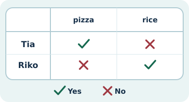
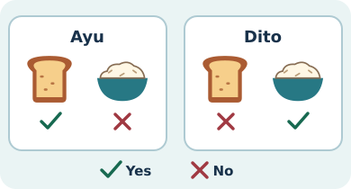

# Bahasa Inggris Kelas 3 — Unit 2: I Don't Like Rice

## MOD-01 — K03-ENG-B02-MOD-01

### Dari jawaban teman ke laporan

Tanya Riko, **Do you like pizza?** Kalau jawabannya **Yes, I do**, catat Yes. Kalau dia menjawab **No, I don’t**, catat No. Saat menceritakan jawabannya, ganti **I** dengan nama teman atau **he/she**.

| Siapa yang dibicarakan? | Suka | Tidak suka |
| --- | --- | --- |
| Aku | I like rice. | I don’t like rice. |
| Satu orang lain | Riko likes rice. / He likes rice. | Riko doesn’t like rice. / He doesn’t like rice. |
| Dua orang lain | They like rice. | They don’t like rice. |

Sesudah **doesn’t**, pakai **like** tanpa **-s**. Untuk menanyakan tentang satu orang lain, coba **Does he like rice?** Jawaban pendeknya **Yes, he does.** atau **No, he doesn’t.**

**Kosakata menu** — *rice* (nasi), *bread* (roti), *pizza*, *spaghetti* (spageti), *satay* (sate), *orange juice* (jus jeruk), dan nama hidangan seperti *Mi Aceh*, *Ayam Betutu*, *bakso*, dan *Papeda*.

**Coba sendiri.** Bacakan dua pertanyaan tentang makanan atau minuman untuk temanmu. Catat jawabannya, lalu tulis satu kalimat dengan **likes** dan satu dengan **doesn’t like** berdasarkan hasil sebenarnya. Jika jawabannya belum ada, tanyakan dulu sebelum menulis.

---

## MOD-02 — K03-ENG-B02-MOD-02

### Baca kartu, lalu ceritakan

Pada kartu, tanda centang berarti **Yes** dan silang berarti **No**. Cari nama orang dan gambar makanannya. Lalu bacakan jawaban yang sesuai.

1. **Do you like spaghetti?** dipakai saat bertanya langsung. Jawab **Yes, I do** atau **No, I don’t**. Tambahkan **I like ...** atau **I don’t like ...** kalau perlu.
2. Laporkan kesukaan orang lain dengan **Ayu likes bread** atau **She doesn’t like bread**, sesuai jawabannya. Setelah **doesn’t**, kata **like** kehilangan **-s**.
3. Saat dua teman mempunyai jawaban sama, pakai **They like ...** atau **They don’t like ...**. Kalau baru satu teman yang menjawab, tulis hanya informasi yang sudah ada.
4. Untuk mengecek laporan tentang satu orang, tanya **Does she like rice?** Temanmu dapat menjawab **Yes, she does** atau **No, she doesn’t**.

**Kosakata untuk kartu** — *rice* (nasi), *bread* (roti), *pizza*, *spaghetti* (spageti), *satay* (sate), *orange juice* (jus jeruk), *Mi Aceh*, *Ayam Betutu*, *bakso*, dan *Papeda*.

**Latihan berpasangan.** Minta teman atau orang di rumah menyebut dua pilihan. Buat satu kartu kecil untuk masing-masing pilihan. Tukar kartu dan bacakan satu laporan tentang yang disukai dan satu tentang yang tidak disukai.

### Acuan Unit 2

- [My Next Words Grade 3, buku siswa, Kemdikbudristek 2022, Unit 2, hlm. 13–22](https://fliphtml5.com/ulefo/eefu/Inggris_BS_KLS_III_Lc/)
- [Teacher’s Book – My Next Words Grade 3, Kemdikbudristek 2022, Unit 2, tujuan pembelajaran](https://fliphtml5.com/qpnzc/gudm/Buku_Guru_Bahasa_Inggris_Kelas_III/25/)
