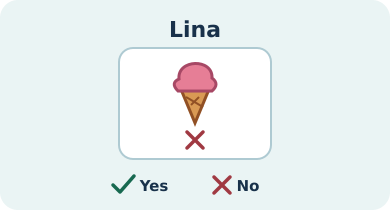
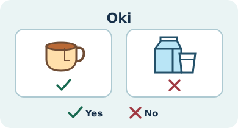
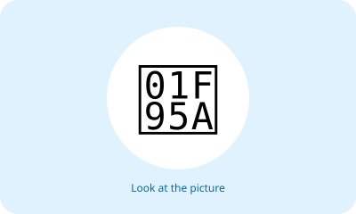
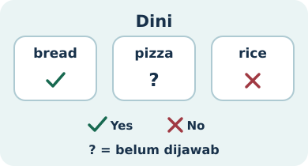
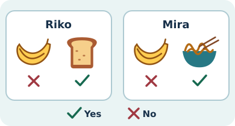
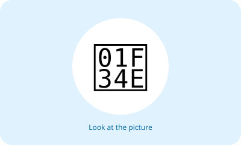
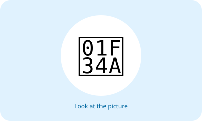
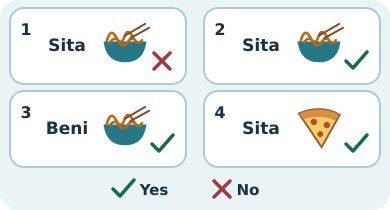
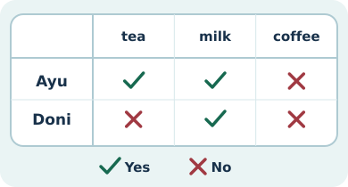
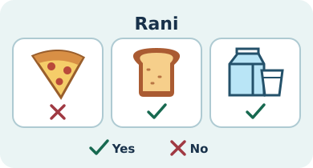

# Unit 2 — 10 Soal Bergambar

## Soal 36 — K03-ENG-B02-M01-036

**Pertanyaan:** Look at the picture. Choose the matching English word.

**Pilihan jawaban:**
- rice
- chicken
- eggs
- apple

**Kunci Jawaban:** rice

**Pembahasan:** Gambar menunjukkan "rice" (nasi).

---

## Soal 37 — K03-ENG-B02-M01-037

**Pertanyaan:** Look at the picture. Choose the matching English word.

**Pilihan jawaban:**
- rice
- soup
- orange
- fish

**Kunci Jawaban:** fish

**Pembahasan:** Gambar menunjukkan "fish" (ikan).

---

## Soal 38 — K03-ENG-B02-M01-038

**Pertanyaan:** Look at the picture. Choose the matching English word.

**Pilihan jawaban:**
- carrot
- milk
- eggs
- fish

**Kunci Jawaban:** eggs

**Pembahasan:** Gambar menunjukkan "eggs" (telur).

---

## Soal 39 — K03-ENG-B02-M01-039

**Pertanyaan:** Look at the picture. Choose the matching English word.

**Pilihan jawaban:**
- bread
- soup
- eggs
- apple

**Kunci Jawaban:** soup

**Pembahasan:** Gambar menunjukkan "soup" (sup).

---

## Soal 40 — K03-ENG-B02-M01-040

**Pertanyaan:** Look at the picture. Choose the matching English word.

**Pilihan jawaban:**
- carrot
- soup
- orange
- chicken

**Kunci Jawaban:** carrot

**Pembahasan:** Gambar menunjukkan "carrot" (wortel).

---

## Soal 41 — K03-ENG-B02-M01-041

**Pertanyaan:** Look at the picture. Choose the matching English word.

**Pilihan jawaban:**
- carrot
- milk
- rice
- apple

**Kunci Jawaban:** apple

**Pembahasan:** Gambar menunjukkan "apple" (apel).

---

## Soal 42 — K03-ENG-B02-M01-042

**Pertanyaan:** Look at the picture. Choose the matching English word.

**Pilihan jawaban:**
- bread
- fish
- orange
- apple

**Kunci Jawaban:** orange

**Pembahasan:** Gambar menunjukkan "orange" (jeruk).

---

## Soal 43 — K03-ENG-B02-M01-043

**Pertanyaan:** Look at the picture. Choose the matching English word.

**Pilihan jawaban:**
- eggs
- milk
- orange
- chicken

**Kunci Jawaban:** milk

**Pembahasan:** Gambar menunjukkan "milk" (susu).

---

## Soal 44 — K03-ENG-B02-M01-044

**Pertanyaan:** Look at the picture. Choose the matching English word.

**Pilihan jawaban:**
- bread
- milk
- rice
- soup

**Kunci Jawaban:** bread

**Pembahasan:** Gambar menunjukkan "bread" (roti).

---

## Soal 45 — K03-ENG-B02-M01-045

**Pertanyaan:** Look at the picture. Choose the matching English word.

**Pilihan jawaban:**
- bread
- fish
- carrot
- chicken

**Kunci Jawaban:** chicken

**Pembahasan:** Gambar menunjukkan "chicken" (ayam).

---
