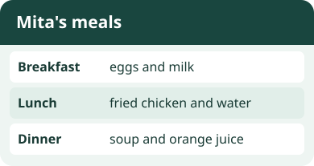
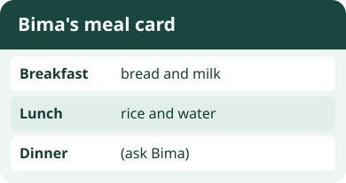

# Bahasa Inggris Kelas 3 — Unit 3: I Have Fried Chicken for Breakfast

## MOD-01 — K03-ENG-B03-MOD-01

### Cerita tentang tiga waktu makan

Kapan kamu makan bersama teman? Dalam bahasa Inggris, **breakfast** berarti sarapan, **lunch** berarti makan siang, dan **dinner** berarti makan malam. Menu tiap keluarga bisa berbeda. Lihat contoh menu Mita dan sebutkan satu makanan serta satu minumannya.

Tanya langsung: **What do you have for breakfast?** Jawab dengan **I have** + makanan atau minuman + **for breakfast**. Coba: **I have eggs and milk for breakfast.** Kalau menyebut minuman saja, kamu juga bisa bilang **I drink milk for breakfast.**

Untuk menceritakan jawaban teman, pakai **has** untuk satu orang: **Mita has soup for dinner.** Kalau berbicara tentang beberapa orang, pakai **have**: **They have soup for dinner.**

**Kosakata** — *eggs* (telur), *bread* (roti), *rice* (nasi), *fried rice* (nasi goreng), *fried chicken* (ayam goreng), *fish* (ikan), *noodles* (mi), *soup* (sup), *milk* (susu), *water* (air), dan *orange juice* (jus jeruk).

**Coba berpasangan.** Pilih dua waktu makan. Tanyakan menu temanmu, dengarkan jawabannya, lalu catat makanan dan minumannya. Bacakan satu jawaban dengan nama teman dan **has**. Jika minumannya belum disebut, tanyakan **What do you drink for lunch?** atau sesuaikan waktu makannya.

---

## MOD-02 — K03-ENG-B03-MOD-02

### Isi kartu menu bersama teman

Bayangkan kelompokmu sedang membuat kartu menu. Tulis **Breakfast** untuk sarapan, **Lunch** untuk makan siang, dan **Dinner** untuk makan malam. Kalau ada catatan yang masih kosong, tanyakan waktu makan yang sesuai.

- **What do you have for dinner?** berarti “Apa yang kamu makan atau minum untuk makan malam?”
- Temanmu bisa menjawab **I have fish and water for dinner.** Dia juga bisa menyebut minumannya dengan **I drink water for dinner.**
- Saat melapor tentang satu teman, ganti **I have** dengan nama teman dan **has**. Contohnya **Bima has fish and water for dinner.** Gunakan **have** untuk **I**, **we**, dan **they**.

**Pilihan kata untuk menu** — *bread* (roti), *eggs* (telur), *rice* (nasi), *fried rice* (nasi goreng), *fried chicken* (ayam goreng), *fish* (ikan), *noodles* (mi), *soup* (sup), *milk* (susu), *water* (air), dan *orange juice* (jus jeruk). Pilih sesuai menu yang ingin kamu ceritakan.

**Coba sendiri.** Buat menu rekaan untuk tiga waktu makan. Bacakan dua baris kepada teman. Teman mencatat makanan dan minuman, lalu bertanya tentang baris yang masih kosong. Tukar peran dan cek apakah catatan sesuai dengan jawaban.

### Acuan Unit 3

- [My Next Words Grade 3, buku siswa, Kemdikbudristek 2022, Unit 3](https://static.perangkat-ajar.belajar.id/Buku%20Murid%20Bahasa%20Inggris%20-%20Bahasa%20Inggris%3A%20My%20Next%20Words%20Buku%20Siswa%20SD%20Kelas%20III%20BAB%203%20-%20Fase%20B.pdf)
- [Teacher’s Book – My Next Words Grade 3, Kemdikbudristek 2022, tujuan pembelajaran Unit 3](https://fliphtml5.com/qpnzc/gudm/Buku_Guru_Bahasa_Inggris_Kelas_III/34/)
