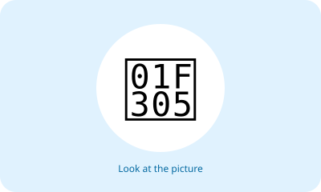

# Bahasa Inggris Kelas 3 — Unit 3: I Have Fried Chicken for Breakfast

## MOD-01 — K03-ENG-B03-MOD-01

### Let's learn!

Ayo belajar kosakata baru dengan melihat gambar dan membacanya keras-keras.

**Kosakata:**
- **breakfast** = sarapan
- **lunch** = makan siang
- **dinner** = makan malam
- **rice** = nasi
- **chicken** = ayam
- **bread** = roti
- **eggs** = telur
- **milk** = susu
- **noodles** = mi
- **water** = air

**Contoh:**
- A: What is "sarapan" in English?
- B: It is "breakfast".
- A: What about "makan siang"?
- B: It is "lunch".

**Latihan:** Sebutkan lima kata yang kamu ingat, lalu buat kalimat sederhana bersama guru atau orang tua.

---

## MOD-02 — K03-ENG-B03-MOD-02

### Let's practice!

Ajak teman bergantian menyebut kata bahasa Inggris dan artinya. Gunakan dalam percakapan sederhana.

**Kosakata:**
- **breakfast** = sarapan
- **lunch** = makan siang
- **dinner** = makan malam
- **rice** = nasi
- **chicken** = ayam
- **bread** = roti
- **eggs** = telur
- **milk** = susu
- **noodles** = mi
- **water** = air

**Contoh:**
- A: What is "sarapan" in English?
- B: It is "breakfast".
- A: What about "makan siang"?
- B: It is "lunch".

**Latihan:** Sebutkan lima kata yang kamu ingat, lalu buat kalimat sederhana bersama guru atau orang tua.

