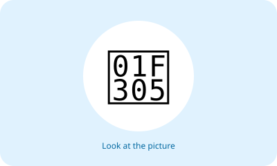
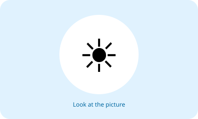
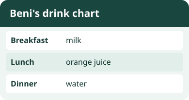
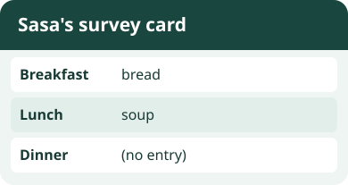
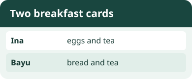
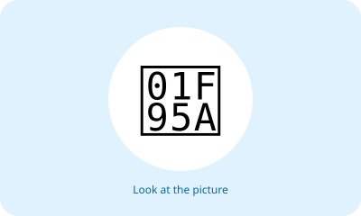
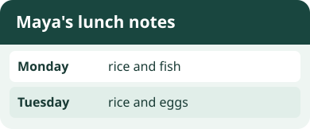
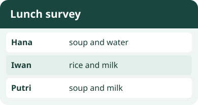
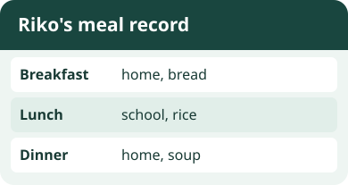

# Unit 3 — 10 Soal Bergambar

## Soal 36 — K03-ENG-B03-M01-036

**Pertanyaan:** Look at the picture. Choose the matching English word.

**Pilihan jawaban:**
- breakfast
- water
- dinner
- bread

**Kunci Jawaban:** breakfast

**Pembahasan:** Gambar menunjukkan "breakfast" (sarapan).

---

## Soal 37 — K03-ENG-B03-M01-037

**Pertanyaan:** Look at the picture. Choose the matching English word.

**Pilihan jawaban:**
- breakfast
- rice
- eggs
- lunch

**Kunci Jawaban:** lunch

**Pembahasan:** Gambar menunjukkan "lunch" (makan siang).

---

## Soal 38 — K03-ENG-B03-M01-038

**Pertanyaan:** Look at the picture. Choose the matching English word.

**Pilihan jawaban:**
- chicken
- milk
- dinner
- lunch

**Kunci Jawaban:** dinner

**Pembahasan:** Gambar menunjukkan "dinner" (makan malam).

---

## Soal 39 — K03-ENG-B03-M01-039

**Pertanyaan:** Look at the picture. Choose the matching English word.

**Pilihan jawaban:**
- noodles
- rice
- dinner
- bread

**Kunci Jawaban:** rice

**Pembahasan:** Gambar menunjukkan "rice" (nasi).

---

## Soal 40 — K03-ENG-B03-M01-040

**Pertanyaan:** Look at the picture. Choose the matching English word.

**Pilihan jawaban:**
- chicken
- rice
- eggs
- water

**Kunci Jawaban:** chicken

**Pembahasan:** Gambar menunjukkan "chicken" (ayam).

---

## Soal 41 — K03-ENG-B03-M01-041

**Pertanyaan:** Look at the picture. Choose the matching English word.

**Pilihan jawaban:**
- chicken
- milk
- breakfast
- bread

**Kunci Jawaban:** bread

**Pembahasan:** Gambar menunjukkan "bread" (roti).

---

## Soal 42 — K03-ENG-B03-M01-042

**Pertanyaan:** Look at the picture. Choose the matching English word.

**Pilihan jawaban:**
- noodles
- lunch
- eggs
- bread

**Kunci Jawaban:** eggs

**Pembahasan:** Gambar menunjukkan "eggs" (telur).

---

## Soal 43 — K03-ENG-B03-M01-043

**Pertanyaan:** Look at the picture. Choose the matching English word.

**Pilihan jawaban:**
- dinner
- milk
- eggs
- water

**Kunci Jawaban:** milk

**Pembahasan:** Gambar menunjukkan "milk" (susu).

---

## Soal 44 — K03-ENG-B03-M01-044

**Pertanyaan:** Look at the picture. Choose the matching English word.

**Pilihan jawaban:**
- noodles
- milk
- breakfast
- rice

**Kunci Jawaban:** noodles

**Pembahasan:** Gambar menunjukkan "noodles" (mi).

---

## Soal 45 — K03-ENG-B03-M01-045

**Pertanyaan:** Look at the picture. Choose the matching English word.

**Pilihan jawaban:**
- noodles
- lunch
- chicken
- water

**Kunci Jawaban:** water

**Pembahasan:** Gambar menunjukkan "water" (air).

---
