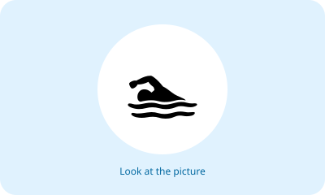
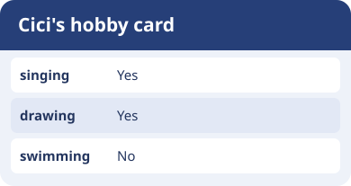

# Bahasa Inggris Kelas 3 — Unit 4: Do You Like Swimming?

## MOD-01 — K03-ENG-B04-MOD-01

### Let's learn!

Ayo belajar kosakata baru dengan melihat gambar dan membacanya keras-keras.

**Kosakata:**
- **swimming** = berenang
- **reading** = membaca
- **singing** = bernyanyi
- **dancing** = menari
- **drawing** = menggambar
- **running** = berlari
- **cycling** = bersepeda
- **football** = sepak bola
- **jumping** = melompat
- **cooking** = memasak

**Contoh:**
- A: What is "berenang" in English?
- B: It is "swimming".
- A: What about "membaca"?
- B: It is "reading".

**Latihan:** Sebutkan lima kata yang kamu ingat, lalu buat kalimat sederhana bersama guru atau orang tua.

---

## MOD-02 — K03-ENG-B04-MOD-02

### Let's practice!

Ajak teman bergantian menyebut kata bahasa Inggris dan artinya. Gunakan dalam percakapan sederhana.

**Kosakata:**
- **swimming** = berenang
- **reading** = membaca
- **singing** = bernyanyi
- **dancing** = menari
- **drawing** = menggambar
- **running** = berlari
- **cycling** = bersepeda
- **football** = sepak bola
- **jumping** = melompat
- **cooking** = memasak

**Contoh:**
- A: What is "berenang" in English?
- B: It is "swimming".
- A: What about "membaca"?
- B: It is "reading".

**Latihan:** Sebutkan lima kata yang kamu ingat, lalu buat kalimat sederhana bersama guru atau orang tua.

