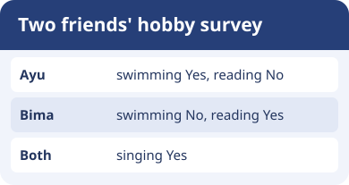
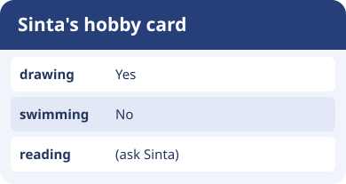

# Bahasa Inggris Kelas 3 — Unit 4: Do You Like Swimming?

## MOD-01 — K03-ENG-B04-MOD-01

### Tanya teman tentang hobinya

**Hobby** adalah kegiatan yang disukai seseorang. Unit ini memakai ungkapan seperti **reading a storybook**, **swimming**, **singing**, **riding a bike**, **playing football**, **playing dolls**, **watching TV**, dan **flying a kite**.

Tanyakan langsung kepada teman: **Do you like swimming?** Jawab **Yes, I do** jika suka atau **No, I don’t** jika tidak suka. Kamu dapat menambahkan hobi lain: **No, I don’t. I like reading.**

Saat melaporkan satu teman, pakai **likes** atau **doesn’t like**: **Ayu likes swimming.** dan **Ayu doesn’t like reading.** Untuk dua orang, pakai **like**: **Ayu and Bima like singing.**

Untuk bertanya tentang satu orang lain, gunakan **Does**: **Does your brother like swimming?** Jawab **Yes, he does** atau **No, he doesn’t**. Setelah **does** atau **doesn’t**, kata kerjanya tetap **like**.

**Latihan survei.** Pilih tiga hobi. Tanyakan kepada dua teman dan catat Yes atau No sesuai jawaban mereka. Jangan mengubah kolom kosong menjadi No. Laporkan dua hasil dengan nama teman.

---

## MOD-02 — K03-ENG-B04-MOD-02

### Baca kartu Yes dan No

Kartu survei membantu kita membedakan hobi sendiri dan hobi teman. Tanda Yes berarti orang itu mengatakan suka. Tanda No berarti orang itu mengatakan tidak suka. Kolom kosong berarti jawabannya belum dicatat.

Gunakan pola berikut:

- **I like drawing.** untuk hobi sendiri.
- **Do you like drawing? — Yes, I do. / No, I don’t.** saat bertanya langsung.
- **Sinta likes drawing.** untuk melaporkan hobi satu teman.
- **Does Sinta like drawing? — Yes, she does. / No, she doesn’t.** saat menanyakan satu teman.
- **They like drawing.** untuk dua orang atau lebih.

Perhatikan **like** dan **likes**. Gunakan **likes** pada pernyataan tentang satu orang lain. Gunakan **like** setelah **does/doesn’t**, serta bersama **I**, **you**, **we**, atau **they**.

**Latihan kelompok.** Buat kartu berisi empat hobi. Satu anak menjawab, satu mencatat, dan satu melaporkan. Tukar peran. Bandingkan jumlah jawaban Yes tanpa menebak jawaban yang belum diberikan.

### Acuan Unit 4

- [My Next Words Grade 3, buku siswa, Kemdikbudristek 2022, Unit 4](https://static.perangkat-ajar.belajar.id/Buku%20Murid%20Bahasa%20Inggris%20-%20Bahasa%20Inggris%3A%20My%20Next%20Words%20Buku%20Siswa%20SD%20Kelas%20III%20BAB%204%20-%20Fase%20B.pdf)
- [Teacher’s Book — My Next Words Grade 3, tujuan pembelajaran Unit 4](https://fliphtml5.com/qpnzc/gudm/Buku_Guru_Bahasa_Inggris_Kelas_III/44/)
