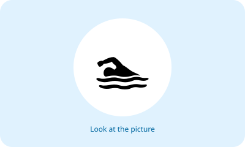
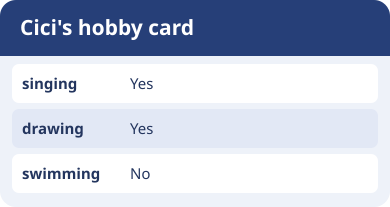
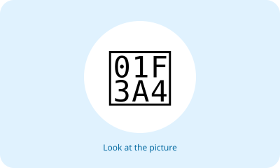
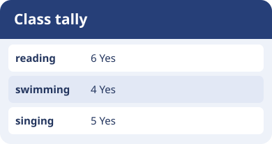
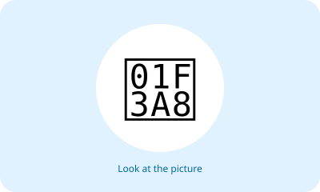
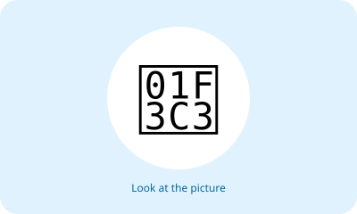
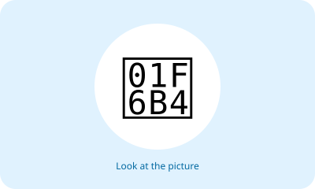
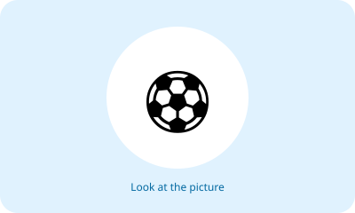
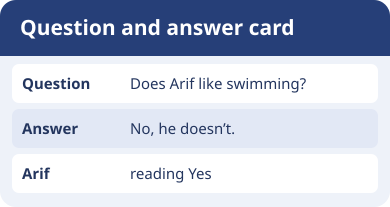

# Unit 4 — 10 Soal Bergambar

## Soal 36 — K03-ENG-B04-M01-036

**Pertanyaan:** Look at the picture. Choose the matching English word.

**Pilihan jawaban:**
- swimming
- cooking
- singing
- running

**Kunci Jawaban:** swimming

**Pembahasan:** Gambar menunjukkan "swimming" (berenang).

---

## Soal 37 — K03-ENG-B04-M01-037

**Pertanyaan:** Look at the picture. Choose the matching English word.

**Pilihan jawaban:**
- swimming
- dancing
- cycling
- reading

**Kunci Jawaban:** reading

**Pembahasan:** Gambar menunjukkan "reading" (membaca).

---

## Soal 38 — K03-ENG-B04-M01-038

**Pertanyaan:** Look at the picture. Choose the matching English word.

**Pilihan jawaban:**
- drawing
- football
- singing
- reading

**Kunci Jawaban:** singing

**Pembahasan:** Gambar menunjukkan "singing" (bernyanyi).

---

## Soal 39 — K03-ENG-B04-M01-039

**Pertanyaan:** Look at the picture. Choose the matching English word.

**Pilihan jawaban:**
- jumping
- dancing
- singing
- running

**Kunci Jawaban:** dancing

**Pembahasan:** Gambar menunjukkan "dancing" (menari).

---

## Soal 40 — K03-ENG-B04-M01-040

**Pertanyaan:** Look at the picture. Choose the matching English word.

**Pilihan jawaban:**
- drawing
- dancing
- cycling
- cooking

**Kunci Jawaban:** drawing

**Pembahasan:** Gambar menunjukkan "drawing" (menggambar).

---

## Soal 41 — K03-ENG-B04-M01-041

**Pertanyaan:** Look at the picture. Choose the matching English word.

**Pilihan jawaban:**
- drawing
- football
- swimming
- running

**Kunci Jawaban:** running

**Pembahasan:** Gambar menunjukkan "running" (berlari).

---

## Soal 42 — K03-ENG-B04-M01-042

**Pertanyaan:** Look at the picture. Choose the matching English word.

**Pilihan jawaban:**
- jumping
- reading
- cycling
- running

**Kunci Jawaban:** cycling

**Pembahasan:** Gambar menunjukkan "cycling" (bersepeda).

---

## Soal 43 — K03-ENG-B04-M01-043

**Pertanyaan:** Look at the picture. Choose the matching English word.

**Pilihan jawaban:**
- singing
- football
- cycling
- cooking

**Kunci Jawaban:** football

**Pembahasan:** Gambar menunjukkan "football" (sepak bola).

---

## Soal 44 — K03-ENG-B04-M01-044

**Pertanyaan:** Look at the picture. Choose the matching English word.

**Pilihan jawaban:**
- jumping
- football
- swimming
- dancing

**Kunci Jawaban:** jumping

**Pembahasan:** Gambar menunjukkan "jumping" (melompat).

---

## Soal 45 — K03-ENG-B04-M01-045

**Pertanyaan:** Look at the picture. Choose the matching English word.

**Pilihan jawaban:**
- jumping
- reading
- drawing
- cooking

**Kunci Jawaban:** cooking

**Pembahasan:** Gambar menunjukkan "cooking" (memasak).

---
