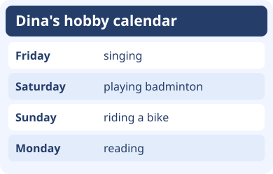
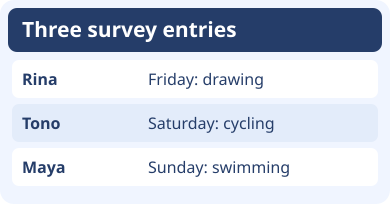

# Bahasa Inggris Kelas 3 — Unit 5: I Like Riding a Bike on Sunday

## MOD-01 — K03-ENG-B05-MOD-01

### Susun hari dan ceritakan hobimu

Baca tujuh nama hari secara urut: **Monday, Tuesday, Wednesday, Thursday, Friday, Saturday, Sunday**. Sesudah Sunday, urutan berulang ke Monday. Awali setiap nama hari dengan huruf kapital.

**Before** berarti sebelum. **After** berarti sesudah. Untuk satu hari yang langsung berdekatan, kamu bisa bilang **right before** atau **right after**. Saturday datang tepat sebelum Sunday, dan Monday datang tepat sesudah Sunday.

Saat menyebutkan hari kegiatan, pakai **on**. Coba tanya teman, **What do you like doing on Sunday?** Jawaban yang cocok misalnya **I like riding a bike on Sunday.** Pertanyaan **Do you like riding a bike on Sunday?** bisa dijawab **Yes, I do.** atau **No, I don’t.** Saat melaporkan hobi satu teman, gunakan **likes**: **Dina likes riding a bike on Sunday.**

**Coba berpasangan.** Pilih dua hari. Tanya hobi teman pada kedua hari itu, lalu laporkan satu jawaban memakai nama teman. Pakai jadwalnya untuk menjawab satu pertanyaan tentang hari sebelum atau sesudahnya.

---

## MOD-02 — K03-ENG-B05-MOD-02

### Buat kartu jadwal hobi

Tulis tujuh kartu hari: **Sunday, Monday, Tuesday, Wednesday, Thursday, Friday, Saturday**. Susun melingkar agar kamu bisa melihat bahwa sesudah Saturday kembali ke Sunday. Periksa huruf kapital pada setiap kartu. Pakai **before** untuk sebelum dan **after** untuk sesudah. Sebagai latihan, letakkan Friday tepat sebelum Saturday dan Monday tepat sesudah Sunday.

Pilih satu hari dan satu hobi, seperti **drawing**, **swimming**, **reading**, **playing badminton**, atau **riding a bike**. Tanya **What do you like doing on Saturday?** Temanmu bisa menjawab **I like swimming on Saturday.** Kalau ingin memastikan pilihan, tanya **Do you like swimming on Saturday?** Jawabannya bisa **Yes, I do.** atau **No, I don’t.**

Catat hari dan hobi yang kamu dengar. Gunakan **on** sebelum nama hari dan **likes** ketika melaporkan hobi satu orang. Contohnya **Maya likes swimming on Sunday.**

**Coba bertiga.** Satu anak bertanya, satu menjawab, dan satu membaca kembali catatan. Tukar peran. Geser satu kartu hobi satu hari lebih awal, lalu sebutkan hari barunya.

### Acuan Unit 5

- [My Next Words Grade 3, buku siswa, Kemdikbudristek 2022, Unit 5](https://fliphtml5.com/hcjff/zlru/Inggris_BS_KLS_III/73/)
- [Teacher’s Book — My Next Words Grade 3, Kemdikbudristek 2022, Unit 5](https://fliphtml5.com/qpnzc/gudm/Buku_Guru_Bahasa_Inggris_Kelas_III/55/)
