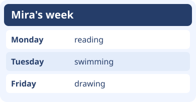
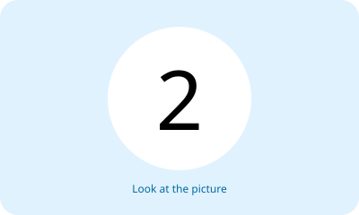
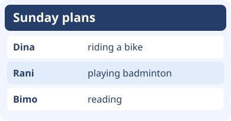
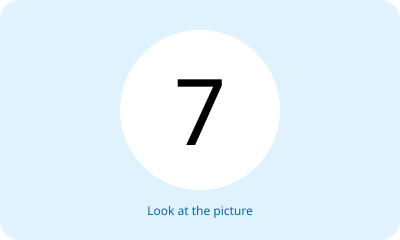

# Unit 5 — 10 Soal Bergambar

## Soal 36 — K03-ENG-B05-M01-036

**Pertanyaan:** When does Mira swim?

**Pilihan jawaban:**
- Monday
- Tuesday
- Friday
- Sunday

**Kunci Jawaban:** Tuesday

**Pembahasan:** Swimming is listed on Tuesday.

---

## Soal 37 — K03-ENG-B05-M01-037

**Pertanyaan:** Which numbered card is one day before Friday?

**Pilihan jawaban:**
- Card 1
- Card 3
- Card 2
- Cards 1 and 3

**Kunci Jawaban:** Card 2

**Pembahasan:** Thursday, on card 2, immediately precedes Friday.

---

## Soal 38 — K03-ENG-B05-M01-038

**Pertanyaan:** Who plays badminton on Sunday?

**Pilihan jawaban:**
- Dina
- Bimo
- Dina and Bimo
- Rani

**Kunci Jawaban:** Rani

**Pembahasan:** The Sunday plan pairs Rani with badminton.

---

## Soal 39 — K03-ENG-B05-M01-039

**Pertanyaan:** What do the two notes have in common?

**Pilihan jawaban:**
- the day
- the person
- the activity
- the whole plan

**Kunci Jawaban:** the day

**Pembahasan:** Both notes name Friday, with different activities.

---

## Soal 40 — K03-ENG-B05-M01-040

**Pertanyaan:** How did the session move?

**Pilihan jawaban:**
- one day later
- two days later
- one day earlier
- it stayed on Sunday

**Kunci Jawaban:** one day earlier

**Pembahasan:** Saturday comes immediately before Sunday.

---

## Soal 41 — K03-ENG-B05-M01-041

**Pertanyaan:** What should you ask Lia to complete the entry?

**Pilihan jawaban:**
- Do you like reading?
- Do you like riding a bike?
- Who likes reading?
- When do you like reading?

**Kunci Jawaban:** When do you like reading?

**Pembahasan:** The activity is already known. The missing information is its day.

---

## Soal 42 — K03-ENG-B05-M01-042

**Pertanyaan:** On which two days does Bayu play football?

**Pilihan jawaban:**
- Monday and Friday
- Monday and Wednesday
- Wednesday and Friday
- Tuesday and Friday

**Kunci Jawaban:** Monday and Friday

**Pembahasan:** Football appears in the Monday and Friday rows.

---

## Soal 43 — K03-ENG-B05-M01-043

**Pertanyaan:** Who shares Sita’s activity on a different day?

**Pilihan jawaban:**
- Nara
- Edo
- Sita and Nara
- Nara and Edo

**Kunci Jawaban:** Edo

**Pembahasan:** Sita and Edo both draw, on Tuesday and Thursday respectively.

---

## Soal 44 — K03-ENG-B05-M01-044

**Pertanyaan:** Which activity immediately follows the bike ride on the chart?

**Pilihan jawaban:**
- singing
- swimming
- drawing
- reading a book

**Kunci Jawaban:** reading a book

**Pembahasan:** Sunday’s reading entry follows Saturday’s bike ride.

---

## Soal 45 — K03-ENG-B05-M01-045

**Pertanyaan:** Which report matches both answers?

**Pilihan jawaban:**
- The child likes swimming on Saturday, but not on Friday.
- The child likes swimming on both days.
- The child likes swimming on Friday only.
- The child dislikes swimming on both days.

**Kunci Jawaban:** The child likes swimming on Saturday, but not on Friday.

**Pembahasan:** The Friday entry is No and the Saturday entry is Yes.

---
