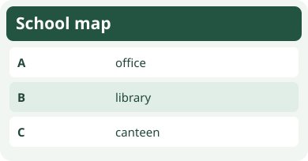
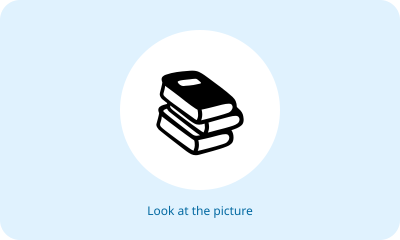

# Bahasa Inggris Kelas 3 — Unit 6: Is It the Canteen?

## MOD-01 — K03-ENG-B06-MOD-01

### Let's learn!

Ayo belajar kosakata baru dengan melihat gambar dan membacanya keras-keras.

**Kosakata:**
- **canteen** = kantin
- **library** = perpustakaan
- **classroom** = ruang kelas
- **office** = kantor
- **toilet** = toilet
- **playground** = taman bermain
- **garden** = taman
- **gate** = gerbang
- **yard** = halaman
- **computer** = komputer

**Contoh:**
- A: What is "kantin" in English?
- B: It is "canteen".
- A: What about "perpustakaan"?
- B: It is "library".

**Latihan:** Sebutkan lima kata yang kamu ingat, lalu buat kalimat sederhana bersama guru atau orang tua.

---

## MOD-02 — K03-ENG-B06-MOD-02

### Let's practice!

Ajak teman bergantian menyebut kata bahasa Inggris dan artinya. Gunakan dalam percakapan sederhana.

**Kosakata:**
- **canteen** = kantin
- **library** = perpustakaan
- **classroom** = ruang kelas
- **office** = kantor
- **toilet** = toilet
- **playground** = taman bermain
- **garden** = taman
- **gate** = gerbang
- **yard** = halaman
- **computer** = komputer

**Contoh:**
- A: What is "kantin" in English?
- B: It is "canteen".
- A: What about "perpustakaan"?
- B: It is "library".

**Latihan:** Sebutkan lima kata yang kamu ingat, lalu buat kalimat sederhana bersama guru atau orang tua.

