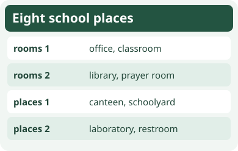
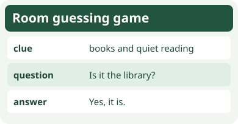

# Bahasa Inggris Kelas 3 — Unit 6: Is It the Canteen?

## MOD-01 — K03-ENG-B06-MOD-01

### Kenali delapan tempat di sekolah

Unit ini mengenalkan **office** (kantor), **classroom** (ruang kelas), **library** (perpustakaan), **prayer room** (ruang ibadah), **canteen** (kantin), **schoolyard** (halaman sekolah), **laboratory** (laboratorium), dan **restroom** (toilet). Gunakan gambar, tanda ruangan, dan kegiatan sebagai petunjuk.

Tanyakan nama ruangan dengan **What room is it?** Jawab **It is a classroom.** Untuk mengecek satu tebakan, gunakan **Is it a laboratory?** Jawab **Yes, it is.** jika benar. Jika salah, jawab **No, it isn’t. It is the library.**

Gunakan **a** sebelum kata yang diawali bunyi konsonan, seperti **a classroom** atau **a laboratory**. Gunakan **an** sebelum bunyi vokal, seperti **an office**. Saat membicarakan tempat tertentu di sekolah, bentuk **the library** atau **the canteen** juga dapat digunakan.

**Coba berpasangan.** Pilih tiga kartu tempat. Satu anak membacakan petunjuk tanpa menyebut nama ruangan, lalu temannya bertanya dan menjawab. Tukar peran. Gunakan area sekolah hanya sesuai izin dan aturan sekolah.

---

## MOD-02 — K03-ENG-B06-MOD-02

### Tebak ruangan dari petunjuk

Setiap ruangan mempunyai petunjuk. Books dan quiet reading mengarah ke **library**. Meal tables mengarah ke **canteen**. Desks dan lesson board mengarah ke **classroom**. Experiment tools dengan pengawasan guru mengarah ke **laboratory**.

Ikuti alur berikut.

1. Dengarkan petunjuk sampai selesai.
2. Tanyakan **What room is it?** jika kamu meminta namanya.
3. Gunakan **Is it the office?** atau **Is it a restroom?** untuk mengecek tebakan.
4. Jawab **Yes, it is.** atau **No, it isn’t.**
5. Setelah jawaban No, sebutkan ruangan yang benar jika sudah diketahui.

Jawaban **No, it isn’t** hanya menunjukkan tebakan awal salah. Kita masih membutuhkan petunjuk atau koreksi untuk mengetahui ruangan yang benar.

**Latihan kelompok.** Buat delapan kartu nama tempat. Satu anak mengambil kartu, satu memberi petunjuk, dan satu menebak. Catat nama anak dan jawaban seperti contoh “Made — classroom”.

### Acuan Unit 6

- [My Next Words Grade 3, buku siswa, Kemdikbudristek 2022, Unit 6](https://fliphtml5.com/hytuwb/My-Next-Words-Grade-3-Buku-Siswa/76/)
- [Teacher’s Book — My Next Words Grade 3, Kemdikbudristek 2022, Unit 6](https://fliphtml5.com/qpnzc/gudm/Buku_Guru_Bahasa_Inggris_Kelas_III/64/)
