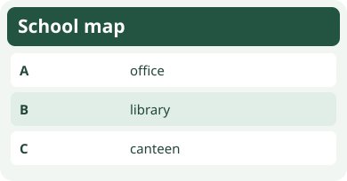
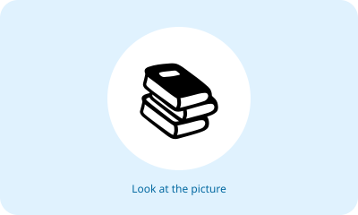
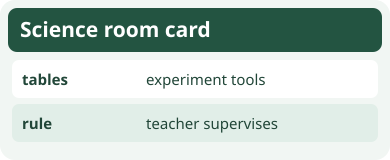
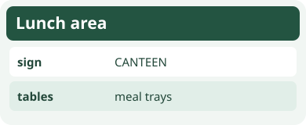
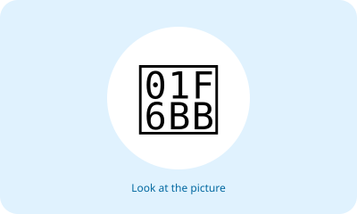
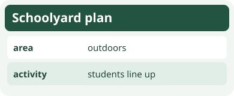
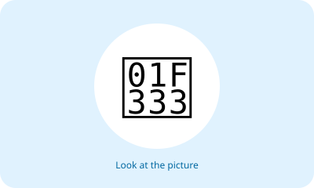
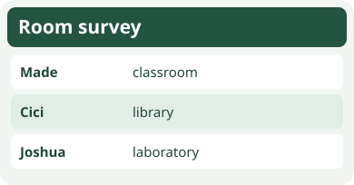
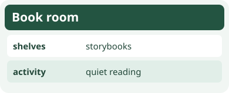
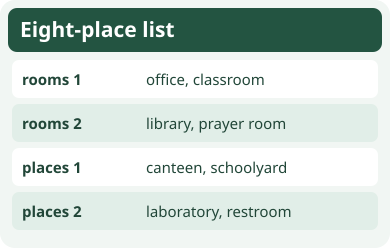

# Unit 6 — 10 Soal Bergambar

## Soal 36 — K03-ENG-B06-M01-036

**Pertanyaan:** Which room is marked B?

**Pilihan jawaban:**
- library
- office
- canteen
- classroom

**Kunci Jawaban:** library

**Pembahasan:** The map key pairs B with library.

---

## Soal 37 — K03-ENG-B06-M01-037

**Pertanyaan:** What room does the card show?

**Pilihan jawaban:**
- laboratory
- restroom
- office
- prayer room

**Kunci Jawaban:** prayer room

**Pembahasan:** The sign and prayer mats identify the prayer room.

---

## Soal 38 — K03-ENG-B06-M01-038

**Pertanyaan:** Which school room matches the card?

**Pilihan jawaban:**
- library
- canteen
- laboratory
- schoolyard

**Kunci Jawaban:** laboratory

**Pembahasan:** Experiment tools and supervision are clues for a laboratory.

---

## Soal 39 — K03-ENG-B06-M01-039

**Pertanyaan:** A friend asks “Is it the canteen?” Which answer fits?

**Pilihan jawaban:**
- No, it isn’t.
- Yes, I do.
- Yes, it is.
- No, they don’t.

**Kunci Jawaban:** Yes, it is.

**Pembahasan:** The sign confirms the canteen.

---

## Soal 40 — K03-ENG-B06-M01-040

**Pertanyaan:** Which reply corrects the guess?

**Pilihan jawaban:**
- Yes, it is an office.
- No, it isn’t. It is a classroom.
- No, it isn’t. It is an office.
- Yes, they are.

**Kunci Jawaban:** No, it isn’t. It is a classroom.

**Pembahasan:** The sign identifies a classroom, so the office guess is wrong.

---

## Soal 41 — K03-ENG-B06-M01-041

**Pertanyaan:** What place is described?

**Pilihan jawaban:**
- schoolyard
- restroom
- office
- library

**Kunci Jawaban:** schoolyard

**Pembahasan:** An outdoor lineup area is the schoolyard.

---

## Soal 42 — K03-ENG-B06-M01-042

**Pertanyaan:** Which sentence identifies the room?

**Pilihan jawaban:**
- It is the restroom.
- It is the library.
- It is the laboratory.
- It is the canteen.

**Kunci Jawaban:** It is the restroom.

**Pembahasan:** The door sign says restroom.

---

## Soal 43 — K03-ENG-B06-M01-043

**Pertanyaan:** What is Joshua’s answer?

**Pilihan jawaban:**
- classroom
- library
- office
- laboratory

**Kunci Jawaban:** laboratory

**Pembahasan:** Joshua’s row contains laboratory.

---

## Soal 44 — K03-ENG-B06-M01-044

**Pertanyaan:** Which question is a sensible guess?

**Pilihan jawaban:**
- Is it the canteen?
- Is it the restroom?
- Is it the library?
- Is it the schoolyard?

**Kunci Jawaban:** Is it the library?

**Pembahasan:** Bookshelves and reading indicate the library.

---

## Soal 45 — K03-ENG-B06-M01-045

**Pertanyaan:** How many names are listed altogether?

**Pilihan jawaban:**
- four
- six
- eight
- ten

**Kunci Jawaban:** eight

**Pembahasan:** The two lines contain four names each, for eight altogether.

---
