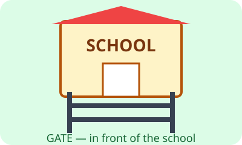

# Bahasa Inggris Kelas 3 — Unit 7: My Class Is Behind the Office

## MOD-01 — K03-ENG-B07-MOD-01

### Let's learn! — Menjelaskan letak

Kita belajar menyebutkan letak ruang dan benda menggunakan kata posisi. Lihat gambar berikut, kemudian sebutkan nama tempat yang terlihat.

**Kata posisi:**
- **behind** = di belakang
- **in front of** = di depan
- **next to** = di sebelah, berdampingan
- **between** = di antara dua tempat atau benda
- **near** = dekat
- **far from** = jauh dari
- **inside** = di dalam
- **outside** = di luar
- **on** = di atas permukaan, biasanya menyentuhnya
- **under** = di bawah

**Pola kalimat:** `The classroom is behind the office.` (Ruang kelas berada di belakang kantor.) Kita memakai `is` untuk satu tempat atau benda. Untuk bertanya, gunakan `Where is the classroom?` (Di mana ruang kelas?)

**Contoh dialog:**
- A: Where is your classroom?
- B: It is behind the office.
- A: Is the office in front of your classroom?
- B: Yes, it is.

**Penting:** Jika A berada di belakang B, maka B berada di depan A. Kata `near` dan `far from` tidak memberi ukuran jarak yang pasti. Kata `between` perlu dua acuan, misalnya `The office is between the library and the canteen.`

**Latihan:** Gunakan buku dan pensil di atas meja. Letakkan pensil `on`, `under`, dan `next to` buku. Ucapkan kalimat lengkap untuk setiap posisi.

---

## MOD-02 — K03-ENG-B07-MOD-02

### Let's practice! — Membaca petunjuk lokasi

Perhatikan ilustrasi tempat sekolah. Guru atau teman dapat membuat denah sederhana dengan tiga kotak: **LIBRARY — OFFICE — CANTEEN**. Urutan kotak ini adalah contoh untuk latihan, bukan informasi yang harus diasumsikan dari ilustrasi.

**Baca denah latihan:** Library berada di kiri Office, dan Canteen di kanan Office. Jadi, `The office is between the library and the canteen.` Jika ketiga kotak berjajar dan saling bersentuhan, `The library is next to the office.`

**Percakapan:**
- A: Where is the office?
- B: It is between the library and the canteen.
- A: Where is the library?
- B: It is next to the office.

**Latihan membandingkan informasi:**
1. `The classroom is behind the office.` Lengkapi: `The office is ___ the classroom.` Jawaban: `in front of`.
2. `The ball is under the desk.` Apakah bola berada di atas meja? `No, it isn't.`
3. `The gate is near the yard.` Apakah kita tahu jarak persisnya? Tidak. Kata `near` tidak menyebut jumlah meter.
4. `The garden is outside the classroom.` Artinya taman tidak berada di dalam ruang kelas.

**Ayo bermain:** Buat denah tiga tempat di kertas. Siswa A memilih satu tempat dan memberi dua petunjuk posisi. Siswa B menanyakan `Where is ...?` dan menyusun kalimat `It is ...`. Tukar peran. Saat menjelaskan `behind` dan `in front of`, sepakati arah depan bangunan agar tidak membingungkan.

**Cek pemahaman:** Kalimat `The library is next to the office` menyatakan letak relatif, bukan jarak pasti dalam meter.
