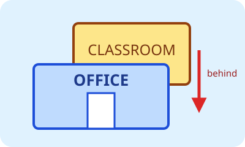

# Bahasa Inggris Kelas 3 — Unit 7: My Class Is Behind the Office

## MOD-01 — K03-ENG-B07-MOD-01

### Let's learn! — Menjelaskan letak

Pada unit ini kita belajar menanyakan dan menjelaskan letak benda serta ruangan di sekolah. Perhatikan posisi ruang kelas dan kantor pada gambar.

**Kata posisi utama:**
- **in** = di dalam
- **on** = di atas dan menyentuh permukaan
- **under** = di bawah
- **beside** = di sebelah
- **behind** = di belakang
- **in front of** = di depan
- **between** = di antara dua benda atau tempat

**Pola bertanya:** `Where is the classroom?`

**Pola menjawab:** `It is behind the office.`

Untuk satu benda atau tempat, gunakan **is**. Kata **between** memakai dua acuan, misalnya `The canteen is between the library and the office.`

**Contoh dialog:**
- A: Where is the laboratory?
- B: It is beside the parking area.
- A: Where is the gate?
- B: It is in front of the school.

**Ayo mencoba:** Letakkan buku **on** the desk, tas **under** the chair, dan pensil **in** the pencil case. Ucapkan satu kalimat untuk setiap posisi.

---

## MOD-02 — K03-ENG-B07-MOD-02

### Let's practice! — Membaca posisi pada denah

Kita dapat menggunakan denah sederhana untuk menjelaskan letak. Pada gambar berikut, perpustakaan berada di sebelah kantor.

**Ingat pasangan posisi:**
- Jika kelas berada **behind** the office, kantor berada **in front of** the classroom.
- Jika perpustakaan berada **beside** the office, kedua tempat itu berdampingan.
- Jika kantin berada **between** the library and the office, kantin berada di tengah dua tempat.

**Latihan membaca:**
1. `The ball is under the chair.` Di mana bola? Bola berada di bawah kursi.
2. `The book is on the desk.` Di mana buku? Buku berada di atas meja.
3. `The ruler is between the book and the pencil case.` Benda apa yang di tengah? Penggaris.
4. `The pencil is in the pencil case.` Di mana pensil? Pensil berada di dalam kotak pensil.

**Percakapan berpasangan:**
- Siswa A bertanya, `Where is the ...?`
- Siswa B menjawab, `It is ...` lalu menyebutkan kata posisi dan tempat acuannya.
- Tukar peran setelah tiga pertanyaan.

**Cek pemahaman:** Kata posisi harus dibaca bersama tempat acuannya. Kalimat `It is behind` belum lengkap jika pendengar belum tahu benda atau tempat yang menjadi acuan.
