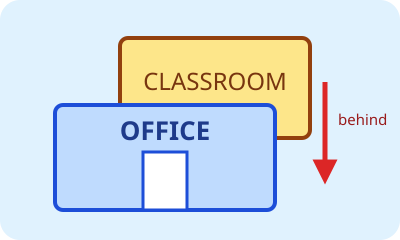
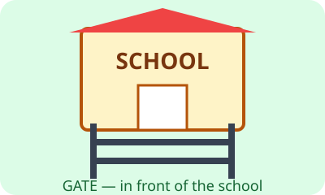
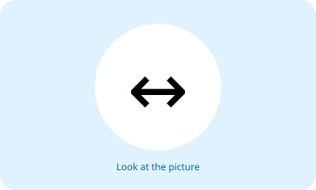
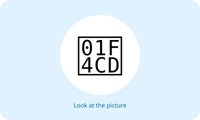
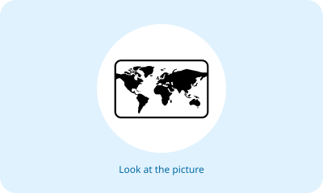
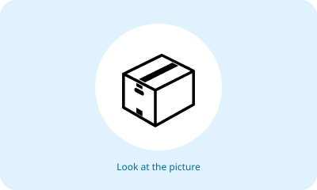
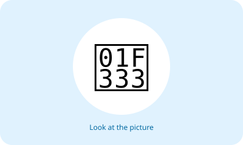
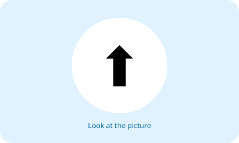
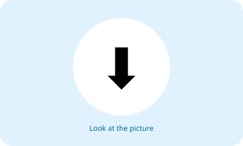

# Unit 7 — 10 Soal Bergambar

## Soal 36 — K03-ENG-B07-M01-036

**Pertanyaan:** Where is the classroom?

**Pilihan jawaban:**
- behind the office
- in front of the office
- under the office
- between two offices

**Kunci Jawaban:** behind the office

**Pembahasan:** Pada gambar, ruang kelas berada di belakang kantor.

---

## Soal 37 — K03-ENG-B07-M01-037

**Pertanyaan:** Where is the gate?

**Pilihan jawaban:**
- behind the school
- in front of the school
- on the school
- under the school

**Kunci Jawaban:** in front of the school

**Pembahasan:** Gerbang tampak di depan sekolah, yaitu **in front of the school**.

---

## Soal 38 — K03-ENG-B07-M01-038

**Pertanyaan:** Which place is beside the office?

**Pilihan jawaban:**
- the library
- the canteen
- the classroom
- the restroom

**Kunci Jawaban:** the library

**Pembahasan:** Perpustakaan dan kantor tampak berdampingan.

---

## Soal 39 — K03-ENG-B07-M01-039

**Pertanyaan:** Which place is between the library and the office?

**Pilihan jawaban:**
- the gate
- the canteen
- the laboratory
- the parking area

**Kunci Jawaban:** the canteen

**Pembahasan:** Kantin berada di tengah perpustakaan dan kantor.

---

## Soal 40 — K03-ENG-B07-M01-040

**Pertanyaan:** Where is the pencil?

**Pilihan jawaban:**
- in the pencil case
- behind the pencil case
- under the pencil case
- beside the pencil case

**Kunci Jawaban:** in the pencil case

**Pembahasan:** Pensil tampak berada **in the pencil case**.

---

## Soal 41 — K03-ENG-B07-M01-041

**Pertanyaan:** Where is the book?

**Pilihan jawaban:**
- under the desk
- on the desk
- behind the desk
- between two desks

**Kunci Jawaban:** on the desk

**Pembahasan:** Buku berada di atas dan menyentuh permukaan meja.

---

## Soal 42 — K03-ENG-B07-M01-042

**Pertanyaan:** Which sentence matches the picture?

**Pilihan jawaban:**
- The bag is on the chair.
- The bag is beside the chair.
- The bag is behind the chair.
- The bag is under the chair.

**Kunci Jawaban:** The bag is under the chair.

**Pembahasan:** Tas tampak berada di bawah kursi.

---

## Soal 43 — K03-ENG-B07-M01-043

**Pertanyaan:** Where is the ball?

**Pilihan jawaban:**
- behind the chair
- in front of the chair
- on the chair
- between two chairs

**Kunci Jawaban:** behind the chair

**Pembahasan:** Sebagian bola tertutup kursi sehingga letaknya **behind the chair**.

---

## Soal 44 — K03-ENG-B07-M01-044

**Pertanyaan:** Where is the cat?

**Pilihan jawaban:**
- under the table
- behind the table
- in front of the table
- on the table

**Kunci Jawaban:** in front of the table

**Pembahasan:** Kucing digambar di depan meja.

---

## Soal 45 — K03-ENG-B07-M01-045

**Pertanyaan:** Which object is between the book and the pencil case?

**Pilihan jawaban:**
- the ruler
- the chair
- the ball
- the bag

**Kunci Jawaban:** the ruler

**Pembahasan:** Penggaris berada di tengah buku dan kotak pensil.

---
