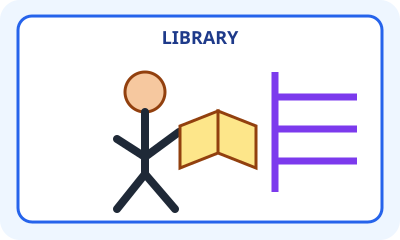

# Bahasa Inggris Kelas 3 — Unit 8: I Drink Orange Juice in the Canteen

## MOD-01 — K03-ENG-B08-MOD-01

### Let's learn! — Makanan, minuman, dan tempat

**Kosakata minuman:** orange juice (jus jeruk), water (air), milk (susu), tea (teh).

**Kosakata makanan:** bread (roti), rice (nasi), noodles (mi).

**Tempat:** canteen (kantin), classroom (ruang kelas), library (perpustakaan).

**Pola kalimat:**
- `I drink orange juice.` (Saya minum jus jeruk.)
- `I eat rice.` (Saya makan nasi.)
- `I drink water in the canteen.` (Saya minum air di kantin.)

Kata **drink** digunakan saat minum; **eat** digunakan saat makan. Kata **in the canteen** menunjukkan tempat melakukan kegiatan. Jangan menukar kata kerja eat dan drink pada kalimat contoh.

**Dialog:**
- A: What do you drink?
- B: I drink water.
- A: Where do you drink water?
- B: In the canteen.

**Latihan:** Pilih satu makanan, satu minuman, dan satu tempat. Buat dua kalimat menggunakan `I eat ...` dan `I drink ... in the ...`.

---

## MOD-02 — K03-ENG-B08-MOD-02

### Let's practice! — Percakapan di kantin

**Baca contoh kegiatan:**
- Sari eats **bread** and drinks **milk**.
- Beni eats **rice** and drinks **water**.
- Rina eats **noodles** and drinks **orange juice**.
- Dika drinks **tea** in the **canteen**.

**Temukan jawaban dari informasi di atas:** Who drinks milk? Sari. What does Beni eat? Rice. Where does Dika drink tea? In the canteen.

**Pola tanya-jawab:**
- A: Do you drink water?
- B: Yes, I do.
- A: Do you drink tea?
- B: No, I don't.

`Yes, I do` dan `No, I don't` menjawab pertanyaan `Do you ...?`. Pertanyaan `What do you drink?` meminta nama minuman; `Where ...?` meminta tempat.

**Latihan berpasangan:** Buat kartu bertuliskan drink, eat, orange juice, bread, water, rice, canteen. Susun tiga kalimat dan ajukan tiga pertanyaan kepada teman. Jawab sesuai isi kartu, bukan tebakan.

**Ingat:** Bahasa Inggris dipakai untuk mendeskripsikan pilihan makanan/minuman, bukan untuk menyatakan bahwa satu pilihan harus diminum oleh setiap anak.
