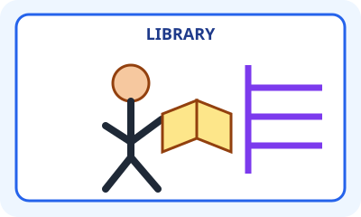
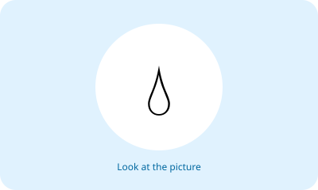
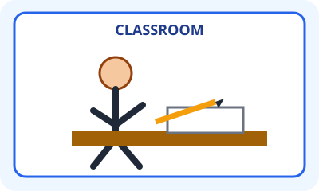
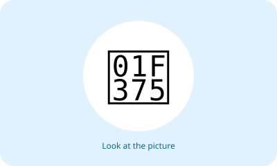
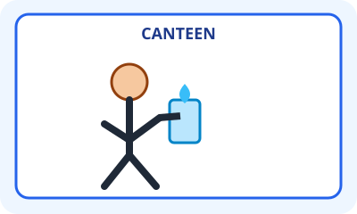
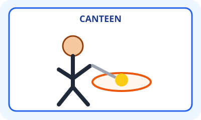
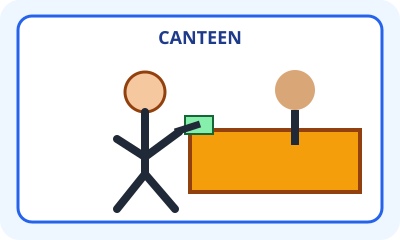
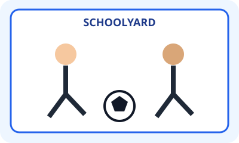
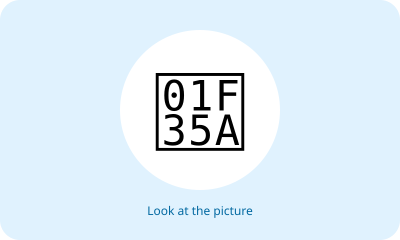
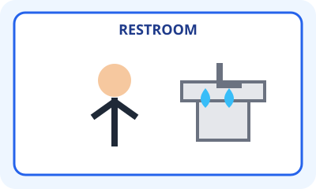

# Unit 8 — 10 Soal Bergambar

## Soal 36 — K03-ENG-B08-M01-036

**Pertanyaan:** What does the student do in the library?

**Pilihan jawaban:**
- reads a book
- buys food
- plays football
- washes his face

**Kunci Jawaban:** reads a book

**Pembahasan:** Gambar menunjukkan siswa membaca buku di perpustakaan.

---

## Soal 37 — K03-ENG-B08-M01-037

**Pertanyaan:** What does the teacher do?

**Pilihan jawaban:**
- teaches in the classroom
- buys food in the canteen
- plays in the schoolyard
- prays in the prayer room

**Kunci Jawaban:** teaches in the classroom

**Pembahasan:** Guru menunjuk tulisan di papan kelas.

---

## Soal 38 — K03-ENG-B08-M01-038

**Pertanyaan:** Which activity is shown?

**Pilihan jawaban:**
- writing
- drinking
- playing
- buying

**Kunci Jawaban:** writing

**Pembahasan:** Siswa memegang pensil dan menulis di kertas.

---

## Soal 39 — K03-ENG-B08-M01-039

**Pertanyaan:** What do the students do?

**Pilihan jawaban:**
- study Math
- buy lunch
- play football
- read a menu

**Kunci Jawaban:** study Math

**Pembahasan:** Dua siswa belajar Matematika di ruang kelas.

---

## Soal 40 — K03-ENG-B08-M01-040

**Pertanyaan:** Which sentence matches the picture?

**Pilihan jawaban:**
- The child drinks water in the canteen.
- The child reads in the library.
- The child writes in the classroom.
- The child plays in the schoolyard.

**Kunci Jawaban:** The child drinks water in the canteen.

**Pembahasan:** Gelas di dekat mulut menunjukkan kegiatan minum.

---

## Soal 41 — K03-ENG-B08-M01-041

**Pertanyaan:** Which activity is shown in the canteen?

**Pilihan jawaban:**
- eating food
- teaching Math
- reading books
- playing football

**Kunci Jawaban:** eating food

**Pembahasan:** Gambar memperlihatkan anak makan dari piring.

---

## Soal 42 — K03-ENG-B08-M01-042

**Pertanyaan:** What does the child do at the counter?

**Pilihan jawaban:**
- buys food
- writes a letter
- studies Math
- prays

**Kunci Jawaban:** buys food

**Pembahasan:** Anak menyerahkan uang dan menerima makanan.

---

## Soal 43 — K03-ENG-B08-M01-043

**Pertanyaan:** Which sentence matches the picture?

**Pilihan jawaban:**
- The children play football in the schoolyard.
- The children read in the library.
- The children buy food in the canteen.
- The children write in the classroom.

**Kunci Jawaban:** The children play football in the schoolyard.

**Pembahasan:** Bola dan lapangan menunjukkan kegiatan bermain sepak bola.

---

## Soal 44 — K03-ENG-B08-M01-044

**Pertanyaan:** Where does the child pray?

**Pilihan jawaban:**
- in the prayer room
- in the canteen
- in the library
- in the schoolyard

**Kunci Jawaban:** in the prayer room

**Pembahasan:** Gambar menunjukkan kegiatan berdoa di ruang ibadah.

---

## Soal 45 — K03-ENG-B08-M01-045

**Pertanyaan:** What does the child do in the restroom?

**Pilihan jawaban:**
- washes his face
- reads a book
- buys food
- plays football

**Kunci Jawaban:** washes his face

**Pembahasan:** Wastafel dan air menunjukkan kegiatan membasuh wajah.

---
