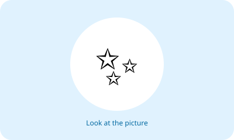
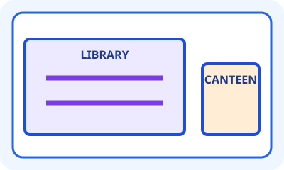

# Bahasa Inggris Kelas 3 — Unit 9: My Classroom Is Clean

## MOD-01 — K03-ENG-B09-MOD-01

### Let's learn! — Room conditions

Pada unit ini kita belajar menggambarkan kondisi dan ukuran ruangan di sekolah.

**Kata sasaran:**
- **clean** = bersih
- **dirty** = kotor
- **big** = besar
- **large** = besar atau luas
- **small** = kecil
- **narrow** = sempit
- **wide** = lebar

**Pola bertanya:** `How is the canteen?`

**Pola menjawab:** `It is small.` atau `It is small and clean.`

Kata **and** menggabungkan dua kondisi. Contoh: `The library is big and clean.` Ukuran dan kebersihan adalah dua ciri berbeda. Ruangan kecil dapat tetap bersih, dan ruangan besar dapat saja kotor.

**Pasangan yang perlu diingat:**
- clean ↔ dirty
- big/large ↔ small
- narrow ↔ wide

**Latihan:** Amati satu ruangan dari tempat yang aman dan dengan izin guru. Buat satu kalimat tentang ukuran atau lebarnya dan satu kalimat tentang kebersihannya. Jangan masuk ke ruangan yang tidak diizinkan.

---

## MOD-02 — K03-ENG-B09-MOD-02

### Let's practice! — Describe two rooms

Perhatikan perbandingan perpustakaan dan kantin.

**Baca laporan contoh:**
- The library is large and clean.
- The canteen is small and clean.
- The restroom is narrow.
- The schoolyard is wide, but it is dirty.

**Tanya-jawab:**
- A: How is the library?
- B: It is large and clean.
- A: How is the restroom?
- B: It is narrow.

**Membaca bukti:** Kata **large** tidak memberi informasi apakah ruangan bersih. Kata **clean** tidak memberi informasi apakah ruangan besar. Gunakan hanya kondisi yang terlihat atau disebutkan pada teks.

**Ayo membuat laporan:**
1. Pilih dua tempat sekolah.
2. Tulis nama tempat dan dua kondisi yang benar-benar diketahui.
3. Susun kalimat `The ... is ... and ...`.
4. Bacakan dengan sopan. Jika keadaan dapat berubah, gunakan keterangan “saat diamati”.

**Cek pemahaman:** Pertanyaan `Where is the library?` menanyakan letak. Pertanyaan `How is the library?` menanyakan keadaan atau kondisinya.
