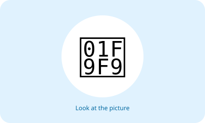
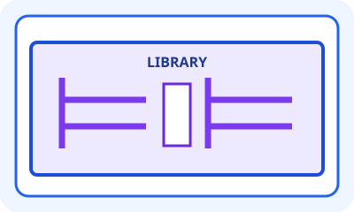
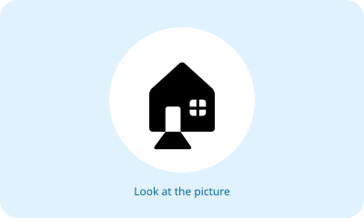
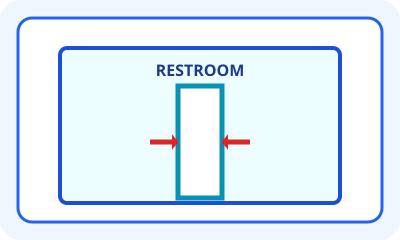
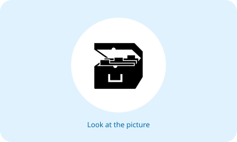
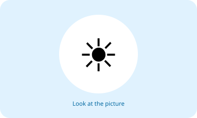
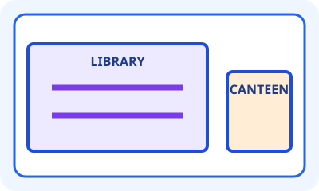
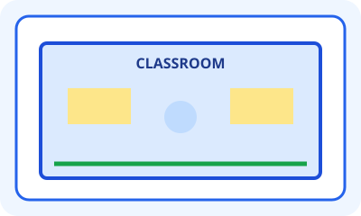
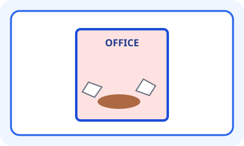

# Unit 9 — 10 Soal Bergambar

## Soal 36 — K03-ENG-B09-M01-036

**Pertanyaan:** How is the classroom?

**Pilihan jawaban:**
- It is clean.
- It is dirty.
- It is narrow.
- It is small.

**Kunci Jawaban:** It is clean.

**Pembahasan:** Lantai bersih dan tempat sampah tertutup menunjukkan kelas bersih.

---

## Soal 37 — K03-ENG-B09-M01-037

**Pertanyaan:** How is the schoolyard?

**Pilihan jawaban:**
- It is clean.
- It is dirty.
- It is narrow.
- It is small.

**Kunci Jawaban:** It is dirty.

**Pembahasan:** Gambar memperlihatkan sampah dan noda di halaman sekolah.

---

## Soal 38 — K03-ENG-B09-M01-038

**Pertanyaan:** Which word describes the library's size?

**Pilihan jawaban:**
- big
- small
- narrow
- dirty

**Kunci Jawaban:** big

**Pembahasan:** Perpustakaan digambar luas dengan banyak rak.

---

## Soal 39 — K03-ENG-B09-M01-039

**Pertanyaan:** How is the canteen?

**Pilihan jawaban:**
- It is large.
- It is dirty.
- It is small.
- It is wide.

**Kunci Jawaban:** It is small.

**Pembahasan:** Kantin digambar berukuran kecil dengan dua meja.

---

## Soal 40 — K03-ENG-B09-M01-040

**Pertanyaan:** Which word describes the restroom entrance?

**Pilihan jawaban:**
- wide
- clean
- large
- narrow

**Kunci Jawaban:** narrow

**Pembahasan:** Pintu masuk tampak sempit.

---

## Soal 41 — K03-ENG-B09-M01-041

**Pertanyaan:** How is the schoolyard from left to right?

**Pilihan jawaban:**
- wide
- narrow
- small
- dirty

**Kunci Jawaban:** wide

**Pembahasan:** Panah mendatar menunjukkan halaman yang lebar.

---

## Soal 42 — K03-ENG-B09-M01-042

**Pertanyaan:** Which place is large?

**Pilihan jawaban:**
- the prayer room
- the small canteen
- the narrow restroom
- the small office

**Kunci Jawaban:** the prayer room

**Pembahasan:** Ruang ibadah digambar luas dan mampu menampung banyak orang.

---

## Soal 43 — K03-ENG-B09-M01-043

**Pertanyaan:** Which place is smaller?

**Pilihan jawaban:**
- the library
- the canteen
- both are equal
- the schoolyard

**Kunci Jawaban:** the canteen

**Pembahasan:** Perbandingan gambar menunjukkan kantin lebih kecil daripada perpustakaan.

---

## Soal 44 — K03-ENG-B09-M01-044

**Pertanyaan:** Which sentence matches the classroom?

**Pilihan jawaban:**
- It is big and clean.
- It is small and dirty.
- It is narrow and dirty.
- It is small and clean.

**Kunci Jawaban:** It is big and clean.

**Pembahasan:** Kelas tampak luas serta tidak memiliki sampah atau noda.

---

## Soal 45 — K03-ENG-B09-M01-045

**Pertanyaan:** Which sentence matches the office?

**Pilihan jawaban:**
- It is wide and clean.
- It is narrow and dirty.
- It is large and clean.
- It is big and wide.

**Kunci Jawaban:** It is narrow and dirty.

**Pembahasan:** Kantor tampak sempit dan memiliki sampah di lantai.

---
