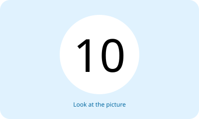
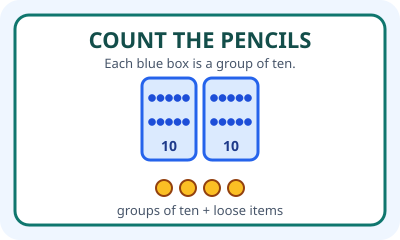

# Bahasa Inggris Kelas 3 — Unit 10: There Are Twenty Books on the Shelf

## MOD-01 — K03-ENG-B10-MOD-01

### Let's learn! — Menghitung dan menyebut jumlah

**Bilangan 10–20:**
- 10 ten; 11 eleven; 12 twelve; 13 thirteen; 14 fourteen
- 15 fifteen; 16 sixteen; 17 seventeen; 18 eighteen; 19 nineteen; 20 twenty

Baca dan ucapkan setiap bilangan dengan jelas. Kata **fifteen** berarti 15; **fifty** berbeda dan tidak termasuk rentang ini.

**Pola kalimat:**
- `There are twenty books on the shelf.` (Ada dua puluh buku di rak.)
- `There are twelve pencils in the box.` (Ada dua belas pensil di kotak.)
- `How many books are there?` (Ada berapa buku?)
- `There are fifteen books.` (Ada lima belas buku.)

Gunakan `There are` dengan bilangan lebih dari satu dan bentuk jamak **books, pencils, chairs**. Gunakan `There is one book` untuk satu benda.

**Latihan:** Hitung antara 10 dan 20 benda pada gambar atau benda nyata. Tuliskan jumlahnya dengan angka dan kata Inggris.

---

## MOD-02 — K03-ENG-B10-MOD-02

### Let's practice! — Menghitung dari informasi

**Latihan membaca data (contoh rekaan):**
- Shelf A: 12 books.
- Shelf B: 7 books.
- Box C: 15 pencils.
- Box D: 5 pencils.

**Pertanyaan:**
- How many books are there on Shelves A and B? **Nineteen books**, because 12 + 7 = 19.
- How many pencils are there in Boxes C and D? **Twenty pencils**, because 15 + 5 = 20.
- Are there twenty books? **No, there aren't. There are nineteen books.**

**Pola dialog:**
- A: How many books are there?
- B: There are nineteen books.
- A: Are there twenty books?
- B: No, there aren't.

**Perhatikan:** Pertanyaan `How many ...?` meminta jumlah. Jika informasi mengatakan `No, there are eighteen`, jangan memakai angka yang ditebak pada pertanyaan awal.

**Latihan berpasangan:** Buat data dua rak dengan 10–20 benda seluruhnya, kemudian jawab `How many ... are there?`. Teman harus menjelaskan dari mana jumlah berasal. Hindari menghitung benda yang sama dua kali.
