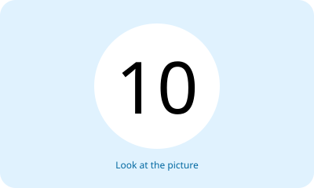
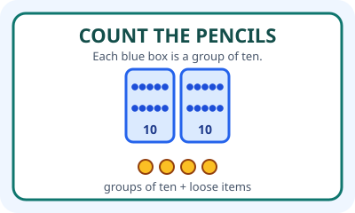
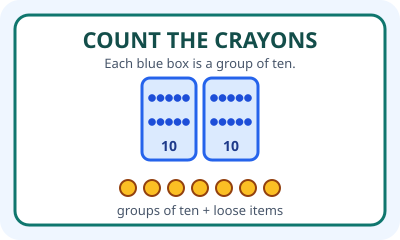
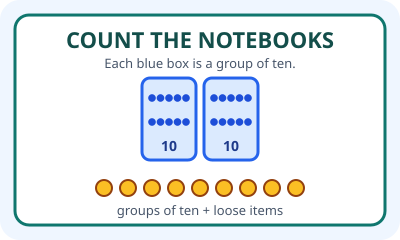
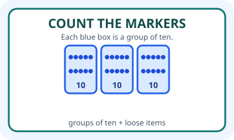
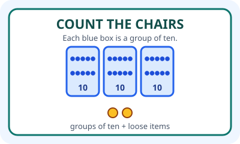
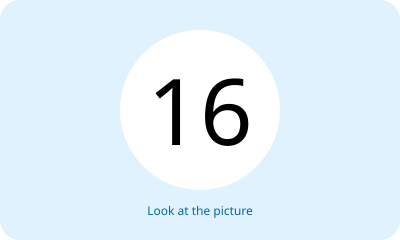
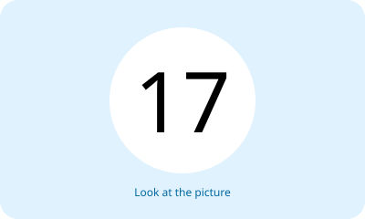
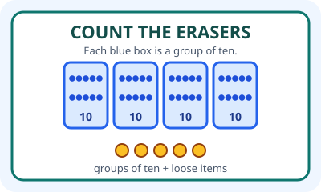
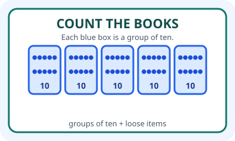

# Unit 10 — 10 Soal Bergambar

## Soal 36 — K03-ENG-B10-M01-036

**Pertanyaan:** Which number word matches the groups in the picture?

**Pilihan jawaban:**
- twenty-one
- twenty-two
- thirty-one
- forty-one

**Kunci Jawaban:** twenty-one

**Pembahasan:** Gambar menampilkan 2 kelompok berisi sepuluh books dan 1 satuan, jadi jumlahnya twenty-one.

---

## Soal 37 — K03-ENG-B10-M01-037

**Pertanyaan:** How many pencils are shown?

**Pilihan jawaban:**
- twenty-two
- twenty-four
- thirty-four
- forty-two

**Kunci Jawaban:** twenty-four

**Pembahasan:** Gambar menampilkan 2 kelompok berisi sepuluh pencils dan 4 satuan, jadi jumlahnya twenty-four.

---

## Soal 38 — K03-ENG-B10-M01-038

**Pertanyaan:** Choose the correct number name.

**Pilihan jawaban:**
- twenty-five
- twenty-six
- twenty-seven
- thirty-seven

**Kunci Jawaban:** twenty-seven

**Pembahasan:** Gambar menampilkan 2 kelompok berisi sepuluh crayons dan 7 satuan, jadi jumlahnya twenty-seven.

---

## Soal 39 — K03-ENG-B10-M01-039

**Pertanyaan:** How many notebooks are shown?

**Pilihan jawaban:**
- nineteen
- twenty-eight
- twenty-nine
- thirty-nine

**Kunci Jawaban:** twenty-nine

**Pembahasan:** Gambar menampilkan 2 kelompok berisi sepuluh notebooks dan 9 satuan, jadi jumlahnya twenty-nine.

---

## Soal 40 — K03-ENG-B10-M01-040

**Pertanyaan:** Which sentence matches the picture?

**Pilihan jawaban:**
- There are thirteen markers.
- There are twenty markers.
- There are thirty markers.
- There are forty markers.

**Kunci Jawaban:** There are thirty markers.

**Pembahasan:** Gambar menampilkan 3 kelompok berisi sepuluh markers, jadi jumlahnya There are thirty markers..

---

## Soal 41 — K03-ENG-B10-M01-041

**Pertanyaan:** How many chairs are shown?

**Pilihan jawaban:**
- twenty-three
- thirty
- thirty-two
- forty-two

**Kunci Jawaban:** thirty-two

**Pembahasan:** Gambar menampilkan 3 kelompok berisi sepuluh chairs dan 2 satuan, jadi jumlahnya thirty-two.

---

## Soal 42 — K03-ENG-B10-M01-042

**Pertanyaan:** Which number word matches the picture?

**Pilihan jawaban:**
- thirty-three
- thirty-five
- forty-five
- fifty

**Kunci Jawaban:** thirty-five

**Pembahasan:** Gambar menampilkan 3 kelompok berisi sepuluh books dan 5 satuan, jadi jumlahnya thirty-five.

---

## Soal 43 — K03-ENG-B10-M01-043

**Pertanyaan:** Complete: There are ___ pencils.

**Pilihan jawaban:**
- fourteen
- thirty
- forty
- fifty

**Kunci Jawaban:** forty

**Pembahasan:** Gambar menampilkan 4 kelompok berisi sepuluh pencils, jadi jumlahnya forty.

---

## Soal 44 — K03-ENG-B10-M01-044

**Pertanyaan:** Which report matches the picture?

**Pilihan jawaban:**
- There are thirty-five erasers.
- There are forty erasers.
- There are forty-five erasers.
- There are fifty erasers.

**Kunci Jawaban:** There are forty-five erasers.

**Pembahasan:** Gambar menampilkan 4 kelompok berisi sepuluh erasers dan 5 satuan, jadi jumlahnya There are forty-five erasers..

---

## Soal 45 — K03-ENG-B10-M01-045

**Pertanyaan:** How many books are shown?

**Pilihan jawaban:**
- fifteen
- forty
- forty-five
- fifty

**Kunci Jawaban:** fifty

**Pembahasan:** Gambar menampilkan 5 kelompok berisi sepuluh books, jadi jumlahnya fifty.

---

