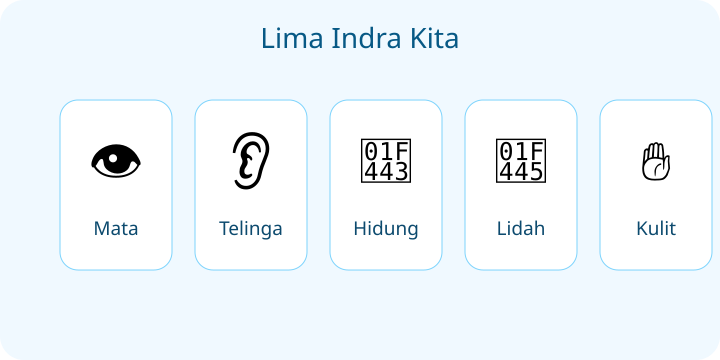
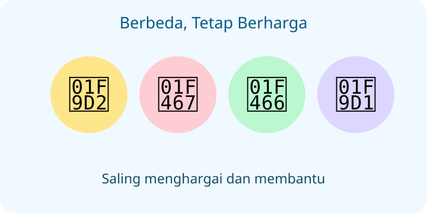

# IPAS Kelas 3 — Bab 1: Keajaiban Tubuhku

**Sumber rujukan:** Buku Siswa IPAS Kelas III, Edisi Revisi 2025. Materi EDUYASA ditulis ulang secara orisinal.

## K03-IPAS-B01-MOD-01 — Detektif Tubuh Hebat

Halo, Detektif! Pernahkah kamu menutup mata lalu mencoba mengenali suara teman? Tubuhmu punya banyak cara untuk mengenal dunia.

### Lima indra yang bekerja sama
- **Mata** membantu melihat bentuk, warna, dan gerakan.
- **Telinga** membantu mendengar suara.
- **Hidung** membantu mencium aroma.
- **Lidah** membantu mengenali rasa, seperti manis, asin, asam, pahit, dan umami.
- **Kulit** membantu merasakan sentuhan, tekanan, suhu, dan nyeri.

Coba bayangkan kamu makan jeruk. Mata melihat warnanya, hidung mencium aromanya, lidah merasakan asam-manisnya, dan kulit merasakan permukaan kulit jeruk. Hebat, bukan? Indra bekerja sama dengan otak untuk memahami informasi.

### Bentuk membantu fungsi
Daun telinga yang berlekuk membantu mengumpulkan bunyi menuju liang telinga. Bulu mata membantu menghalangi debu. Kulit terdapat di berbagai bagian tubuh, bukan hanya telapak tangan. Setiap indra menerima jenis informasi tertentu; warna saja tidak memastikan rasa makanan.

### Tubuh setiap anak unik
Ada teman yang tinggi, ada yang lebih pendek. Rambut dan warna kulit pun bisa berbeda. Ada pula teman yang menggunakan kacamata, alat bantu dengar, atau alat bantu bergerak. **Perbedaan bukan alasan mengejek.** Kita saling menghargai dan membantu jika diminta.

### Ayo, rawat tubuhmu
Cuci tangan dengan sabun, makan beragam makanan bergizi, minum air cukup, tidur cukup, bergerak aktif, dan jaga kebersihan. Jangan menatap matahari langsung, jangan memasukkan benda ke telinga, dan jangan mencicipi bahan yang tidak dikenal.

**Misi detektif:** Sebutkan tiga indra yang kamu gunakan saat menikmati semangkuk sup. Mengapa kita tidak boleh menilai teman hanya dari penampilannya?

## K03-IPAS-B01-MOD-02 — Sehari Bersama Tubuhku

Pagi ini, Dita bangun karena mendengar suara ayam. Ia membuka jendela, melihat cahaya pagi, lalu mencium wangi sarapan. “Wah, tubuhku seperti tim penyelidik!” katanya.

### Siapa bertugas hari ini?
Ketika Dita menyeberang bersama orang dewasa, **mata** memperhatikan jalan dan **telinga** mendengar kendaraan. Saat sarapan, **hidung** mencium makanan, **lidah** mengenali rasanya, dan **kulit** merasakan apakah mangkuk terlalu panas. Otak membantu mengolah pesan dari indra.

**Tantangan kecil:** Tutup mata sejenak di tempat aman. Sebutkan dua suara yang terdengar. Buka mata, lalu amati dua warna di sekitarmu. Jangan melakukan tantangan ini saat berjalan atau menyeberang.

### Bentuk dan bukti pengamatan
Dita mengamati lekuk daun telinga yang membantu mengumpulkan bunyi dan bulu mata yang membantu menghalangi debu. Ketika membandingkan kain, ia membandingkan tekstur dengan cara sentuhan yang sama. Ia tidak menebak rasa buah hanya dari warnanya. Hasil pengamatan berbeda dari kesukaan pribadi: kain terasa kasar adalah bukti sentuhan, sedangkan paling bagus adalah penilaian.

### Semua tubuh berharga
Di sekolah, Dita bertemu teman-teman dengan ciri fisik berbeda. Ada yang memakai kacamata dan ada yang membutuhkan bantuan agar bisa mengikuti kegiatan. Mereka tetap dapat bermain dan belajar bersama. Kita menghormati ruang pribadi, tidak menyentuh tubuh orang lain tanpa izin, dan memberi bantuan dengan sopan.

### Kebiasaan baik untuk tubuh
Sebelum makan, Dita mencuci tangan dengan sabun. Setelah bermain, ia minum air dan beristirahat. Ia menjaga kebersihan mata, telinga, hidung, lidah, dan kulit. Bila ada gangguan pada indra, ia memberi tahu orang dewasa tepercaya.

**Ceritakan kembali:** Bagaimana lima indra membantu Dita dari bangun pagi sampai sarapan? Sebutkan dua cara menghargai perbedaan tubuh teman.

**Pesan penting:** Tubuhmu unik, berharga, dan perlu dirawat. Tubuh temanmu juga demikian.
