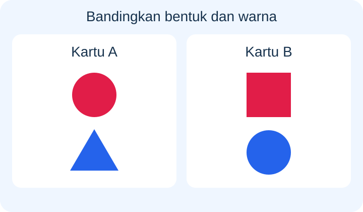
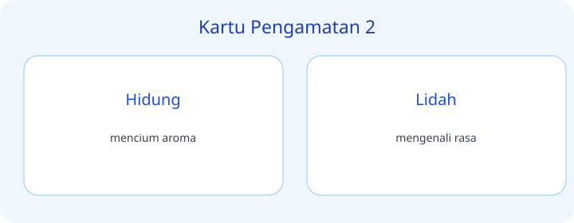
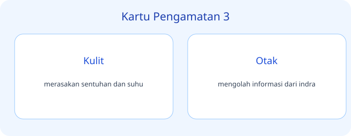
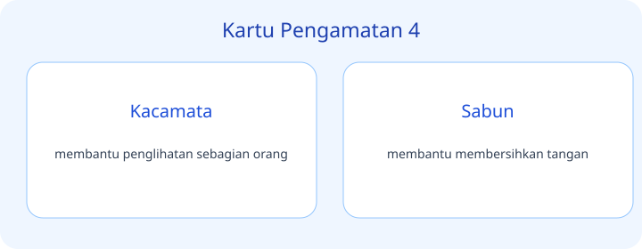
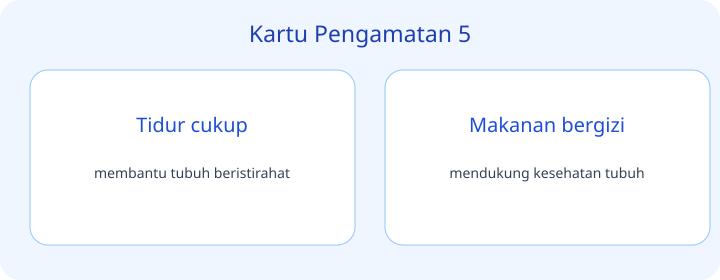
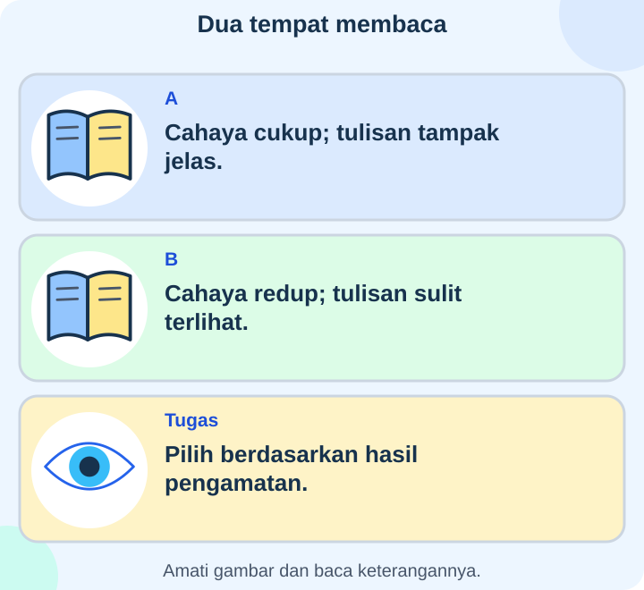
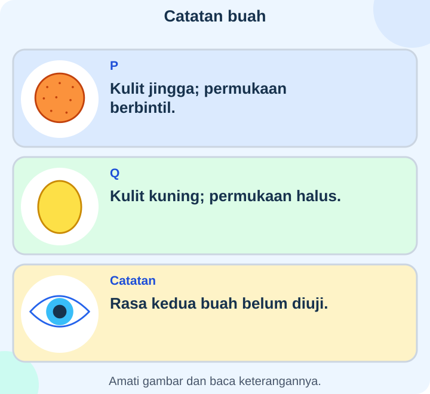
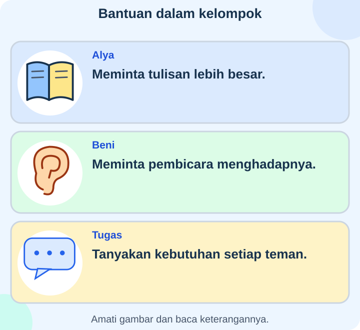
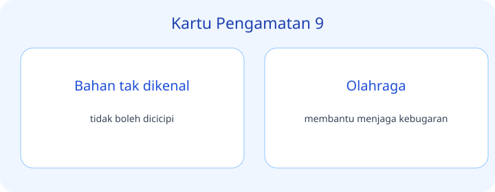
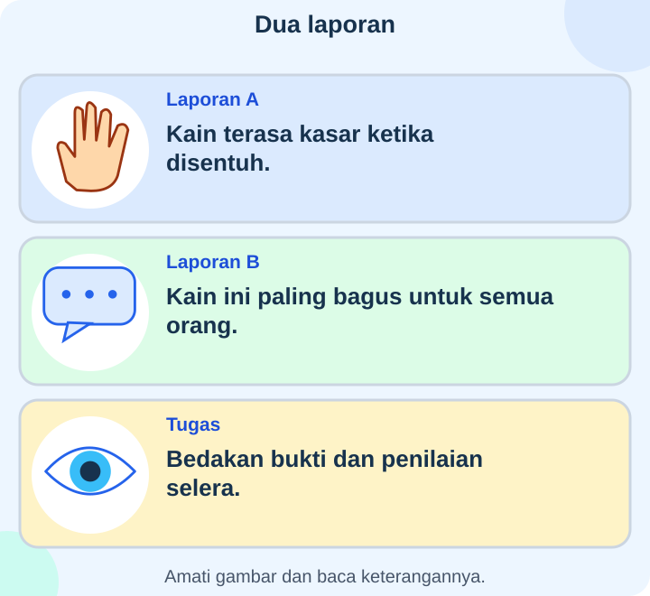

# IPAS Kelas 3 — Bab 1: Keajaiban Tubuhku — 20 Soal Bergambar

## Soal 51 — K03-IPAS-B01-M01-051

**Pertanyaan:** Berdasarkan kartu pengamatan, pernyataan yang tepat tentang **Mata** adalah ...

**Pilihan jawaban:**
- melihat warna dan bentuk
- mengenali rasa
- membantu penglihatan sebagian orang
- mendukung kesehatan tubuh

**Kunci Jawaban:** melihat warna dan bentuk

**Pembahasan:** Mata: melihat warna dan bentuk.

---

## Soal 52 — K03-IPAS-B01-M01-052

**Pertanyaan:** Berdasarkan kartu pengamatan, pernyataan yang tepat tentang **Telinga** adalah ...

**Pilihan jawaban:**
- merasakan sentuhan dan suhu
- mendengar suara
- membantu membersihkan tangan
- membantu memenuhi kebutuhan cairan

**Kunci Jawaban:** mendengar suara

**Pembahasan:** Telinga: mendengar suara.

---

## Soal 53 — K03-IPAS-B01-M01-053

**Pertanyaan:** Berdasarkan kartu pengamatan, pernyataan yang tepat tentang **Hidung** adalah ...

**Pilihan jawaban:**
- mengolah informasi dari indra
- membantu tubuh beristirahat
- mencium aroma
- membuat teman merasa diterima

**Kunci Jawaban:** mencium aroma

**Pembahasan:** Hidung: mencium aroma.

---

## Soal 54 — K03-IPAS-B01-M01-054

**Pertanyaan:** Berdasarkan kartu pengamatan, pernyataan yang tepat tentang **Lidah** adalah ...

**Pilihan jawaban:**
- membantu penglihatan sebagian orang
- mendukung kesehatan tubuh
- menghormati batas tubuh orang lain
- mengenali rasa

**Kunci Jawaban:** mengenali rasa

**Pembahasan:** Lidah: mengenali rasa.

---

## Soal 55 — K03-IPAS-B01-M01-055

**Pertanyaan:** Berdasarkan kartu pengamatan, pernyataan yang tepat tentang **Kulit** adalah ...

**Pilihan jawaban:**
- merasakan sentuhan dan suhu
- membantu membersihkan tangan
- membantu memenuhi kebutuhan cairan
- tempat bercerita saat ada masalah

**Kunci Jawaban:** merasakan sentuhan dan suhu

**Pembahasan:** Kulit: merasakan sentuhan dan suhu.

---

## Soal 56 — K03-IPAS-B01-M01-056

**Pertanyaan:** Berdasarkan kartu pengamatan, pernyataan yang tepat tentang **Otak** adalah ...

**Pilihan jawaban:**
- membantu tubuh beristirahat
- mengolah informasi dari indra
- membuat teman merasa diterima
- tidak boleh ditatap

**Kunci Jawaban:** mengolah informasi dari indra

**Pembahasan:** Otak: mengolah informasi dari indra.

---

## Soal 57 — K03-IPAS-B01-M01-057

**Pertanyaan:** Berdasarkan kartu pengamatan, pernyataan yang tepat tentang **Kacamata** adalah ...

**Pilihan jawaban:**
- mendukung kesehatan tubuh
- menghormati batas tubuh orang lain
- membantu penglihatan sebagian orang
- tidak dimasukkan ke telinga

**Kunci Jawaban:** membantu penglihatan sebagian orang

**Pembahasan:** Kacamata: membantu penglihatan sebagian orang.

---

## Soal 58 — K03-IPAS-B01-M01-058

**Pertanyaan:** Berdasarkan kartu pengamatan, pernyataan yang tepat tentang **Sabun** adalah ...

**Pilihan jawaban:**
- membantu memenuhi kebutuhan cairan
- tempat bercerita saat ada masalah
- tidak boleh dicicipi
- membantu membersihkan tangan

**Kunci Jawaban:** membantu membersihkan tangan

**Pembahasan:** Sabun: membantu membersihkan tangan.

---

## Soal 59 — K03-IPAS-B01-M01-059

**Pertanyaan:** Berdasarkan kartu pengamatan, pernyataan yang tepat tentang **Tidur cukup** adalah ...

**Pilihan jawaban:**
- membantu tubuh beristirahat
- membuat teman merasa diterima
- tidak boleh ditatap
- membantu menjaga kebugaran

**Kunci Jawaban:** membantu tubuh beristirahat

**Pembahasan:** Tidur cukup: membantu tubuh beristirahat.

---

## Soal 60 — K03-IPAS-B01-M01-060

**Pertanyaan:** Berdasarkan kartu pengamatan, pernyataan yang tepat tentang **Makanan bergizi** adalah ...

**Pilihan jawaban:**
- menghormati batas tubuh orang lain
- mendukung kesehatan tubuh
- tidak dimasukkan ke telinga
- dilakukan sebelum makan

**Kunci Jawaban:** mendukung kesehatan tubuh

**Pembahasan:** Makanan bergizi: mendukung kesehatan tubuh.

---

## Soal 61 — K03-IPAS-B01-M01-061

**Pertanyaan:** Berdasarkan kartu pengamatan, pernyataan yang tepat tentang **Minum air** adalah ...

**Pilihan jawaban:**
- tempat bercerita saat ada masalah
- tidak boleh dicicipi
- membantu memenuhi kebutuhan cairan
- membantu mengenal lingkungan

**Kunci Jawaban:** membantu memenuhi kebutuhan cairan

**Pembahasan:** Minum air: membantu memenuhi kebutuhan cairan.

---

## Soal 62 — K03-IPAS-B01-M01-062

**Pertanyaan:** Berdasarkan kartu pengamatan, pernyataan yang tepat tentang **Menghargai perbedaan** adalah ...

**Pilihan jawaban:**
- tidak boleh ditatap
- membantu menjaga kebugaran
- melihat warna dan bentuk
- membuat teman merasa diterima

**Kunci Jawaban:** membuat teman merasa diterima

**Pembahasan:** Menghargai perbedaan: membuat teman merasa diterima.

---

## Soal 63 — K03-IPAS-B01-M01-063

**Pertanyaan:** Berdasarkan kartu pengamatan, pernyataan yang tepat tentang **Meminta izin** adalah ...

**Pilihan jawaban:**
- menghormati batas tubuh orang lain
- tidak dimasukkan ke telinga
- dilakukan sebelum makan
- mendengar suara

**Kunci Jawaban:** menghormati batas tubuh orang lain

**Pembahasan:** Meminta izin: menghormati batas tubuh orang lain.

---

## Soal 64 — K03-IPAS-B01-M01-064

**Pertanyaan:** Berdasarkan kartu pengamatan, pernyataan yang tepat tentang **Orang dewasa tepercaya** adalah ...

**Pilihan jawaban:**
- tidak boleh dicicipi
- tempat bercerita saat ada masalah
- membantu mengenal lingkungan
- mencium aroma

**Kunci Jawaban:** tempat bercerita saat ada masalah

**Pembahasan:** Orang dewasa tepercaya: tempat bercerita saat ada masalah.

---

## Soal 65 — K03-IPAS-B01-M01-065

**Pertanyaan:** Berdasarkan kartu pengamatan, pernyataan yang tepat tentang **Matahari langsung** adalah ...

**Pilihan jawaban:**
- membantu menjaga kebugaran
- melihat warna dan bentuk
- tidak boleh ditatap
- mengenali rasa

**Kunci Jawaban:** tidak boleh ditatap

**Pembahasan:** Matahari langsung: tidak boleh ditatap.

---

## Soal 66 — K03-IPAS-B01-M01-066

**Pertanyaan:** Berdasarkan kartu pengamatan, pernyataan yang tepat tentang **Benda asing** adalah ...

**Pilihan jawaban:**
- dilakukan sebelum makan
- mendengar suara
- merasakan sentuhan dan suhu
- tidak dimasukkan ke telinga

**Kunci Jawaban:** tidak dimasukkan ke telinga

**Pembahasan:** Benda asing: tidak dimasukkan ke telinga.

---

## Soal 67 — K03-IPAS-B01-M01-067

**Pertanyaan:** Berdasarkan kartu pengamatan, pernyataan yang tepat tentang **Bahan tak dikenal** adalah ...

**Pilihan jawaban:**
- tidak boleh dicicipi
- membantu mengenal lingkungan
- mencium aroma
- mengolah informasi dari indra

**Kunci Jawaban:** tidak boleh dicicipi

**Pembahasan:** Bahan tak dikenal: tidak boleh dicicipi.

---

## Soal 68 — K03-IPAS-B01-M01-068

**Pertanyaan:** Berdasarkan kartu pengamatan, pernyataan yang tepat tentang **Olahraga** adalah ...

**Pilihan jawaban:**
- melihat warna dan bentuk
- membantu menjaga kebugaran
- mengenali rasa
- membantu penglihatan sebagian orang

**Kunci Jawaban:** membantu menjaga kebugaran

**Pembahasan:** Olahraga: membantu menjaga kebugaran.

---

## Soal 69 — K03-IPAS-B01-M01-069

**Pertanyaan:** Berdasarkan kartu pengamatan, pernyataan yang tepat tentang **Mencuci tangan** adalah ...

**Pilihan jawaban:**
- mendengar suara
- merasakan sentuhan dan suhu
- dilakukan sebelum makan
- membantu membersihkan tangan

**Kunci Jawaban:** dilakukan sebelum makan

**Pembahasan:** Mencuci tangan: dilakukan sebelum makan.

---

## Soal 70 — K03-IPAS-B01-M01-070

**Pertanyaan:** Berdasarkan kartu pengamatan, pernyataan yang tepat tentang **Indra** adalah ...

**Pilihan jawaban:**
- mencium aroma
- mengolah informasi dari indra
- membantu tubuh beristirahat
- membantu mengenal lingkungan

**Kunci Jawaban:** membantu mengenal lingkungan

**Pembahasan:** Indra: membantu mengenal lingkungan.

---
