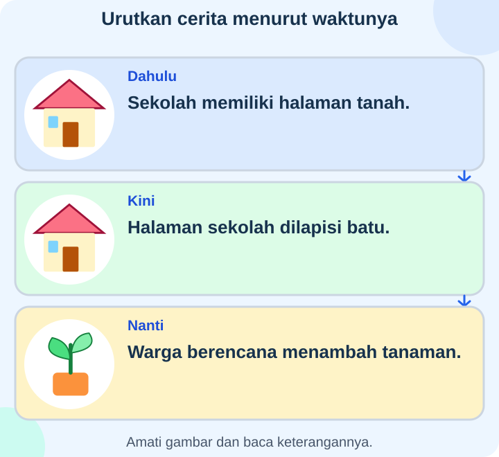
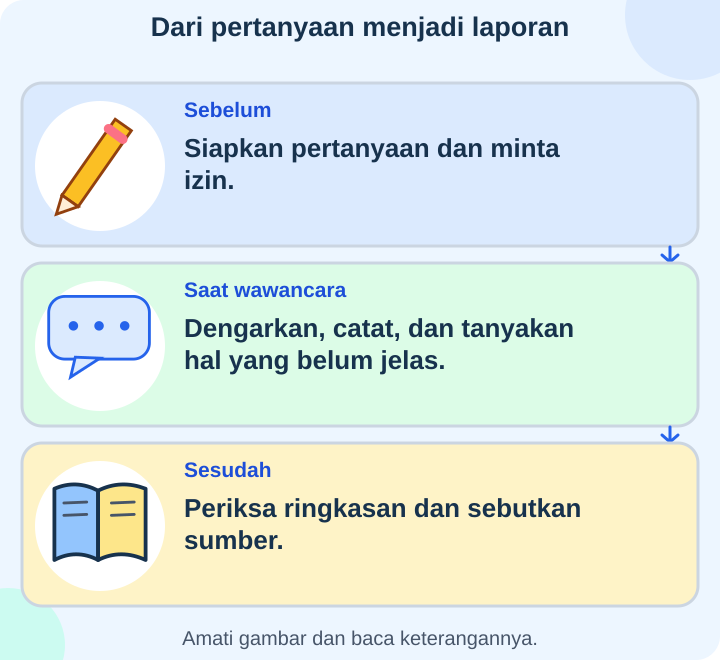

# IPAS Kelas 3 — Bab 2: Dahulu, Kini, dan Nanti

**Acuan:** Buku pemerintah IPAS SD/MI Kelas III, Edisi Revisi 2025, Bab 2
halaman 25–48. Cerita dan contoh berikut dibuat untuk EDUYASA.

## K03-IPAS-B02-MOD-01 — Penyelidik Cerita Keluarga

Setiap keluarga dan lingkungan mempunyai cerita. Kita dapat mempelajari
asal-usul keluarga, kebiasaan, serta perubahan tempat tinggal. Cerita satu
keluarga tidak selalu sama dengan keluarga lain. Jika tidak nyaman membahas
hal pribadi, kamu boleh memilih cerita sekolah atau lingkungan bersama guru.

### Dahulu, sekarang, dan rencana

**Masa lalu** sudah terjadi, termasuk kemarin. **Masa kini** sedang berlangsung.
**Masa depan** belum terjadi. Rencana membahas kegiatan yang akan dilakukan,
bukan bukti bahwa kegiatan sudah terlaksana. Rencana dapat berubah.

Garis waktu menempatkan peristiwa menurut urutannya. Misalnya: perpustakaan
mulai dibangun, kemudian dibuka, lalu ruang bacanya diperluas. Bila waktu suatu
kejadian belum diketahui, tulis ketidakpastian itu; jangan mengisi tahun asal.

### Mencari bukti

Foto, surat, catatan, dan benda lama dapat menjadi sumber. Foto memperlihatkan
hal yang tampak, tetapi belum tentu memberi tahu alasan orang berkumpul atau
perasaannya. Periksa siapa, di mana, dan kapan foto diambil jika keterangannya
tersedia. Bandingkan foto lama dan baru dari lokasi serta sudut yang serupa.

Cerita lisan diperoleh melalui **wawancara**. Orang yang memberi keterangan
disebut **narasumber**. Mintalah izin sebelum merekam dan sebelum membagikan
rekaman. Tidak semua data pribadi, seperti alamat lengkap, perlu dipublikasikan.

### Berubah dan tetap ada

Surat dan panggilan video sama-sama menyampaikan kabar. Medianya berubah,
tujuannya dapat tetap sama. Kendaraan baru tidak selalu menghilangkan yang
lama. Kebiasaan berbagi saat perayaan juga dapat bertahan meskipun undangannya
beralih dari surat ke pesan digital. Kebiasaan yang bertahan menunjukkan
kesinambungan; perubahan tidak terjadi dengan cara yang sama pada semua keluarga.

### Misi penyelidik

Tanyakan satu perubahan yang diketahui narasumber. Catat sumbernya, buat urutan
kejadian, lalu bacakan ringkasan untuk memeriksa pemahamanmu. Bila dua sumber
berbeda, cari catatan tambahan. Rawat foto dan surat lama secara hati-hati bersama
orang dewasa. Laporan berisi informasi yang diperoleh, bukan kejadian rekaan.

## K03-IPAS-B02-MOD-02 — Album yang Mengajak Bertanya

Rani menemukan album lama sekolah. Satu foto menunjukkan halaman tanah; foto
baru menunjukkan halaman yang dilapisi batu. Ia dapat menyimpulkan permukaannya
berbeda. Ia belum tahu kapan dan mengapa berubah, sebab foto tidak menjelaskan
semuanya. Rani memutuskan bertanya kepada orang yang mengetahuinya.

### Sebelum membuka percakapan

Rani menyiapkan pertanyaan: “Bagaimana keadaan sekolah dahulu?” Ia meminta
izin mewawancarai dan merekam. Ia menyebut tujuan kegiatan. Ia tidak memaksa
narasumber menjawab hal pribadi yang tidak ingin dibagikan.

Saat berbicara, Rani menunggu giliran. Kata yang belum dimengerti ditanyakan
kembali. Ia mencatat sumber dan waktu wawancara, lalu membacakan ringkasannya.
Dengan begitu, narasumber dapat memperbaiki bagian yang salah dipahami.

### Menata potongan cerita

Rani memisahkan **masa lalu**, **masa kini**, dan **masa depan**. Foto lama
merupakan bukti keadaan terdahulu. Pengamatan hari ini menunjukkan keadaan
sekarang. Rancangan menambah taman adalah rencana yang belum membuktikan
pembangunannya sudah selesai. Kalender membantu menentukan hari dan tanggal;
garis waktu membantu melihat urutan peristiwa.

### Membandingkan dengan teliti

Dua orang kadang mengingat tahun berbeda. Rani tidak langsung menuduh mereka
berbohong. Ia membandingkan ingatan dengan catatan lain. Jika tetap belum pasti,
ia menuliskan batas pengetahuannya. Cerita asal-usul suatu tempat pun dapat
memiliki beberapa versi; sumber tiap versi perlu disebutkan.

Perubahan dapat terjadi pada alat, bangunan, atau cara berkegiatan. Namun,
kebiasaan lama dapat tetap ada. Misalnya, keluarga tetap berbagi makanan walau
cara mengirim undangan berubah. Pengalaman satu keluarga tidak otomatis
menggambarkan seluruh masyarakat. Setiap keluarga patut dihargai.

### Buat album belajarmu

Pilih cerita keluarga atau sekolah yang nyaman dibahas. Gabungkan catatan dengan
foto yang penggunaannya diizinkan. Jangan menambahkan kejadian rekaan sebagai
fakta. Jangan membagikan alamat rinci atau informasi pribadi yang tidak diperlukan.
Rawat sumber asli di tempat aman dan kering; mintalah bantuan orang dewasa bila
kertas rapuh. Jelaskan satu hal yang berubah, satu yang tetap, dan satu yang masih
perlu ditanyakan.
