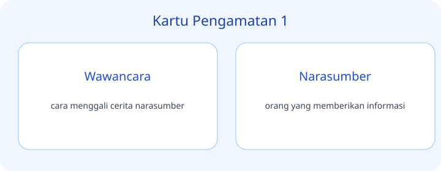
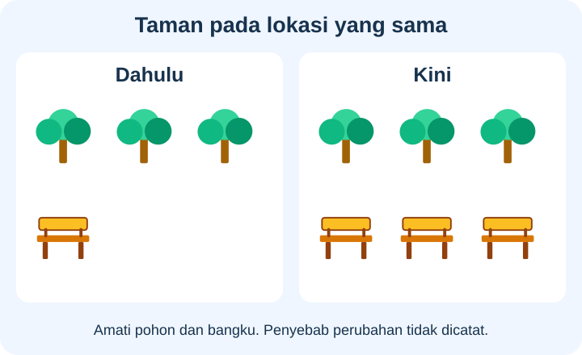
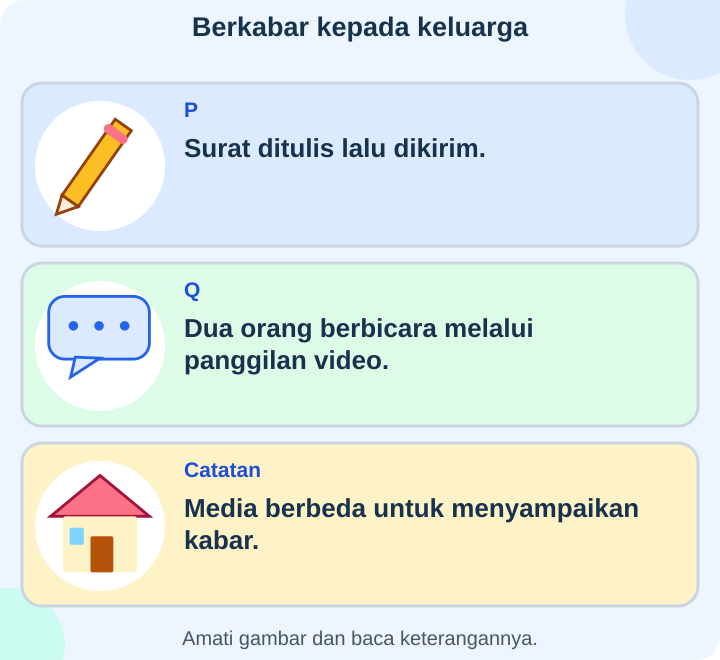
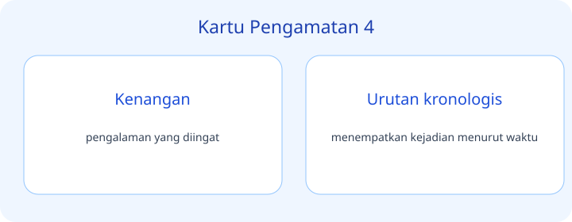
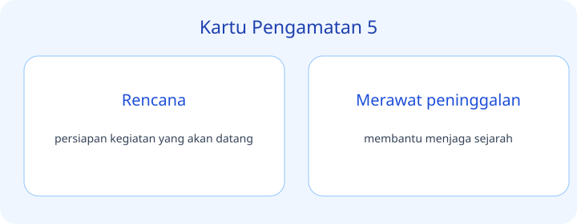
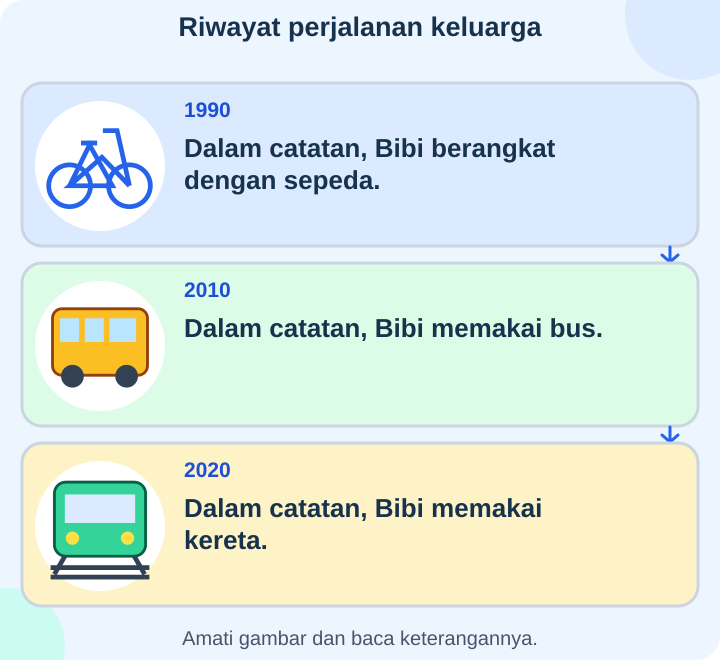
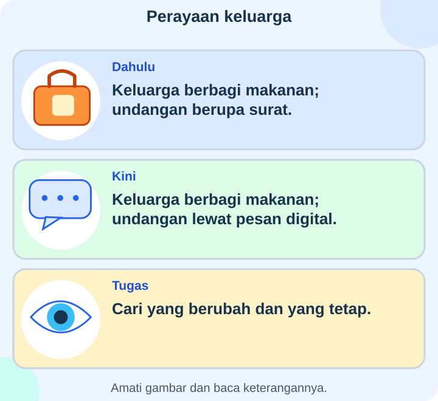
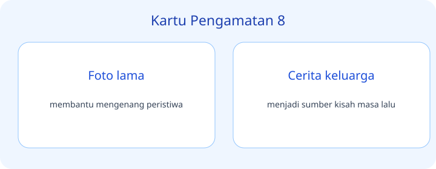
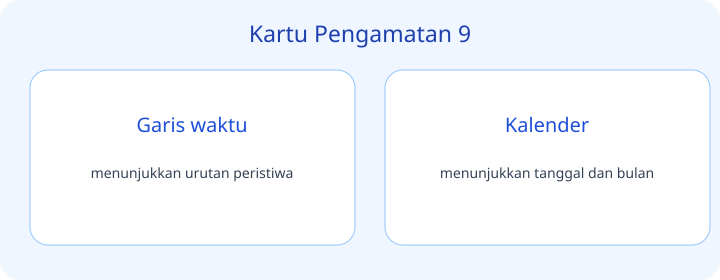
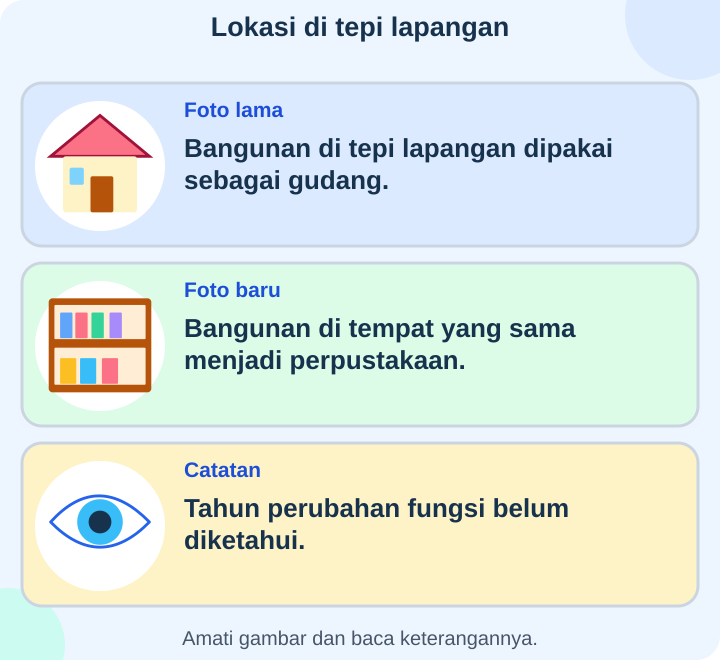

# IPAS Kelas 3 — Bab 2: Dahulu, Kini, dan Nanti — 20 Soal Bergambar

## Soal 51 — K03-IPAS-B02-M01-051

**Pertanyaan:** Peristiwa apa yang paling akhir pada garis waktu?

**Pilihan jawaban:**
- Perpustakaan mulai dibangun
- Perpustakaan dibuka
- Ruang baca diperluas
- Semua peristiwa terjadi bersamaan

**Kunci Jawaban:** Ruang baca diperluas

**Pembahasan:** Tahun 2023 terletak setelah 2018 dan 2020 dalam garis waktu.

---

## Soal 52 — K03-IPAS-B02-M01-052

**Pertanyaan:** Apa yang terjadi di antara pembangunan awal dan perluasan ruang baca?

**Pilihan jawaban:**
- Perpustakaan mulai dibangun
- Ruang baca diperluas
- Tidak ada peristiwa lain
- Perpustakaan dibuka

**Kunci Jawaban:** Perpustakaan dibuka

**Pembahasan:** Pembukaan pada 2020 ditempatkan sesudah pembangunan 2018 dan sebelum perluasan 2023.

---

## Soal 53 — K03-IPAS-B02-M01-053

**Pertanyaan:** Perubahan apa yang ditunjukkan oleh catatan?

**Pilihan jawaban:**
- Bangku bertambah
- Pohon berkurang
- Semua pohon berganti tempat
- Bangku menjadi lebih sedikit

**Kunci Jawaban:** Bangku bertambah

**Pembahasan:** Jumlah pohon tetap tiga, sedangkan jumlah bangku berubah dari satu menjadi tiga.

---

## Soal 54 — K03-IPAS-B02-M01-054

**Pertanyaan:** Informasi apa yang belum diberikan gambar?

**Pilihan jawaban:**
- Jumlah bangku dahulu
- Alasan penambahan bangku
- Jumlah pohon kini
- Jumlah bangku kini

**Kunci Jawaban:** Alasan penambahan bangku

**Pembahasan:** Catatan memuat jumlah objek, tetapi tidak menyebut sebab bangku ditambah.

---

## Soal 55 — K03-IPAS-B02-M01-055

**Pertanyaan:** Pada kartu mana dua orang dapat bertukar suara dan gambar secara langsung lewat jaringan?

**Pilihan jawaban:**
- Kartu P
- Kedua kartu hanya menunjukkan surat
- Kartu Q
- Tidak ada kegiatan komunikasi

**Kunci Jawaban:** Kartu Q

**Pembahasan:** Panggilan video pada Q memungkinkan suara dan gambar diterima melalui jaringan selama percakapan.

---

## Soal 56 — K03-IPAS-B02-M01-056

**Pertanyaan:** Kesamaan tujuan dua kegiatan pada kartu ialah ...

**Pilihan jawaban:**
- Mengangkut penumpang
- Menyusun bangunan
- Menentukan cuaca
- Menyampaikan kabar

**Kunci Jawaban:** Menyampaikan kabar

**Pembahasan:** Surat dan panggilan video sama-sama digunakan untuk berkomunikasi walaupun medianya berbeda.

---

## Soal 57 — K03-IPAS-B02-M01-057

**Pertanyaan:** Bagian keterangan mana yang berbeda?

**Pilihan jawaban:**
- Tahun pembukaan
- Nama desa
- Jenis bangunan
- Kegiatan yang dibicarakan

**Kunci Jawaban:** Tahun pembukaan

**Pembahasan:** Kedua sumber menyebut jembatan dan Desa Melati, tetapi tahunnya berbeda.

---

## Soal 58 — K03-IPAS-B02-M01-058

**Pertanyaan:** Apa yang sebaiknya diperiksa melalui sumber tambahan?

**Pilihan jawaban:**
- Nama desa yang sama-sama disebut sebagai perbedaan
- Tahun pembukaan jembatan
- Warna pakaian pewawancara
- Makanan kesukaan sumber

**Kunci Jawaban:** Tahun pembukaan jembatan

**Pembahasan:** Perbedaan yang perlu diperiksa ialah tanggal atau tahun pembukaan, misalnya melalui catatan pembangunan.

---

## Soal 59 — K03-IPAS-B02-M01-059

**Pertanyaan:** Benda mana menggambarkan rencana yang belum dinyatakan telah terlaksana?

**Pilihan jawaban:**
- Foto pada A
- Catatan pada C
- Rancangan pada B
- Ketiganya bukti taman sudah dibuat

**Kunci Jawaban:** Rancangan pada B

**Pembahasan:** Kartu B menyebut rancangan yang akan dibuat, berbeda dari foto dan catatan kegiatan yang telah terjadi.

---

## Soal 60 — K03-IPAS-B02-M01-060

**Pertanyaan:** Pasangan mana mencatat sesuatu yang telah terjadi?

**Pilihan jawaban:**
- A dan B
- B saja
- B dan C
- A dan C

**Kunci Jawaban:** A dan C

**Pembahasan:** Foto tahun 2019 dan catatan kemarin merujuk peristiwa yang sudah terjadi.

---

## Soal 61 — K03-IPAS-B02-M01-061

**Pertanyaan:** Menurut catatan, alat yang digunakan Bibi pada 2010 ialah ...

**Pilihan jawaban:**
- Bus
- Sepeda
- Kereta
- Perahu

**Kunci Jawaban:** Bus

**Pembahasan:** Kartu bertahun 2010 mencatat penggunaan bus, bukan alat pada dua tahun lainnya.

---

## Soal 62 — K03-IPAS-B02-M01-062

**Pertanyaan:** Kesimpulan mana didukung oleh riwayat ini?

**Pilihan jawaban:**
- Semua orang berhenti memakai sepeda pada 2010
- Cara bepergian Bibi berbeda pada tiga tahun yang dicatat
- Bus tidak ada lagi setelah 2020
- Semua daerah mempunyai kereta

**Kunci Jawaban:** Cara bepergian Bibi berbeda pada tiga tahun yang dicatat

**Pembahasan:** Catatan hanya memberi informasi perjalanan Bibi, bukan seluruh orang atau semua daerah.

---

## Soal 63 — K03-IPAS-B02-M01-063

**Pertanyaan:** Apa yang tetap dilakukan menurut dua kartu?

**Pilihan jawaban:**
- Mengirim undangan hanya lewat surat
- Mengirim undangan hanya lewat pesan digital
- Berbagi makanan
- Menggunakan media undangan yang sama

**Kunci Jawaban:** Berbagi makanan

**Pembahasan:** Kedua kartu menyebut berbagi makanan meskipun media undangannya berbeda.

---

## Soal 64 — K03-IPAS-B02-M01-064

**Pertanyaan:** Apa perubahan yang dapat dibuktikan dari kartu?

**Pilihan jawaban:**
- Jumlah seluruh anggota keluarga
- Jenis semua makanan
- Tempat lahir setiap tamu
- Media undangan

**Kunci Jawaban:** Media undangan

**Pembahasan:** Kartu menunjukkan surat dan pesan digital sebagai dua media; data jumlah keluarga atau tempat lahir tidak tersedia.

---

## Soal 65 — K03-IPAS-B02-M01-065

**Pertanyaan:** Kegiatan apa dilakukan sebelum wawancara pada jadwal?

**Pilihan jawaban:**
- Menyiapkan pertanyaan
- Memeriksa ringkasan hasil wawancara
- Menghapus rekaman hasil
- Membagikan laporan akhir

**Kunci Jawaban:** Menyiapkan pertanyaan

**Pembahasan:** Menyiapkan pertanyaan berada pada Senin, sebelum wawancara Rabu.

---

## Soal 66 — K03-IPAS-B02-M01-066

**Pertanyaan:** Mengapa kegiatan Jumat ditempatkan sesudah Rabu?

**Pilihan jawaban:**
- Hari Jumat selalu merupakan hari pertama dalam minggu
- Ringkasan perlu berdasarkan wawancara yang telah dilakukan
- Jawaban harus ditentukan sebelum pertanyaan
- Semua kegiatan pada jadwal harus dilakukan bersamaan

**Kunci Jawaban:** Ringkasan perlu berdasarkan wawancara yang telah dilakukan

**Pembahasan:** Ringkasan dibuat dari hasil wawancara sehingga pemeriksaannya mengikuti kegiatan mengumpulkan informasi.

---

## Soal 67 — K03-IPAS-B02-M01-067

**Pertanyaan:** Pada hari dan tanggal berapa izin narasumber diminta?

**Pilihan jawaban:**
- Senin tanggal 4
- Kamis tanggal 7
- Rabu tanggal 6
- Rabu tanggal 7

**Kunci Jawaban:** Rabu tanggal 6

**Pembahasan:** Kartu tengah memasangkan kegiatan meminta izin dengan Rabu tanggal 6.

---

## Soal 68 — K03-IPAS-B02-M01-068

**Pertanyaan:** Urutan kegiatan mana sesuai jadwal?

**Pilihan jawaban:**
- Wawancara → meminta izin → membagi tugas
- Meminta izin → wawancara → membagi tugas
- Ketiga kegiatan tidak memiliki urutan
- Membagi tugas → meminta izin → wawancara

**Kunci Jawaban:** Membagi tugas → meminta izin → wawancara

**Pembahasan:** Membaca kartu dari Senin ke Rabu lalu Kamis menghasilkan urutan persiapan, izin, dan wawancara.

---

## Soal 69 — K03-IPAS-B02-M01-069

**Pertanyaan:** Perubahan apa yang diketahui dari keterangan dua foto?

**Pilihan jawaban:**
- Fungsi bangunan
- Arah letak lapangan
- Nama semua pekerja
- Tanggal pasti pembongkaran

**Kunci Jawaban:** Fungsi bangunan

**Pembahasan:** Keterangan menunjukkan fungsi gudang berubah menjadi perpustakaan pada lokasi yang sama.

---

## Soal 70 — K03-IPAS-B02-M01-070

**Pertanyaan:** Apa yang belum boleh disimpulkan dari gambar?

**Pilihan jawaban:**
- Fungsi pada foto lama adalah gudang
- Tahun pasti perubahan fungsi
- Fungsi pada foto baru adalah perpustakaan
- Kedua foto membahas lokasi yang sama

**Kunci Jawaban:** Tahun pasti perubahan fungsi

**Pembahasan:** Catatan secara tegas menyebut tahun perubahan belum diketahui, sehingga perlu sumber tambahan.

---
