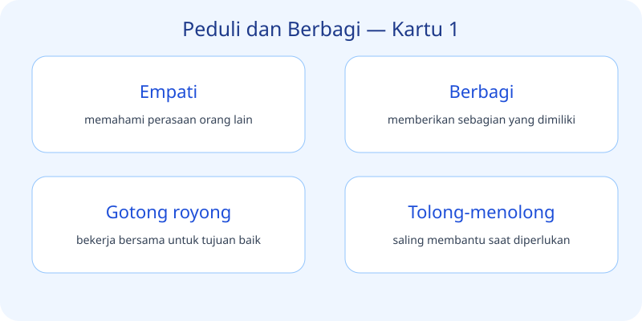
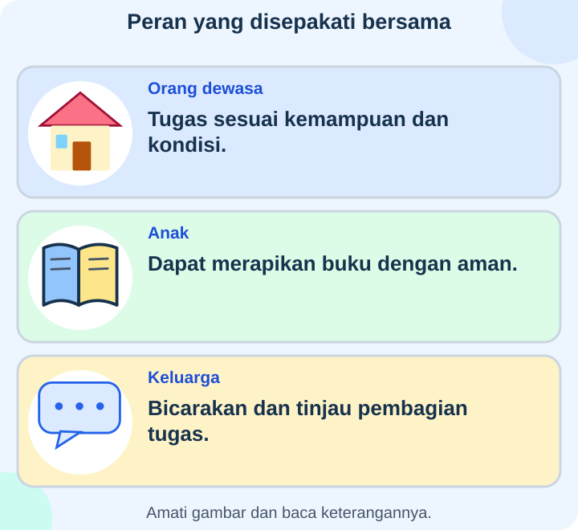

# IPAS Kelas 3 — Bab 3: Peduli dan Berbagi

**Acuan:** Buku pemerintah IPAS SD/MI Kelas III, Edisi Revisi 2025, Bab 3
halaman 49–66: perjalanan hidup manusia dan berbagi peran dalam keluarga.
Contoh serta catatan pengukuran dalam modul ini merupakan ilustrasi pembelajaran.

## K03-IPAS-B03-MOD-01 — Tumbuh, Belajar, dan Berperan

Dahulu kamu memerlukan lebih banyak bantuan. Sekarang ada kegiatan yang mulai
bisa kamu lakukan sendiri. Tubuh dapat berubah ukuran, sementara kemampuan
berkembang melalui pengalaman, kesempatan, dan latihan dengan dukungan yang sesuai.

### Dua jenis perubahan

**Pertumbuhan** mencakup bertambahnya ukuran tubuh, misalnya tinggi atau ukuran
kaki. **Perkembangan** mencakup perubahan kemampuan, seperti makin terampil
mengancingkan baju atau menyusun cerita. Menjadi lebih tinggi tidak otomatis
membuat seseorang lancar membaca; keterampilan juga memerlukan proses belajar.

Untuk mengamati perubahan tinggi, bandingkan hasil anak yang sama pada waktu
berbeda. Gunakan cara dan alat yang sama, lalu catat tanggalnya. Satu hasil saja
belum menunjukkan perubahan. Jangan mengarang angka agar tampak paling besar.
Tinggi badan saja tidak menentukan kepandaian atau seluruh keadaan kesehatan.

### Tahapan hidup

Buku membahas urutan **bayi, kanak-kanak, remaja, dewasa muda, dewasa, dan
lanjut usia**. Tahap itu menggambarkan perjalanan hidup, bukan aturan bahwa
kemampuan semua orang harus persis sama. Individu lanjut usia tidak berubah
kembali menjadi bayi. Bayi pada generasi berikutnya merupakan individu baru.

Makanan beragam, tidur cukup, aktivitas sesuai kemampuan, serta dukungan keluarga
membantu kebutuhan tumbuh dan belajar. Bila ada kesulitan atau keluhan, mintalah
bantuan orang dewasa tepercaya. Orang lanjut usia tetap dapat berbagi pengalaman
dan berperan sesuai kemampuan serta pilihannya.

### Berbagi peran dengan adil

Setiap keluarga dapat mempunyai susunan berbeda. Anggotanya berbagi peran agar
rumah nyaman. Adil bukan berarti tugas harus identik; pertimbangkan kemampuan,
waktu, kondisi, dan kebutuhan. Memasak tidak hanya boleh dilakukan perempuan,
dan merapikan rumah bukan tugas satu orang saja.

Anak dapat membantu pekerjaan aman, misalnya merapikan alat belajar. Benda
panas, pekerjaan listrik, ketinggian, dan beban berat memerlukan penanganan orang
dewasa yang sesuai. Jika tugas terlalu berat atau seseorang sakit, bicarakan
penyesuaian. Dengarkan pendapat, buat kesepakatan, lalu tinjau hasilnya.

### Misi bersama

Sebutkan satu keterampilan yang sedang kamu pelajari. Pilih satu tugas rumah
yang aman bersama keluarga. Setelah dicoba, ceritakan manfaat dan bantuan yang
diperlukan. Kamu tidak perlu membagikan data tubuh atau cerita keluarga yang
bersifat pribadi kepada umum.

## K03-IPAS-B03-MOD-02 — Dari Album ke Meja Keluarga

Lani melihat cerita masa kecilnya bersama wali. Dahulu ia perlu dibantu memakai
baju, kini mulai dapat mengancingkannya sendiri. Perubahan itu menunjukkan
perkembangan keterampilan. Foto juga dapat memperlihatkan perubahan tampilan,
tetapi tidak menunjukkan berat badan tepat atau seluruh kemampuan seseorang.

### Membaca perjalanan hidup

Tahapan pada buku dimulai dari **bayi**, lalu **kanak-kanak**, **remaja**,
**dewasa muda**, **dewasa**, dan **lanjut usia**. Bayi memerlukan pengasuhan
untuk banyak kebutuhan. Seiring waktu, kemampuan dapat berkembang melalui
pengalaman dan dukungan. Laju perubahan serta kebutuhan setiap orang dapat berbeda.

Orang lanjut usia bukan bayi yang sama berulang kembali. Kelahiran generasi baru
merupakan kehidupan individu baru. Setiap tahap tetap berharga dan dapat memperoleh
dukungan yang berbeda. Kita tidak menilai kepandaian hanya dari ukuran tubuh.

### Perhatikan bukti

Dalam contoh catatan, tinggi Tio awal semester $110\ \text{cm}$ dan akhir
semester $113\ \text{cm}$. Catatan menunjukkan pertambahan tinggi, yaitu
pertumbuhan ukuran tubuh. Catatan itu belum membuktikan penyebab pasti perubahan
atau kemampuan membacanya. Mengancingkan baju dengan lebih terampil merupakan
contoh perkembangan kemampuan, bukan hasil pengukuran tinggi.

Jika melakukan pengamatan sederhana bersama guru atau keluarga, catat dengan
jujur dan gunakan cara yang sama. Kamu boleh memakai contoh yang disediakan,
tanpa mengumumkan ukuran atau informasi pribadi milikmu dan teman.

### Rapat kecil untuk rumah nyaman

Keluarga Lani membahas pekerjaan rumah. Ada yang memasak, merapikan buku, dan
merawat tanaman. Pembagiannya mengikuti kemampuan serta waktu, bukan jenis
kelamin saja. Mereka memberi giliran menggunakan alat dan mengucapkan terima kasih.

Ketika seseorang sakit, jadwal dapat diubah sementara melalui pembicaraan.
Tanggung jawab berarti menjalankan kesepakatan serta memberi tahu bila ada
kesulitan. Tugas baru perlu dicoba dengan aman; anak tidak mengangkat lemari
berat atau membawa panci panas sendirian. Meminta bantuan bukan alasan mengejek.

### Coba dan tinjau

Bicarakan satu pekerjaan yang sesuai kemampuanmu. Jalankan bersama dukungan
bila diperlukan, lalu lihat hasilnya. Apakah ruang lebih rapi? Apakah tugasnya
terlalu berat? Sampaikan dengan sopan agar pembagian dapat diperbaiki.
