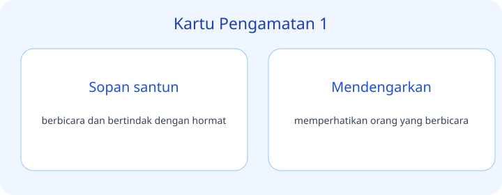
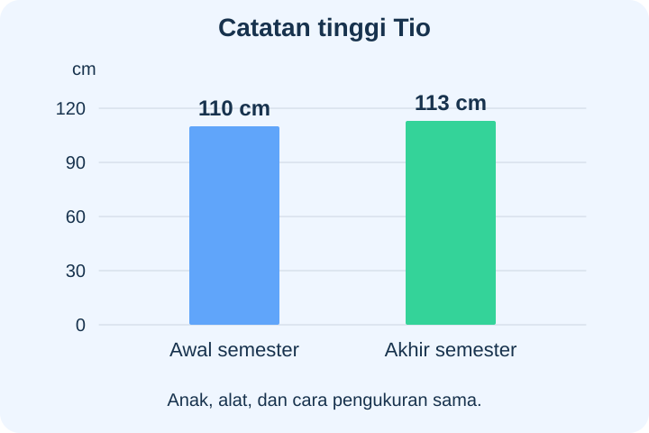
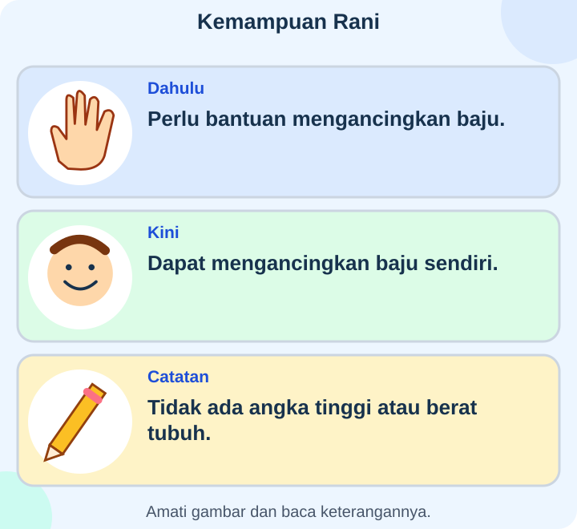
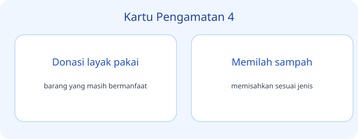
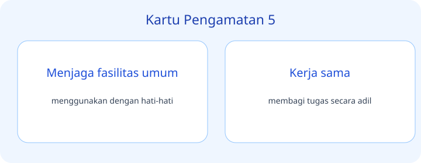
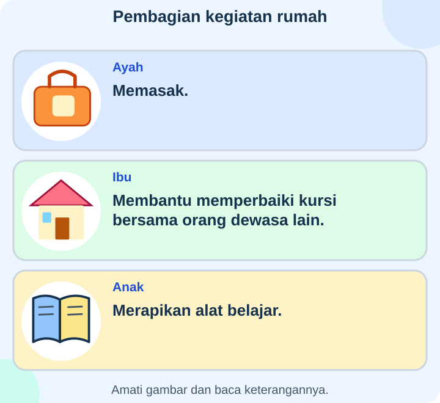
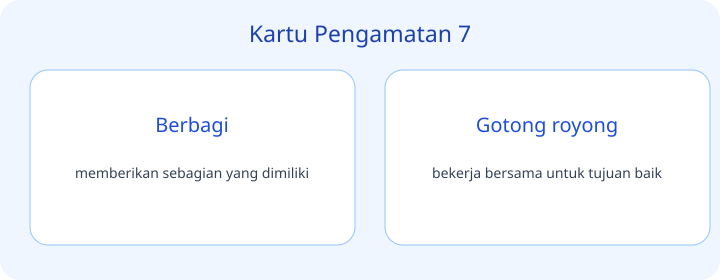
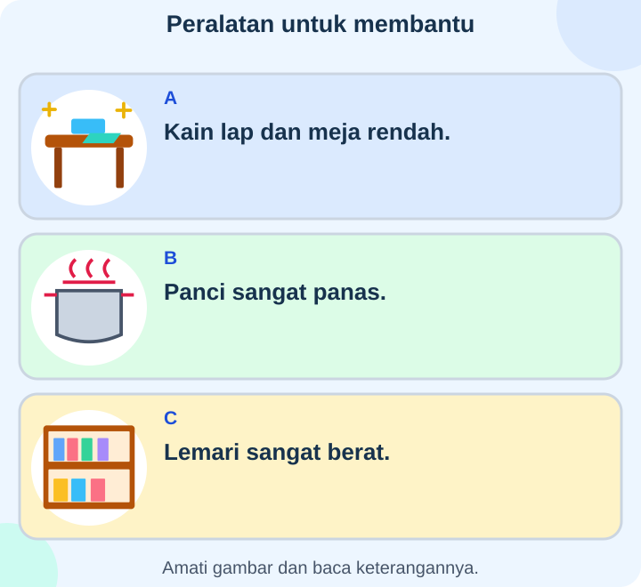
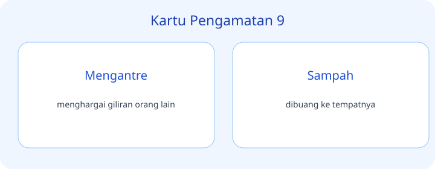
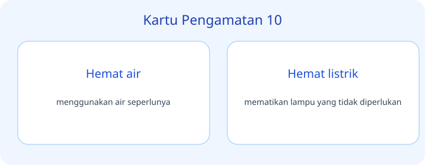

# IPAS Kelas 3 — Bab 3: Peduli dan Berbagi — 20 Soal Bergambar

## Soal 51 — K03-IPAS-B03-M01-051

**Pertanyaan:** Pada diagram, tahap tepat sebelum kotak C ialah ...

**Pilihan jawaban:**
- Bayi
- Dewasa
- Kanak-kanak
- Lanjut usia

**Kunci Jawaban:** Kanak-kanak

**Pembahasan:** Urutan pada diagram menempatkan kanak-kanak di antara bayi dan remaja.

---

## Soal 52 — K03-IPAS-B03-M01-052

**Pertanyaan:** Tahap pada kotak D dan E berturut-turut ialah ...

**Pilihan jawaban:**
- Lanjut usia lalu bayi pada orang yang sama
- Remaja lalu bayi
- Dewasa muda lalu kanak-kanak
- Dewasa muda lalu dewasa

**Kunci Jawaban:** Dewasa muda lalu dewasa

**Pembahasan:** Kotak D bertuliskan dewasa muda, diikuti kotak E dewasa. Kotak F baru menunjukkan lanjut usia.

---

## Soal 53 — K03-IPAS-B03-M01-053

**Pertanyaan:** Perubahan apa yang dicatat pada Tio?

**Pilihan jawaban:**
- Tinggi badannya bertambah
- Kemampuan membacanya pasti bertambah
- Ukuran rumahnya berubah
- Jumlah anggota keluarganya bertambah

**Kunci Jawaban:** Tinggi badannya bertambah

**Pembahasan:** Angka tinggi berubah dari $110\ \text{cm}$ menjadi $113\ \text{cm}$; catatan tidak mengukur kemampuan membaca atau rumah.

---

## Soal 54 — K03-IPAS-B03-M01-054

**Pertanyaan:** Informasi mana tidak dapat ditentukan dari catatan?

**Pilihan jawaban:**
- Tinggi pada awal semester
- Penyebab pasti perubahan tinggi Tio
- Tinggi pada akhir semester
- Apakah angka tinggi bertambah

**Kunci Jawaban:** Penyebab pasti perubahan tinggi Tio

**Pembahasan:** Catatan menunjukkan dua hasil pengukuran tetapi tidak menjelaskan penyebabnya secara pasti.

---

## Soal 55 — K03-IPAS-B03-M01-055

**Pertanyaan:** Perubahan yang ditunjukkan kartu terutama mengenai ...

**Pilihan jawaban:**
- Ukuran tinggi yang telah diukur
- Berat tubuh yang telah ditimbang
- Keterampilan melakukan kegiatan
- Ukuran ruangan

**Kunci Jawaban:** Keterampilan melakukan kegiatan

**Pembahasan:** Perbandingan membahas kemampuan mengancingkan baju, bukan data ukuran tubuh.

---

## Soal 56 — K03-IPAS-B03-M01-056

**Pertanyaan:** Kesimpulan apa yang belum didukung kartu?

**Pilihan jawaban:**
- Kemampuan mengancingkan baju berubah
- Dahulu Rani memerlukan bantuan
- Kini Rani dapat melakukan kegiatan itu sendiri
- Berat tubuh Rani bertambah

**Kunci Jawaban:** Berat tubuh Rani bertambah

**Pembahasan:** Tidak ada data berat pada kartu, sehingga perubahan berat tidak dapat ditentukan.

---

## Soal 57 — K03-IPAS-B03-M01-057

**Pertanyaan:** Catatan mana merupakan contoh pertumbuhan ukuran tubuh?

**Pilihan jawaban:**
- Catatan A
- Catatan B
- Keduanya hanya warna benda
- Tidak ada perubahan ukuran

**Kunci Jawaban:** Catatan A

**Pembahasan:** A menyebut ukuran kaki, sedangkan B menunjukkan keterampilan melakukan tugas.

---

## Soal 58 — K03-IPAS-B03-M01-058

**Pertanyaan:** Catatan B menunjukkan ...

**Pilihan jawaban:**
- Pertambahan ukuran kaki
- Perkembangan keterampilan
- Perubahan tinggi yang telah diukur
- Perubahan warna kulit

**Kunci Jawaban:** Perkembangan keterampilan

**Pembahasan:** Menyusun buku dengan lebih terampil merupakan perubahan kemampuan, bukan ukuran tubuh.

---

## Soal 59 — K03-IPAS-B03-M01-059

**Pertanyaan:** Dukungan yang sesuai untuk Sita pada kartu ialah ...

**Pilihan jawaban:**
- Melarangnya mencoba karena belum terampil
- Mengejeknya karena berbeda dengan Bima
- Memberi kesempatan berlatih dan bantuan bila dibutuhkan
- Menganggap ia tidak dapat belajar hal lain

**Kunci Jawaban:** Memberi kesempatan berlatih dan bantuan bila dibutuhkan

**Pembahasan:** Sita sedang belajar; latihan dan bantuan yang sesuai mendukung perkembangannya.

---

## Soal 60 — K03-IPAS-B03-M01-060

**Pertanyaan:** Apa yang belum diketahui dari kartu?

**Pilihan jawaban:**
- Kegiatan yang sedang dipelajari Sita
- Keterampilan yang sudah dimiliki Bima
- Bahwa kebutuhan belajar mereka dapat berbeda
- Tinggi badan Sita dan Bima

**Kunci Jawaban:** Tinggi badan Sita dan Bima

**Pembahasan:** Kartu memuat kemampuan, bukan data pengukuran tinggi kedua anak.

---

## Soal 61 — K03-IPAS-B03-M01-061

**Pertanyaan:** Tugas anak yang tercatat ialah ...

**Pilihan jawaban:**
- Merapikan alat belajar
- Memasak semua makanan sendiri
- Memperbaiki kursi sendirian
- Memperbaiki atap

**Kunci Jawaban:** Merapikan alat belajar

**Pembahasan:** Kartu anak menyebut kegiatan merapikan alat belajar, berbeda dari dua tugas orang dewasa.

---

## Soal 62 — K03-IPAS-B03-M01-062

**Pertanyaan:** Pelajaran apa yang sesuai dengan pembagian pada gambar?

**Pilihan jawaban:**
- Memasak harus selalu menjadi tugas ibu
- Tugas dapat dibagi menurut kemampuan, bukan hanya jenis kelamin
- Semua anak harus memperbaiki kursi
- Setiap anggota wajib mendapat tugas yang sama persis

**Kunci Jawaban:** Tugas dapat dibagi menurut kemampuan, bukan hanya jenis kelamin

**Pembahasan:** Gambar menunjukkan peran yang berbeda dan tidak membatasi memasak hanya pada perempuan.

---

## Soal 63 — K03-IPAS-B03-M01-063

**Pertanyaan:** Siapa yang menyiram tanaman pada Selasa?

**Pilihan jawaban:**
- Alya
- Keduanya tercatat tidak bertugas
- Beni
- Tidak ada keterangan hari Selasa

**Kunci Jawaban:** Beni

**Pembahasan:** Baris Selasa menyebut Beni menyiram dan Alya merapikan buku.

---

## Soal 64 — K03-IPAS-B03-M01-064

**Pertanyaan:** Pola pembagian tugas pada dua hari itu ialah ...

**Pilihan jawaban:**
- Alya selalu melakukan kedua tugas
- Beni selalu tidak bertugas
- Tidak ada giliran
- Berganti tugas

**Kunci Jawaban:** Berganti tugas

**Pembahasan:** Kedua anak bertukar kegiatan dari Senin ke Selasa sehingga tugas tidak selalu dikerjakan orang yang sama.

---

## Soal 65 — K03-IPAS-B03-M01-065

**Pertanyaan:** Kegiatan mana paling sesuai dilakukan anak dengan arahan?

**Pilihan jawaban:**
- Mengelap meja rendah menggunakan alat A
- Mengangkat panci panas B sendiri
- Memindahkan lemari C sendiri
- Mengangkat B dan C bersamaan

**Kunci Jawaban:** Mengelap meja rendah menggunakan alat A

**Pembahasan:** Meja rendah dan kain lap dapat disesuaikan dengan kemampuan anak; panas dan beban berat memerlukan penanganan orang dewasa.

---

## Soal 66 — K03-IPAS-B03-M01-066

**Pertanyaan:** Apa alasan tugas B dan C memerlukan perhatian orang dewasa?

**Pilihan jawaban:**
- Keduanya pasti bukan barang rumah
- Ada risiko panas atau beban berat
- Semua anak harus mampu mengangkatnya
- Alat A selalu lebih mahal

**Kunci Jawaban:** Ada risiko panas atau beban berat

**Pembahasan:** Keterangan pada kartu menyebut panci panas dan lemari berat, dua risiko yang berbeda dari tugas A.

---

## Soal 67 — K03-IPAS-B03-M01-067

**Pertanyaan:** Mengapa pembagian tugas perlu dibicarakan kembali?

**Pilihan jawaban:**
- Menyapu tidak pernah diperlukan
- Semua tugas harus diberikan kepada bayi
- Kondisi orang yang bertugas berubah
- Kesepakatan tidak boleh berubah

**Kunci Jawaban:** Kondisi orang yang bertugas berubah

**Pembahasan:** Kakak sedang sakit sehingga kemampuan atau kebutuhannya saat itu perlu dipertimbangkan.

---

## Soal 68 — K03-IPAS-B03-M01-068

**Pertanyaan:** Perubahan yang disarankan gambar ialah ...

**Pilihan jawaban:**
- Memaksa Kakak tetap menyapu meskipun tidak mampu
- Menyembunyikan keadaan Kakak
- Menghapus semua tanggung jawab selamanya
- Mencari pengganti sementara melalui pembicaraan

**Kunci Jawaban:** Mencari pengganti sementara melalui pembicaraan

**Pembahasan:** Rencana pada kartu menekankan penyesuaian sementara, bukan pemaksaan atau penghapusan semua tanggung jawab.

---

## Soal 69 — K03-IPAS-B03-M01-069

**Pertanyaan:** Bukti bahwa kegiatan membantu keamanan ruangan ialah ...

**Pilihan jawaban:**
- Jalan kembali terbuka setelah dirapikan
- Semua orang mempunyai tinggi sama
- Mainan dibiarkan menutupi jalan
- Tidak ada anggota keluarga yang bekerja

**Kunci Jawaban:** Jalan kembali terbuka setelah dirapikan

**Pembahasan:** Keadaan sesudah menunjukkan jalur yang sebelumnya tertutup sudah dapat dilalui.

---

## Soal 70 — K03-IPAS-B03-M01-070

**Pertanyaan:** Apa hubungan kegiatan dan hasil pada gambar?

**Pilihan jawaban:**
- Ruangan rapi tanpa kegiatan apa pun
- Berbagi tugas membantu ruangan kembali rapi
- Buku bertambah karena tidak disentuh
- Jalan menjadi lebih tertutup setelah dirapikan

**Kunci Jawaban:** Berbagi tugas membantu ruangan kembali rapi

**Pembahasan:** Urutan sebelum, kegiatan, dan sesudah menunjukkan hasil tindakan bersama.

---
