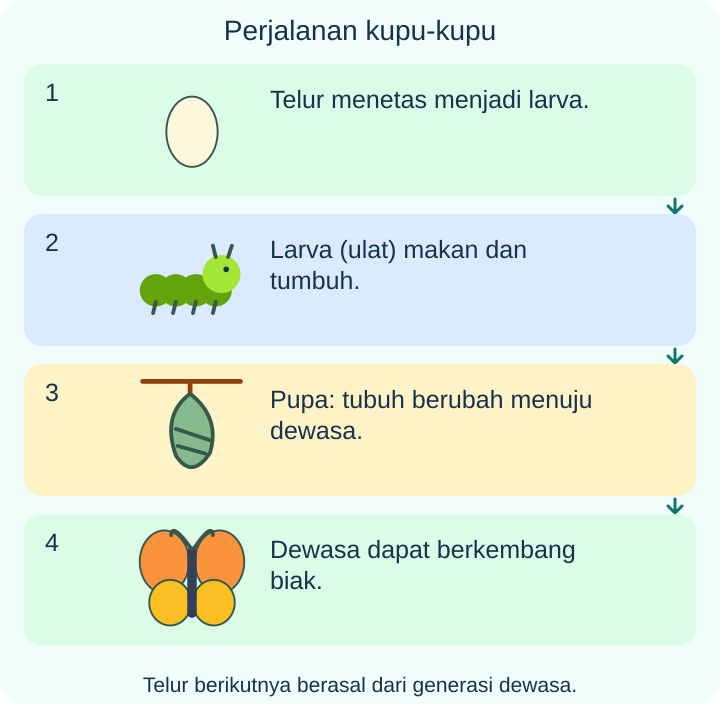
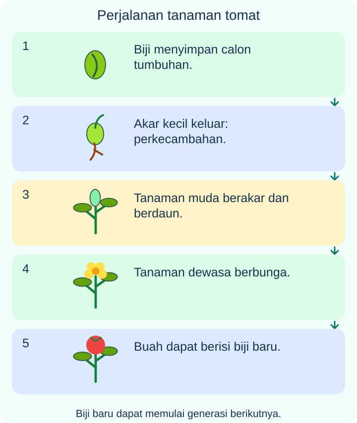

# IPAS Kelas 3 — Bab 4: Siklus Hidup yang Menakjubkan

## K03-IPAS-B04-MOD-01 — Menelusuri Daur Kehidupan

### Dari satu generasi ke generasi berikutnya

Makhluk hidup tumbuh, berkembang, dan akhirnya mati. Ketika berkembang biak, makhluk hidup menghasilkan keturunan. Keturunannya dapat tumbuh dan menghasilkan generasi berikutnya. Urutan tahapan itu disebut **siklus atau daur hidup**.

Panah melingkar tidak berarti hewan dewasa berubah kembali menjadi telur yang sama. Contohnya, ayam betina dewasa dapat menghasilkan telur. Dari telur yang dibuahi dan mendapat kondisi pengeraman sesuai, dapat menetas anak ayam dari generasi baru. Tidak semua telur yang dibeli di pasar dapat menetas.

### Membandingkan hewan

- **Kucing:** bayi kucing → kucing muda → kucing dewasa. Bentuk dasar anak mirip induknya, lalu tubuhnya membesar. Kucing melahirkan.
- **Ayam:** telur → anak ayam → ayam dewasa. Anak ayam mirip bentuk dasar induknya dan tidak melalui pupa.
- **Kupu-kupu:** telur → larva atau ulat → pupa → kupu-kupu dewasa. Ulat makan dan tumbuh. Di dalam pupa, tubuh berubah meskipun dari luar tampak diam. Kupu-kupu dewasa dapat berkembang biak.
- **Jangkrik:** telur → nimfa → dewasa. Nimfa mirip bentuk dasar dewasa, tetapi lebih kecil dan sayapnya belum sempurna.
- **Katak yang biasa dipelajari:** telur → berudu → berudu berkaki → katak muda → katak dewasa. Kaki tumbuh dan ekor berangsur memendek. Berudu hidup di air yang sesuai; kebutuhan tempat hidup berubah selama perkembangan.

**Metamorfosis** adalah perubahan bentuk tubuh selama perkembangan, seperti berudu menjadi katak. Untuk membandingkan **serangga**, kupu-kupu mengalami metamorfosis sempurna dengan pupa, sedangkan jangkrik mengalami metamorfosis tidak sempurna tanpa pupa. Bertelur saja tidak menunjukkan bahwa hewan pasti mempunyai pupa. Katak mengalami metamorfosis, tetapi tidak mempunyai pupa seperti kupu-kupu.

### Tumbuhan juga mempunyai daur hidup

Contoh tanaman tomat dari biji: **biji → kecambah → tanaman muda → tanaman dewasa berbunga → berbuah dan menghasilkan biji**. Biji yang hidup dapat tumbuh jika kondisinya sesuai. Tidak setiap biji pasti berhasil tumbuh.

Pada awal perkecambahan, akar kecil keluar. Calon tumbuhan memakai cadangan makanan dalam biji. Biji kacang hijau dapat mulai berkecambah tanpa matahari langsung jika air, udara, dan suhunya sesuai. Jangan menyimpulkan bahwa semua jenis biji memerlukan kondisi cahaya yang sama.

Kenali bagian dan fungsinya:

- **Akar** menyerap air dan mineral serta membantu menambatkan tumbuhan.
- **Batang** menopang bagian atas dan menyalurkan air.
- **Daun hijau** terutama membuat makanan melalui fotosintesis dengan bantuan cahaya. Akar tidak menyerap makanan jadi dari tanah.
- **Bunga** berperan dalam perkembangbiakan tumbuhan berbunga. Setelah penyerbukan dan pembuahan, bagian bunga dapat berkembang menjadi buah; tidak semua bunga berhasil.
- **Buah tomat** melindungi biji di dalamnya.

Urutan berbunga dan berbuah adalah contoh tumbuhan berbunga dari biji. Tidak semua tumbuhan berbunga; lumut, misalnya, tidak menghasilkan bunga.

### Menyelidiki pertumbuhan dengan adil

Bersama guru, bandingkan beberapa biji kacang hijau pada kapas lembap dan kapas kering. Samakan jenis serta jumlah biji, tempat, suhu, dan waktu pengamatan. Ubah satu hal yang ingin dipelajari. Jangan sekaligus mengganti jenis biji dan tempat karena penyebab perbedaan akan sulit diketahui.

Catat tanggal, jumlah biji yang berkecambah, tinggi dengan cara ukur sama, warna daun, dan kekuatan batang. Beberapa biji lebih berguna daripada satu karena ada biji yang mungkin rusak. Hasil satu percobaan bukan kepastian untuk semua biji.

Tanaman yang memanjang dalam gelap dapat tampak pucat dan lemah. **Lebih tinggi belum tentu lebih sehat.** Daun hijau membutuhkan cahaya untuk membuat makanan. Biji dan akar juga memerlukan udara; kapas lembap berbeda dari genangan dalam wadah kedap udara.

### Merawat agar daur dapat berlanjut

Saat tanah kering, periksa kebutuhan penyiraman. Saat pot tergenang, minta orang dewasa memeriksa lubang pembuangan. Saat angin kuat, lindungi tanaman muda dengan bantuan orang dewasa. Waktu tumbuh dan berbunga berbeda menurut jenis serta keadaan lingkungan.

Habitat menyediakan tempat, makanan, air, dan perlindungan. Tanaman makanan ulat dan bunga dapat mendukung tahap berbeda pada kupu-kupu. Kupu-kupu dapat membantu penyerbukan; tidak berarti setiap bunga pasti menjadi buah. Ulat juga dapat menjadi makanan burung. Menghilangkan semua ulat dapat mengurangi sumber makan burung dan menghambat daur kupu-kupu.

Jangan mengotori kolam tempat telur dan berudu hidup. Amati hewan tanpa mengambil telur, mengguncang pupa, atau menyentuh ulat yang belum dikenal. Jangan menutup hewan dalam stoples kedap udara atau memindahkannya ke tempat asing tanpa arahan. Kenali biji bersama guru; jangan mencicipi biji yang tidak dikenal. Merawat bibit sesudah ditanam juga bagian dari pelestarian.

**Latihan bercerita:** Pilih satu hewan dan satu tanaman dari materi. Ceritakan urutan hidup, kebutuhan setiap tahap, serta satu cara menjaganya. Bedakan hal yang benar-benar diamati dari dugaan.

## K03-IPAS-B04-MOD-02 — Catatan Kebun Kelas

### Catatan pertama: anak hewan tidak selalu sama

Kelas Sari menonton rekaman kucing dan ayam dari kecil hingga dewasa. Anak kucing dilahirkan, sedangkan anak ayam menetas dari telur. Keduanya mirip bentuk dasar induk dan tumbuh membesar. Guru menjelaskan bahwa telur ayam perlu dibuahi dan mendapat kondisi pengeraman sesuai agar dapat menetas. Karena itu, telur pasar belum tentu menetas.

Kemudian mereka mengamati gambar kupu-kupu dan jangkrik. Kupu-kupu melewati **telur, ulat, pupa, dewasa**. Ulat makan dan tumbuh. Di dalam pupa berlangsung perubahan tubuh, bukan berhenti hidup. Jangkrik melewati **telur, nimfa, dewasa**. Nimfa kecil mirip bentuk dasar dewasa, dengan sayap yang belum sempurna.

“Dua serangga itu sama-sama bertelur, tetapi hanya kupu-kupu mempunyai pupa,” kata Sari. Metamorfosis sempurna pada kupu-kupu mempunyai pupa. Metamorfosis tidak sempurna pada jangkrik tidak mempunyai pupa.

Mereka juga melihat urutan **telur katak, berudu, berudu berkaki, katak muda, dan katak dewasa**. Berudu hidup di air. Kaki tumbuh dan ekor berangsur memendek. Ini perubahan bentuk atau metamorfosis juga, tetapi katak tidak melewati pupa.

Guru mengingatkan: satu hewan dapat tumbuh lalu mati. Panah daur menunjukkan keberlanjutan generasi melalui keturunan, bukan hewan tua kembali menjadi telur atau bayi.

### Catatan kedua: perjalanan biji

Kelas menanam tomat dari biji. Akar kecil keluar saat mulai berkecambah. Pada awal tumbuh, calon tanaman memakai cadangan makanan dalam biji. Kecambah menjadi tanaman muda, lalu tanaman dewasa dapat berbunga dan berbuah. Biji dalam buah dapat mengawali generasi berikutnya jika masih hidup dan kondisinya sesuai.

Mereka mengenali akar yang menyerap air dan mineral, batang yang menopang serta menyalurkan air, dan daun hijau yang membuat makanan dengan bantuan cahaya. “Makanan jadi tidak disedot dari tanah,” jelas guru. Proses membuat makanan itu disebut fotosintesis.

Bunga membantu perkembangbiakan tanaman berbunga. Setelah penyerbukan dan pembuahan, bagian bunga dapat menjadi buah. Pada tomat, buah melindungi biji. Tidak setiap bunga pasti menjadi buah, dan tidak semua tumbuhan mempunyai bunga. Lumut adalah contoh tumbuhan tanpa bunga.

### Catatan ketiga: mencoba tanpa menebak hasil

Kelompok membandingkan beberapa biji kacang hijau pada kapas lembap dan kapas kering. Jenis dan jumlah biji, tempat, suhu, serta waktu dibuat sama. Hanya keadaan air yang dibandingkan. Mengganti banyak hal sekaligus akan menyulitkan penjelasan hasil.

Mereka mencatat tanggal, biji yang berkecambah, tinggi dengan cara ukur sama, warna daun, dan keadaan batang. Catatan yang berbeda dari dugaan tetap ditulis jujur. Guru membantu memeriksa kondisi dan mengulang bila perlu. Satu biji yang belum tumbuh belum membuktikan semua biji akan gagal; keadaan setiap biji dapat berbeda.

Biji kacang hijau dapat mulai berkecambah tanpa matahari langsung karena masih memakai cadangan biji. Namun, tumbuhan hijau berdaun memerlukan cahaya untuk membuat makanan. Kecambah dalam gelap bisa lebih panjang sekaligus pucat dan lemah. Tinggi saja tidak cukup untuk menilai pertumbuhan baik. Air, udara, dan suhu sesuai juga penting; genangan dalam wadah kedap udara dapat menghambat perkecambahan.

### Catatan keempat: perawatan mengikuti keadaan

Sesudah hujan, Sari tidak langsung menambah air. Ia memeriksa tanah. Bila pot tergenang, orang dewasa membantu memeriksa pembuangan air. Saat tanah kering, penyiraman disesuaikan. Saat angin kencang, pot tanaman muda dipindahkan ke tempat terlindung dengan bantuan orang dewasa.

Tanaman perlu dirawat setelah ditanam. Tidak semua jenis tumbuh dan berbunga pada waktu yang sama. Satu catatan pengamatan juga tidak menunjukkan seluruh daur; diperlukan waktu atau bantuan sumber bacaan yang tepercaya.

### Catatan kelima: menjaga lebih dari satu tahap

Kelas menjaga tanaman makanan ulat dan bunga untuk kupu-kupu dewasa. Kupu-kupu dapat membantu memindahkan serbuk sari, sedangkan ulat dapat menjadi makanan burung. Menghilangkan seluruh ulat dapat memengaruhi daur kupu-kupu dan persediaan makanan burung. Kebutuhan tiap tahap perlu diperhatikan.

Kolam dijaga dari sampah agar tempat hidup telur serta berudu tidak tercemar. Anak mengamati dari jarak aman bersama guru, tanpa mengambil telur dari sarang atau menyentuh ulat yang belum dikenal. Pupa tidak diguncang. Hewan tidak ditutup dalam stoples kedap udara atau dilepas di lokasi asing tanpa arahan. Biji tak dikenal tidak dicicipi.

**Ceritakan kembali:** Buat satu catatan pengamatan dengan tanggal. Pisahkan fakta yang kamu lihat dan dugaanmu. Jelaskan bagaimana habitat memenuhi kebutuhan makhluk hidup untuk tumbuh dan menghasilkan keturunan.

---

**Acuan kedua modul:** Buku pemerintah *Ilmu Pengetahuan Alam dan Sosial untuk SD/MI Kelas III (Edisi Revisi)*, Aldilla Kusumawardhani, Kristianti Fatimah, Nur Ilmi Setianingsih, 2025, Bab 4 halaman 67–90. Pengelompokan metamorfosis sempurna/tidak sempurna di sini dibandingkan pada serangga; katak tidak dipaksakan mempunyai pupa. Pengamatan menggunakan pendampingan dan mengutamakan kesejahteraan hewan.

Sumber buku: https://static.sc.cloudapp.web.id/content/pdf/bukuteks/kurikulum21/IPAS_BS_KLS_III.pdf
