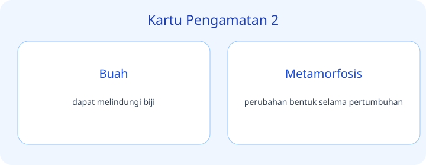
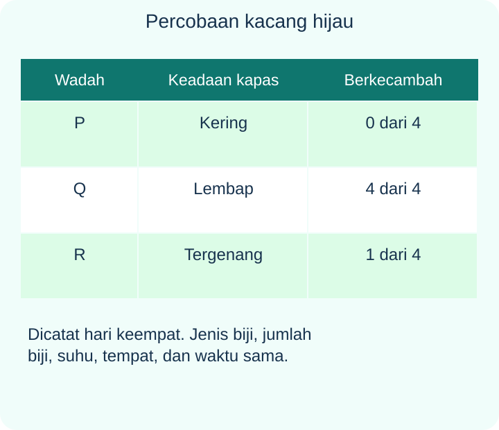
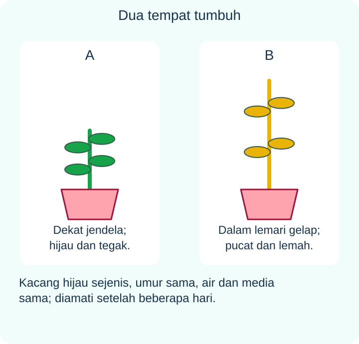
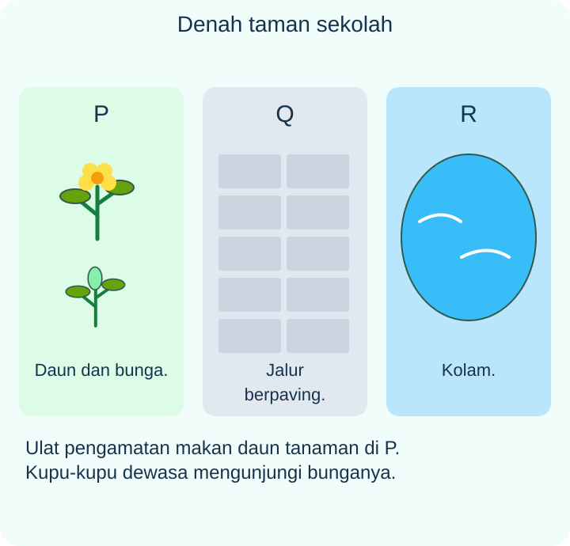
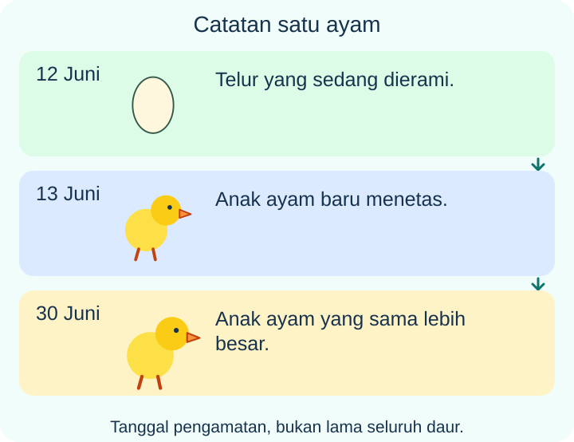

# IPAS Kelas 3 — Bab 4: Siklus Hidup yang Menakjubkan — 20 Soal Bergambar

## Soal 51 — K03-IPAS-B04-M01-051

**Pertanyaan:** Berdasarkan kartu pengamatan, pernyataan yang tepat tentang **Daun** adalah ...

**Pilihan jawaban:**
- tempat utama pembuatan makanan tumbuhan
- perubahan bentuk selama pertumbuhan
- dibutuhkan tumbuhan untuk fotosintesis
- membantu kelangsungan makhluk hidup

**Kunci Jawaban:** tempat utama pembuatan makanan tumbuhan

**Pembahasan:** Daun: tempat utama pembuatan makanan tumbuhan.

---

## Soal 52 — K03-IPAS-B04-M01-052

**Pertanyaan:** Berdasarkan kartu pengamatan, pernyataan yang tepat tentang **Bunga** adalah ...

**Pilihan jawaban:**
- tahapan hidup makhluk hidup
- berperan dalam perkembangbiakan banyak tumbuhan
- dibutuhkan hewan untuk tumbuh
- Pilih tiga hal yang kamu temukan hari ini

**Kunci Jawaban:** berperan dalam perkembangbiakan banyak tumbuhan

**Pembahasan:** Bunga: berperan dalam perkembangbiakan banyak tumbuhan.

---

## Soal 53 — K03-IPAS-B04-M01-053

**Pertanyaan:** Berdasarkan kartu pengamatan, pernyataan yang tepat tentang **Buah** adalah ...

**Pilihan jawaban:**
- dibutuhkan untuk perkecambahan
- tempat makhluk hidup tinggal
- dapat melindungi biji
- tahap awal hidup ayam

**Kunci Jawaban:** dapat melindungi biji

**Pembahasan:** Buah: dapat melindungi biji.

---

## Soal 54 — K03-IPAS-B04-M01-054

**Pertanyaan:** Berdasarkan kartu pengamatan, pernyataan yang tepat tentang **Metamorfosis** adalah ...

**Pilihan jawaban:**
- dibutuhkan tumbuhan untuk fotosintesis
- membantu kelangsungan makhluk hidup
- tumbuh menjadi ayam dewasa
- perubahan bentuk selama pertumbuhan

**Kunci Jawaban:** perubahan bentuk selama pertumbuhan

**Pembahasan:** Metamorfosis: perubahan bentuk selama pertumbuhan.

---

## Soal 55 — K03-IPAS-B04-M01-055

**Pertanyaan:** Berdasarkan kartu pengamatan, pernyataan yang tepat tentang **Siklus hidup** adalah ...

**Pilihan jawaban:**
- tahapan hidup makhluk hidup
- dibutuhkan hewan untuk tumbuh
- Pilih tiga hal yang kamu temukan hari ini
- tahap larva kupu-kupu

**Kunci Jawaban:** tahapan hidup makhluk hidup

**Pembahasan:** Siklus hidup: tahapan hidup makhluk hidup.

---

## Soal 56 — K03-IPAS-B04-M01-056

**Pertanyaan:** Berdasarkan kartu pengamatan, pernyataan yang tepat tentang **Air** adalah ...

**Pilihan jawaban:**
- tempat makhluk hidup tinggal
- dibutuhkan untuk perkecambahan
- tahap awal hidup ayam
- tahap pupa kupu-kupu

**Kunci Jawaban:** dibutuhkan untuk perkecambahan

**Pembahasan:** Air: dibutuhkan untuk perkecambahan.

---

## Soal 57 — K03-IPAS-B04-M01-057

**Pertanyaan:** Berdasarkan kartu pengamatan, pernyataan yang tepat tentang **Cahaya** adalah ...

**Pilihan jawaban:**
- membantu kelangsungan makhluk hidup
- tumbuh menjadi ayam dewasa
- dibutuhkan tumbuhan untuk fotosintesis
- dapat berkembang biak

**Kunci Jawaban:** dibutuhkan tumbuhan untuk fotosintesis

**Pembahasan:** Cahaya: dibutuhkan tumbuhan untuk fotosintesis.

---

## Soal 58 — K03-IPAS-B04-M01-058

**Pertanyaan:** Berdasarkan kartu pengamatan, pernyataan yang tepat tentang **Makanan** adalah ...

**Pilihan jawaban:**
- Pilih tiga hal yang kamu temukan hari ini
- tahap larva kupu-kupu
- anak katak yang hidup di air
- dibutuhkan hewan untuk tumbuh

**Kunci Jawaban:** dibutuhkan hewan untuk tumbuh

**Pembahasan:** Makanan: dibutuhkan hewan untuk tumbuh.

---

## Soal 59 — K03-IPAS-B04-M01-059

**Pertanyaan:** Berdasarkan kartu pengamatan, pernyataan yang tepat tentang **Habitat** adalah ...

**Pilihan jawaban:**
- tempat makhluk hidup tinggal
- tahap awal hidup ayam
- tahap pupa kupu-kupu
- dapat hidup di darat dan air

**Kunci Jawaban:** tempat makhluk hidup tinggal

**Pembahasan:** Habitat: tempat makhluk hidup tinggal.

---

## Soal 60 — K03-IPAS-B04-M01-060

**Pertanyaan:** Berdasarkan kartu pengamatan, pernyataan yang tepat tentang **Pelestarian** adalah ...

**Pilihan jawaban:**
- tumbuh menjadi ayam dewasa
- membantu kelangsungan makhluk hidup
- dapat berkembang biak
- dapat tumbuh menjadi tumbuhan

**Kunci Jawaban:** membantu kelangsungan makhluk hidup

**Pembahasan:** Pelestarian: membantu kelangsungan makhluk hidup.

---

## Soal 61 — K03-IPAS-B04-M01-061

**Pertanyaan:** Berdasarkan kartu pengamatan, pernyataan yang tepat tentang **Tantangan** adalah ...

**Pilihan jawaban:**
- tahap larva kupu-kupu
- anak katak yang hidup di air
- Pilih tiga hal yang kamu temukan hari ini
- tumbuhan muda dari biji

**Kunci Jawaban:** Pilih tiga hal yang kamu temukan hari ini

**Pembahasan:** Tantangan: Pilih tiga hal yang kamu temukan hari ini.

---

## Soal 62 — K03-IPAS-B04-M01-062

**Pertanyaan:** Berdasarkan kartu pengamatan, pernyataan yang tepat tentang **Telur** adalah ...

**Pilihan jawaban:**
- tahap pupa kupu-kupu
- dapat hidup di darat dan air
- tempat utama pembuatan makanan tumbuhan
- tahap awal hidup ayam

**Kunci Jawaban:** tahap awal hidup ayam

**Pembahasan:** Telur: tahap awal hidup ayam.

---

## Soal 63 — K03-IPAS-B04-M01-063

**Pertanyaan:** Berdasarkan kartu pengamatan, pernyataan yang tepat tentang **Anak ayam** adalah ...

**Pilihan jawaban:**
- tumbuh menjadi ayam dewasa
- dapat berkembang biak
- dapat tumbuh menjadi tumbuhan
- berperan dalam perkembangbiakan banyak tumbuhan

**Kunci Jawaban:** tumbuh menjadi ayam dewasa

**Pembahasan:** Anak ayam: tumbuh menjadi ayam dewasa.

---

## Soal 64 — K03-IPAS-B04-M01-064

**Pertanyaan:** Berdasarkan kartu pengamatan, pernyataan yang tepat tentang **Ulat** adalah ...

**Pilihan jawaban:**
- anak katak yang hidup di air
- tahap larva kupu-kupu
- tumbuhan muda dari biji
- dapat melindungi biji

**Kunci Jawaban:** tahap larva kupu-kupu

**Pembahasan:** Ulat: tahap larva kupu-kupu.

---

## Soal 65 — K03-IPAS-B04-M01-065

**Pertanyaan:** Berdasarkan kartu pengamatan, pernyataan yang tepat tentang **Kepompong** adalah ...

**Pilihan jawaban:**
- dapat hidup di darat dan air
- tempat utama pembuatan makanan tumbuhan
- tahap pupa kupu-kupu
- perubahan bentuk selama pertumbuhan

**Kunci Jawaban:** tahap pupa kupu-kupu

**Pembahasan:** Kepompong: tahap pupa kupu-kupu.

---

## Soal 66 — K03-IPAS-B04-M01-066

**Pertanyaan:** Berdasarkan kartu pengamatan, pernyataan yang tepat tentang **Kupu-kupu dewasa** adalah ...

**Pilihan jawaban:**
- dapat tumbuh menjadi tumbuhan
- berperan dalam perkembangbiakan banyak tumbuhan
- tahapan hidup makhluk hidup
- dapat berkembang biak

**Kunci Jawaban:** dapat berkembang biak

**Pembahasan:** Kupu-kupu dewasa: dapat berkembang biak.

---

## Soal 67 — K03-IPAS-B04-M01-067

**Pertanyaan:** Berdasarkan kartu pengamatan, pernyataan yang tepat tentang **Berudu** adalah ...

**Pilihan jawaban:**
- anak katak yang hidup di air
- tumbuhan muda dari biji
- dapat melindungi biji
- dibutuhkan untuk perkecambahan

**Kunci Jawaban:** anak katak yang hidup di air

**Pembahasan:** Berudu: anak katak yang hidup di air.

---

## Soal 68 — K03-IPAS-B04-M01-068

**Pertanyaan:** Berdasarkan kartu pengamatan, pernyataan yang tepat tentang **Katak dewasa** adalah ...

**Pilihan jawaban:**
- tempat utama pembuatan makanan tumbuhan
- dapat hidup di darat dan air
- perubahan bentuk selama pertumbuhan
- dibutuhkan tumbuhan untuk fotosintesis

**Kunci Jawaban:** dapat hidup di darat dan air

**Pembahasan:** Katak dewasa: dapat hidup di darat dan air.

---

## Soal 69 — K03-IPAS-B04-M01-069

**Pertanyaan:** Berdasarkan kartu pengamatan, pernyataan yang tepat tentang **Biji** adalah ...

**Pilihan jawaban:**
- berperan dalam perkembangbiakan banyak tumbuhan
- tahapan hidup makhluk hidup
- dapat tumbuh menjadi tumbuhan
- dibutuhkan hewan untuk tumbuh

**Kunci Jawaban:** dapat tumbuh menjadi tumbuhan

**Pembahasan:** Biji: dapat tumbuh menjadi tumbuhan.

---

## Soal 70 — K03-IPAS-B04-M01-070

**Pertanyaan:** Berdasarkan kartu pengamatan, pernyataan yang tepat tentang **Kecambah** adalah ...

**Pilihan jawaban:**
- dapat melindungi biji
- dibutuhkan untuk perkecambahan
- tempat makhluk hidup tinggal
- tumbuhan muda dari biji

**Kunci Jawaban:** tumbuhan muda dari biji

**Pembahasan:** Kecambah: tumbuhan muda dari biji.

---
