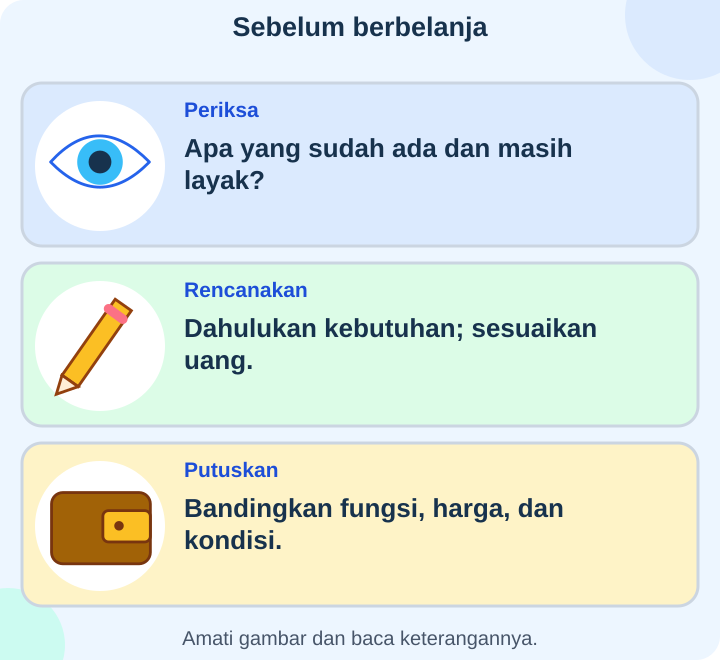
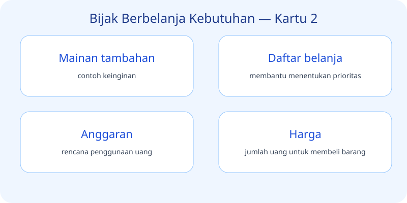

# IPAS Kelas 3 — Bab 5: Bijak Berbelanja Kebutuhan

## K03-IPAS-B05-MOD-01 — Yuk, Jadi Penyelidik!

Pernahkah kamu memperhatikan hal-hal kecil di sekitarmu? Dalam bab **Bijak Berbelanja Kebutuhan**, kita belajar dengan cara mengamati dan bertanya. Ayo mulai dari empat hal penting berikut.

### Kebutuhan
Kebutuhan berkaitan dengan hal berikut: **hal yang diperlukan untuk hidup**. Coba cari contohnya di rumah atau sekolah, lalu ceritakan dengan bahasamu sendiri.

### Keinginan
Keinginan berkaitan dengan hal berikut: **hal yang ingin dimiliki tetapi tidak selalu diperlukan**. Coba cari contohnya di rumah atau sekolah, lalu ceritakan dengan bahasamu sendiri.

### Makanan pokok
Makanan pokok berkaitan dengan hal berikut: **contoh kebutuhan sehari-hari**. Coba cari contohnya di rumah atau sekolah, lalu ceritakan dengan bahasamu sendiri.

### Air minum
Air minum berkaitan dengan hal berikut: **contoh kebutuhan dasar**. Coba cari contohnya di rumah atau sekolah, lalu ceritakan dengan bahasamu sendiri.

### Mainan tambahan
Mainan tambahan berkaitan dengan hal berikut: **contoh keinginan**. Coba cari contohnya di rumah atau sekolah, lalu ceritakan dengan bahasamu sendiri.

### Daftar belanja
Daftar belanja berkaitan dengan hal berikut: **membantu menentukan prioritas**. Coba cari contohnya di rumah atau sekolah, lalu ceritakan dengan bahasamu sendiri.

### Anggaran
Anggaran berkaitan dengan hal berikut: **rencana penggunaan uang**. Coba cari contohnya di rumah atau sekolah, lalu ceritakan dengan bahasamu sendiri.

### Harga
Harga berkaitan dengan hal berikut: **jumlah uang untuk membeli barang**. Coba cari contohnya di rumah atau sekolah, lalu ceritakan dengan bahasamu sendiri.

### Kembalian
Kembalian berkaitan dengan hal berikut: **uang yang diterima setelah pembayaran berlebih**. Coba cari contohnya di rumah atau sekolah, lalu ceritakan dengan bahasamu sendiri.

### Menabung
Menabung berkaitan dengan hal berikut: **menyisihkan uang untuk nanti**. Coba cari contohnya di rumah atau sekolah, lalu ceritakan dengan bahasamu sendiri.

**Prioritas:** mendahulukan yang paling penting.

**Membandingkan harga:** membantu memilih sesuai kebutuhan.

**Tanggal kedaluwarsa:** perlu diperiksa pada produk tertentu.

**Struk:** bukti transaksi pembelian.

**Pedagang:** orang yang menjual barang.

**Pembeli:** orang yang membeli barang.

**Pasar:** tempat kegiatan jual beli.

**Uang:** alat pembayaran.

**Hemat:** menggunakan uang dengan bijak.

**Membawa tas belanja:** dapat mengurangi kantong sekali pakai.

**Tantangan:** Pilih tiga hal yang kamu temukan hari ini. Jelaskan apa yang kamu lihat, mengapa penting, dan bagaimana menerapkannya dengan aman.

## K03-IPAS-B05-MOD-02 — Cerita dari Sekitar Kita

Bayangkan kamu sedang melakukan perjalanan kecil bersama teman. Setiap benda, kegiatan, atau peristiwa yang ditemui bisa menjadi bahan belajar **Bijak Berbelanja Kebutuhan**. Mulailah dengan bertanya: “Apa yang terjadi? Apa manfaatnya? Bagaimana cara menjaganya?”

### Ketika menemukan prioritas
Ingat bahwa **prioritas** mendahulukan yang paling penting. Coba jelaskan kepada teman dengan contoh yang kamu kenal.

### Ketika menemukan membandingkan harga
Ingat bahwa **membandingkan harga** membantu memilih sesuai kebutuhan. Coba jelaskan kepada teman dengan contoh yang kamu kenal.

### Ketika menemukan tanggal kedaluwarsa
Ingat bahwa **tanggal kedaluwarsa** perlu diperiksa pada produk tertentu. Coba jelaskan kepada teman dengan contoh yang kamu kenal.

### Ketika menemukan struk
Ingat bahwa **struk** bukti transaksi pembelian. Coba jelaskan kepada teman dengan contoh yang kamu kenal.

### Ketika menemukan pedagang
Ingat bahwa **pedagang** orang yang menjual barang. Coba jelaskan kepada teman dengan contoh yang kamu kenal.

### Ketika menemukan pembeli
Ingat bahwa **pembeli** orang yang membeli barang. Coba jelaskan kepada teman dengan contoh yang kamu kenal.

### Ketika menemukan pasar
Ingat bahwa **pasar** tempat kegiatan jual beli. Coba jelaskan kepada teman dengan contoh yang kamu kenal.

### Ketika menemukan uang
Ingat bahwa **uang** alat pembayaran. Coba jelaskan kepada teman dengan contoh yang kamu kenal.

### Ketika menemukan hemat
Ingat bahwa **hemat** menggunakan uang dengan bijak. Coba jelaskan kepada teman dengan contoh yang kamu kenal.

### Ketika menemukan membawa tas belanja
Ingat bahwa **membawa tas belanja** dapat mengurangi kantong sekali pakai. Coba jelaskan kepada teman dengan contoh yang kamu kenal.

**Kebutuhan:** hal yang diperlukan untuk hidup.

**Keinginan:** hal yang ingin dimiliki tetapi tidak selalu diperlukan.

**Makanan pokok:** contoh kebutuhan sehari-hari.

**Air minum:** contoh kebutuhan dasar.

**Mainan tambahan:** contoh keinginan.

**Daftar belanja:** membantu menentukan prioritas.

**Anggaran:** rencana penggunaan uang.

**Harga:** jumlah uang untuk membeli barang.

**Kembalian:** uang yang diterima setelah pembayaran berlebih.

**Menabung:** menyisihkan uang untuk nanti.

**Coba ceritakan:** Pilih lima istilah dari gambar. Beri contoh dari pengalamanmu dan jelaskan mengapa informasi itu berguna.
