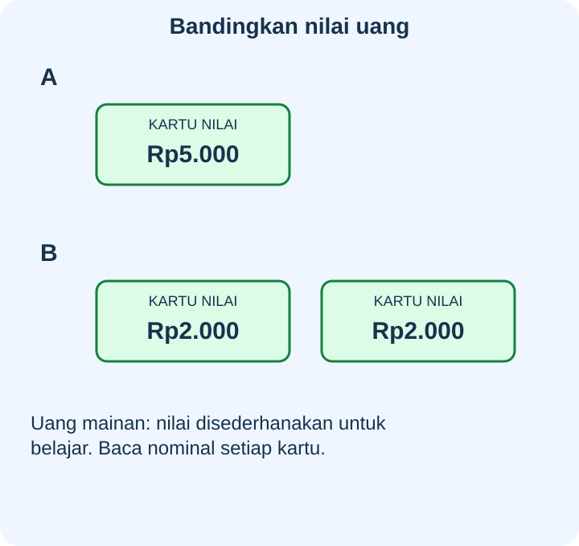
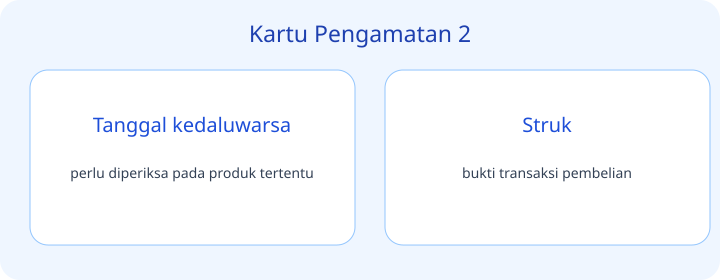
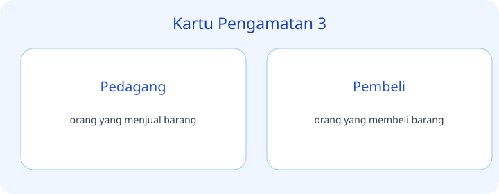
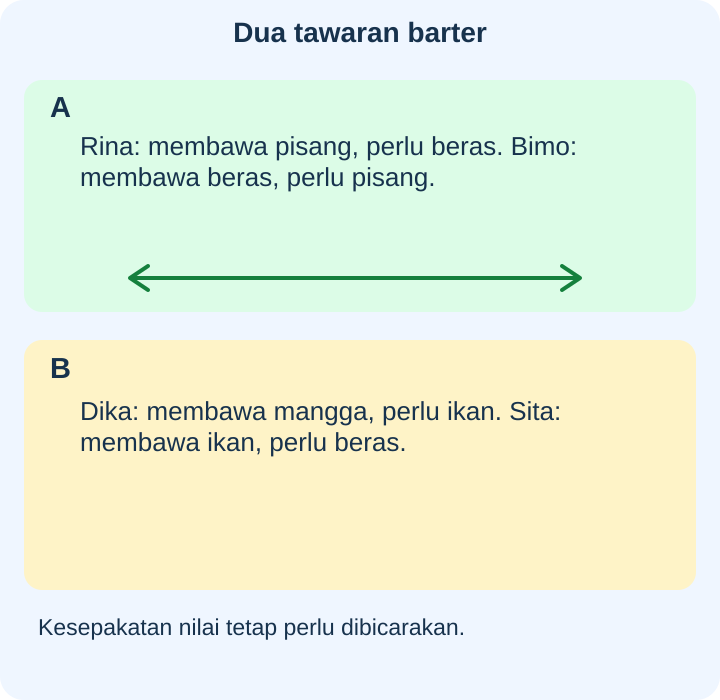
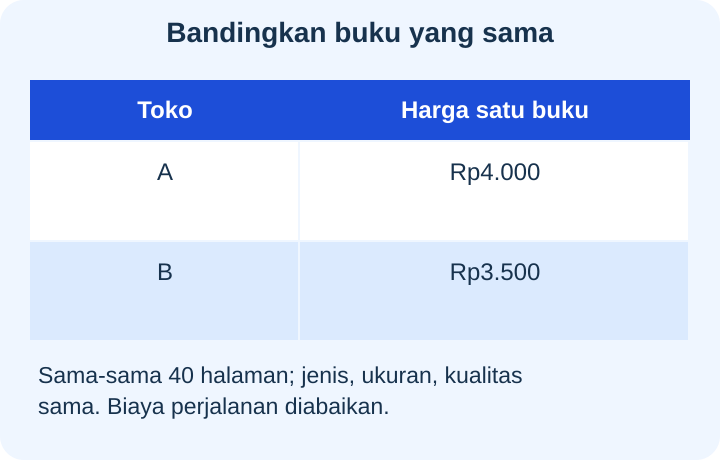
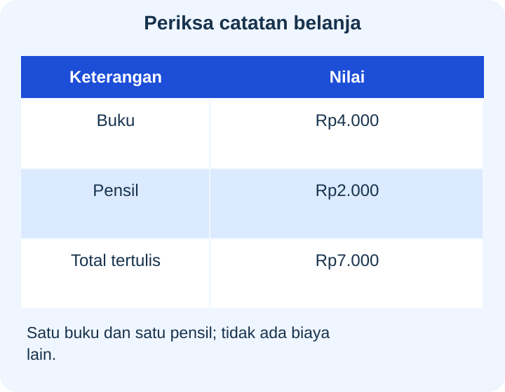
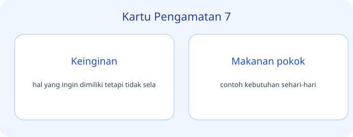
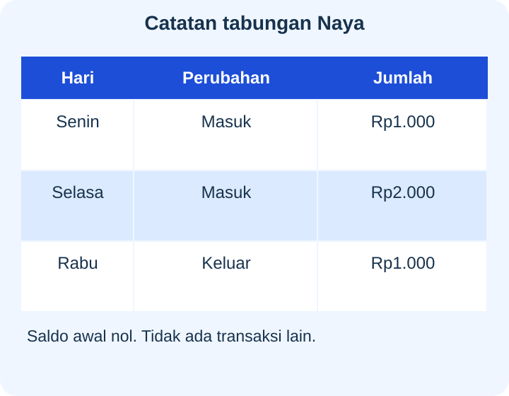
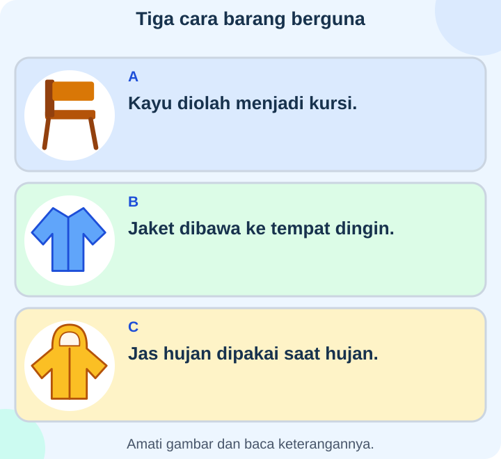
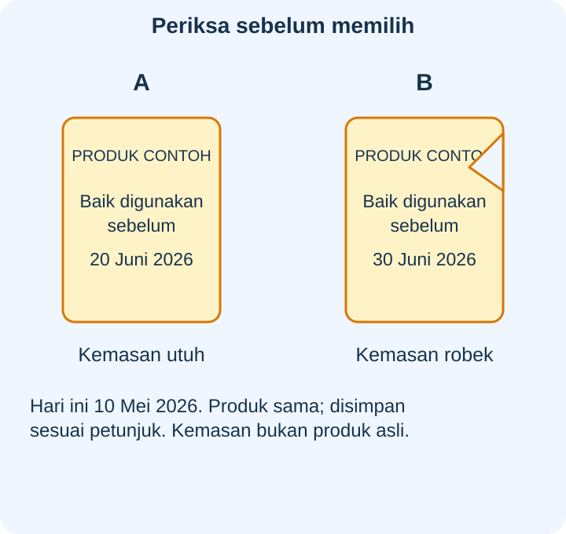

# IPAS Kelas 3 — Bab 5: Bijak Berbelanja Kebutuhan — 20 Soal Bergambar

## Soal 51 — K03-IPAS-B05-M01-051

**Pertanyaan:** Kelompok mana bernilai lebih besar?

**Pilihan jawaban:**
- B
- Keduanya sama
- A
- Belum dapat dibandingkan karena jumlah kartu berbeda

**Kunci Jawaban:** A

**Pembahasan:** A bernilai $5.000$ rupiah; B bernilai $2.000+2.000=4.000$ rupiah. Nilai dibaca dari nominal, bukan jumlah kartu.

---

## Soal 52 — K03-IPAS-B05-M01-052

**Pertanyaan:** Berapa nilai yang masih perlu ditambahkan ke B agar sama dengan A?

**Pilihan jawaban:**
- $\text{Rp}2.000$
- $\text{Rp}4.000$
- $\text{Rp}5.000$
- $\text{Rp}1.000$

**Kunci Jawaban:** $\text{Rp}1.000$

**Pembahasan:** Selisih nilai A dan B ialah $5.000-4.000=1.000$ rupiah.

---

## Soal 53 — K03-IPAS-B05-M01-053

**Pertanyaan:** Berapa biaya membeli satu roti dan satu air minum pada daftar?

**Pilihan jawaban:**
- $\text{Rp}5.000$
- $\text{Rp}3.000$
- $\text{Rp}6.000$
- $\text{Rp}7.000$

**Kunci Jawaban:** $\text{Rp}5.000$

**Pembahasan:** Daftar menunjukkan roti $3.000$ rupiah dan air $2.000$ rupiah; total $3.000+2.000=5.000$ rupiah.

---

## Soal 54 — K03-IPAS-B05-M01-054

**Pertanyaan:** Jika uangmu $\text{Rp}5.000$ dan membeli satu buah, kembalian yang sesuai ialah ...

**Pilihan jawaban:**
- $\text{Rp}2.000$
- $\text{Rp}1.000$
- $\text{Rp}4.000$
- $\text{Rp}9.000$

**Kunci Jawaban:** $\text{Rp}1.000$

**Pembahasan:** Harga buah pada daftar $4.000$ rupiah sehingga kembalian $5.000-4.000=1.000$ rupiah.

---

## Soal 55 — K03-IPAS-B05-M01-055

**Pertanyaan:** Bagian rencana yang mendapat alokasi paling kecil ialah ...

**Pilihan jawaban:**
- Makan
- Alat tulis
- Uang yang belum ditentukan
- Tabungan

**Kunci Jawaban:** Uang yang belum ditentukan

**Pembahasan:** Legenda menunjukkan bagian belum ditentukan $1.000$ rupiah, lebih kecil dari tiga bagian lain.

---

## Soal 56 — K03-IPAS-B05-M01-056

**Pertanyaan:** Jika bagian yang belum ditentukan ikut ditabung tanpa mengubah belanja lain, jumlah untuk tabungan menjadi ...

**Pilihan jawaban:**
- $\text{Rp}1.000$
- $\text{Rp}2.000$
- $\text{Rp}7.000$
- $\text{Rp}3.000$

**Kunci Jawaban:** $\text{Rp}3.000$

**Pembahasan:** Tabungan semula $2.000$ rupiah ditambah sisa $1.000$ rupiah menjadi $3.000$ rupiah.

---

## Soal 57 — K03-IPAS-B05-M01-057

**Pertanyaan:** Pasangan mana sudah saling membutuhkan barang yang dibawa, sebelum menyepakati banyaknya?

**Pilihan jawaban:**
- Pasangan A
- Pasangan B
- Keduanya belum saling membutuhkan
- Tidak ada informasi kebutuhan kedua pasangan

**Kunci Jawaban:** Pasangan A

**Pembahasan:** Rina memerlukan beras Bimo dan Bimo memerlukan pisang Rina; kebutuhan mereka cocok, tetapi banyaknya barang masih perlu disepakati.

---

## Soal 58 — K03-IPAS-B05-M01-058

**Pertanyaan:** Mengapa pasangan B belum cocok untuk barter langsung?

**Pilihan jawaban:**
- Dika tidak membutuhkan ikan
- Sita membutuhkan beras, bukan mangga Dika
- Sita tidak membawa barang untuk ditukar
- Kedua orang sudah saling membutuhkan barang masing-masing

**Kunci Jawaban:** Sita membutuhkan beras, bukan mangga Dika

**Pembahasan:** Dika memerlukan ikan Sita, tetapi barang Dika tidak sesuai kebutuhan Sita, sehingga kecocokan baru satu arah.

---

## Soal 59 — K03-IPAS-B05-M01-059

**Pertanyaan:** Berdasarkan data itu, toko mana memerlukan biaya beli satu buku lebih kecil?

**Pilihan jawaban:**
- A
- Keduanya sama
- B
- Tidak dapat dibandingkan meski barangnya sama

**Kunci Jawaban:** B

**Pembahasan:** Harga buku setara di B lebih rendah daripada di A, dengan biaya perjalanan diabaikan sesuai catatan.

---

## Soal 60 — K03-IPAS-B05-M01-060

**Pertanyaan:** Selisih harga satu buku di dua toko itu ialah ...

**Pilihan jawaban:**
- $\text{Rp}1.500$
- $\text{Rp}3.500$
- $\text{Rp}7.500$
- $\text{Rp}500$

**Kunci Jawaban:** $\text{Rp}500$

**Pembahasan:** Selisihnya $4.000-3.500=500$ rupiah; menjumlahkan kedua harga tidak menghasilkan selisih.

---

## Soal 61 — K03-IPAS-B05-M01-061

**Pertanyaan:** Bagian mana perlu diperbaiki pada catatan?

**Pilihan jawaban:**
- Total seharusnya $\text{Rp}6.000$
- Harga buku seharusnya dihapus
- Jumlah barang harus dianggap tiga
- Total $\text{Rp}7.000$ sudah sesuai

**Kunci Jawaban:** Total seharusnya $\text{Rp}6.000$

**Pembahasan:** Dua harga yang tertera berjumlah $4.000+2.000=6.000$ rupiah, bukan total yang ditulis.

---

## Soal 62 — K03-IPAS-B05-M01-062

**Pertanyaan:** Jika menemukan catatan seperti ini saat berbelanja, tindakan yang membantu ialah ...

**Pilihan jawaban:**
- Menganggap angka total selalu benar meski berbeda
- Menanyakan perhitungan total kepada penjual dengan sopan
- Langsung menuduh penjual sengaja menipu
- Mengambil barang tambahan agar total terasa sesuai

**Kunci Jawaban:** Menanyakan perhitungan total kepada penjual dengan sopan

**Pembahasan:** Perbedaan pada total perlu diperiksa bersama; catatan tidak membuktikan niat orang yang menulisnya.

---

## Soal 63 — K03-IPAS-B05-M01-063

**Pertanyaan:** Barang berlabel mana paling perlu diganti untuk memenuhi kebutuhan belajar besok?

**Pilihan jawaban:**
- B
- C
- A
- B dan C lebih mendesak daripada A

**Kunci Jawaban:** A

**Pembahasan:** Pensil A sudah habis dan diperlukan besok, sedangkan B serta C masih berfungsi; konteks kebutuhan lain sudah terpenuhi.

---

## Soal 64 — K03-IPAS-B05-M01-064

**Pertanyaan:** Mengapa pembelian pengganti B dan C dapat ditunda pada kondisi gambar?

**Pilihan jawaban:**
- Keduanya tidak pernah berguna bagi siapa pun
- Semua tas dan kotak makan selalu merupakan barang mewah
- Keduanya pasti rusak walau catatan menyebut layak
- Barangnya masih berfungsi dan alasan penggantian berupa tampilan

**Kunci Jawaban:** Barangnya masih berfungsi dan alasan penggantian berupa tampilan

**Pembahasan:** Keadaan dan alasan pada kartu menunjukkan keinginan mengganti tampilan, bukan hilangnya fungsi.

---

## Soal 65 — K03-IPAS-B05-M01-065

**Pertanyaan:** Berapa saldo setelah catatan Rabu?

**Pilihan jawaban:**
- $\text{Rp}2.000$
- $\text{Rp}1.000$
- $\text{Rp}3.000$
- $\text{Rp}4.000$

**Kunci Jawaban:** $\text{Rp}2.000$

**Pembahasan:** Dua setoran dikurangi penarikan: $1.000+2.000-1.000=2.000$ rupiah.

---

## Soal 66 — K03-IPAS-B05-M01-066

**Pertanyaan:** Catatan mana mengurangi saldo tabungan?

**Pilihan jawaban:**
- Senin
- Rabu
- Selasa
- Senin dan Selasa

**Kunci Jawaban:** Rabu

**Pembahasan:** Rabu bertanda keluar; Senin dan Selasa bertanda masuk sehingga menambah saldo.

---

## Soal 67 — K03-IPAS-B05-M01-067

**Pertanyaan:** Contoh yang menunjukkan nilai guna bentuk berlabel ...

**Pilihan jawaban:**
- B
- C
- A
- B dan C

**Kunci Jawaban:** A

**Pembahasan:** A menunjukkan bahan kayu diubah menjadi bentuk kursi; B menekankan tempat, C waktu.

---

## Soal 68 — K03-IPAS-B05-M01-068

**Pertanyaan:** Pasangan contoh nilai guna tempat lalu waktu pada gambar ialah ...

**Pilihan jawaban:**
- A lalu B
- C lalu A
- A lalu C
- B lalu C

**Kunci Jawaban:** B lalu C

**Pembahasan:** Jaket B lebih berguna di tempat dingin, sedangkan jas hujan C berguna pada waktu hujan.

---

## Soal 69 — K03-IPAS-B05-M01-069

**Pertanyaan:** Kemasan mana perlu dihindari karena kerusakan meskipun tanggalnya belum terlewati?

**Pilihan jawaban:**
- B
- A
- Keduanya pasti sudah melewati tanggal
- Tidak perlu memeriksa kemasan

**Kunci Jawaban:** B

**Pembahasan:** B robek, sehingga perlindungan isi terganggu meskipun tanggal tercetak belum lewat.

---

## Soal 70 — K03-IPAS-B05-M01-070

**Pertanyaan:** Kesimpulan yang paling hati-hati tentang kemasan A ialah ...

**Pilihan jawaban:**
- Gambar memastikan isi selalu aman apa pun penyimpanannya
- Tanggal belum lewat dan kemasan tampak utuh; tetap periksa petunjuk serta kondisi produk
- Produk pasti sudah kedaluwarsa pada hari pengamatan
- Kemasan utuh membolehkan mengabaikan petunjuk penyimpanan

**Kunci Jawaban:** Tanggal belum lewat dan kemasan tampak utuh; tetap periksa petunjuk serta kondisi produk

**Pembahasan:** Data A memenuhi dua hal yang diamati, tetapi tidak menjamin keamanan tanpa memperhatikan penyimpanan serta keadaan produk.

---
