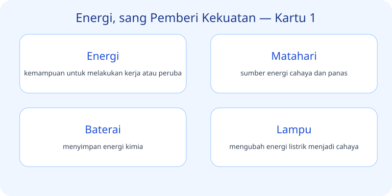
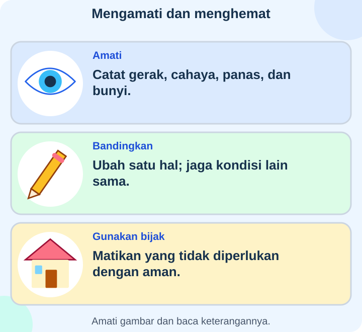

# IPAS Kelas 3 — Bab 6: Energi, sang Pemberi Kekuatan

## K03-IPAS-B06-MOD-01 — Yuk, Jadi Penyelidik!

Pernahkah kamu memperhatikan hal-hal kecil di sekitarmu? Dalam bab **Energi, sang Pemberi Kekuatan**, kita belajar dengan cara mengamati dan bertanya. Ayo mulai dari empat hal penting berikut.

### Energi
Energi berkaitan dengan hal berikut: **kemampuan untuk melakukan kerja atau perubahan**. Coba cari contohnya di rumah atau sekolah, lalu ceritakan dengan bahasamu sendiri.

### Matahari
Matahari berkaitan dengan hal berikut: **sumber energi cahaya dan panas**. Coba cari contohnya di rumah atau sekolah, lalu ceritakan dengan bahasamu sendiri.

### Baterai
Baterai berkaitan dengan hal berikut: **menyimpan energi kimia**. Coba cari contohnya di rumah atau sekolah, lalu ceritakan dengan bahasamu sendiri.

### Lampu
Lampu berkaitan dengan hal berikut: **mengubah energi listrik menjadi cahaya**. Coba cari contohnya di rumah atau sekolah, lalu ceritakan dengan bahasamu sendiri.

### Kipas angin
Kipas angin berkaitan dengan hal berikut: **mengubah energi listrik menjadi gerak**. Coba cari contohnya di rumah atau sekolah, lalu ceritakan dengan bahasamu sendiri.

### Setrika
Setrika berkaitan dengan hal berikut: **mengubah energi listrik menjadi panas**. Coba cari contohnya di rumah atau sekolah, lalu ceritakan dengan bahasamu sendiri.

### Makanan
Makanan berkaitan dengan hal berikut: **sumber energi bagi tubuh**. Coba cari contohnya di rumah atau sekolah, lalu ceritakan dengan bahasamu sendiri.

### Angin
Angin berkaitan dengan hal berikut: **dapat menggerakkan kincir**. Coba cari contohnya di rumah atau sekolah, lalu ceritakan dengan bahasamu sendiri.

### Air mengalir
Air mengalir berkaitan dengan hal berikut: **dapat menggerakkan turbin**. Coba cari contohnya di rumah atau sekolah, lalu ceritakan dengan bahasamu sendiri.

### Bunyi
Bunyi berkaitan dengan hal berikut: **dihasilkan benda bergetar**. Coba cari contohnya di rumah atau sekolah, lalu ceritakan dengan bahasamu sendiri.

**Cahaya:** membantu kita melihat.

**Panas:** dapat mengubah suhu benda.

**Panel surya:** mengubah cahaya matahari menjadi listrik.

**Hemat energi:** mengurangi penggunaan yang tidak perlu.

**Mematikan lampu:** contoh menghemat listrik.

**Mengayuh sepeda:** menggunakan energi dari tubuh.

**Kompor:** menghasilkan panas untuk memasak.

**Energi gerak:** dimiliki benda yang bergerak.

**Energi listrik:** menghidupkan banyak alat.

**Perubahan energi:** peralihan dari satu bentuk ke bentuk lain.

**Tantangan:** Pilih tiga hal yang kamu temukan hari ini. Jelaskan apa yang kamu lihat, mengapa penting, dan bagaimana menerapkannya dengan aman.

## K03-IPAS-B06-MOD-02 — Cerita dari Sekitar Kita

Bayangkan kamu sedang melakukan perjalanan kecil bersama teman. Setiap benda, kegiatan, atau peristiwa yang ditemui bisa menjadi bahan belajar **Energi, sang Pemberi Kekuatan**. Mulailah dengan bertanya: “Apa yang terjadi? Apa manfaatnya? Bagaimana cara menjaganya?”

### Ketika menemukan cahaya
Ingat bahwa **cahaya** membantu kita melihat. Coba jelaskan kepada teman dengan contoh yang kamu kenal.

### Ketika menemukan panas
Ingat bahwa **panas** dapat mengubah suhu benda. Coba jelaskan kepada teman dengan contoh yang kamu kenal.

### Ketika menemukan panel surya
Ingat bahwa **panel surya** mengubah cahaya matahari menjadi listrik. Coba jelaskan kepada teman dengan contoh yang kamu kenal.

### Ketika menemukan hemat energi
Ingat bahwa **hemat energi** mengurangi penggunaan yang tidak perlu. Coba jelaskan kepada teman dengan contoh yang kamu kenal.

### Ketika menemukan mematikan lampu
Ingat bahwa **mematikan lampu** contoh menghemat listrik. Coba jelaskan kepada teman dengan contoh yang kamu kenal.

### Ketika menemukan mengayuh sepeda
Ingat bahwa **mengayuh sepeda** menggunakan energi dari tubuh. Coba jelaskan kepada teman dengan contoh yang kamu kenal.

### Ketika menemukan kompor
Ingat bahwa **kompor** menghasilkan panas untuk memasak. Coba jelaskan kepada teman dengan contoh yang kamu kenal.

### Ketika menemukan energi gerak
Ingat bahwa **energi gerak** dimiliki benda yang bergerak. Coba jelaskan kepada teman dengan contoh yang kamu kenal.

### Ketika menemukan energi listrik
Ingat bahwa **energi listrik** menghidupkan banyak alat. Coba jelaskan kepada teman dengan contoh yang kamu kenal.

### Ketika menemukan perubahan energi
Ingat bahwa **perubahan energi** peralihan dari satu bentuk ke bentuk lain. Coba jelaskan kepada teman dengan contoh yang kamu kenal.

**Energi:** kemampuan untuk melakukan kerja atau perubahan.

**Matahari:** sumber energi cahaya dan panas.

**Baterai:** menyimpan energi kimia.

**Lampu:** mengubah energi listrik menjadi cahaya.

**Kipas angin:** mengubah energi listrik menjadi gerak.

**Setrika:** mengubah energi listrik menjadi panas.

**Makanan:** sumber energi bagi tubuh.

**Angin:** dapat menggerakkan kincir.

**Air mengalir:** dapat menggerakkan turbin.

**Bunyi:** dihasilkan benda bergetar.

**Coba ceritakan:** Pilih lima istilah dari gambar. Beri contoh dari pengalamanmu dan jelaskan mengapa informasi itu berguna.
