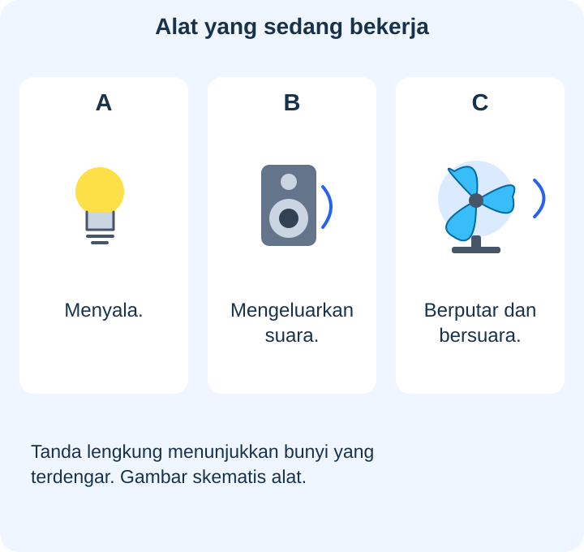
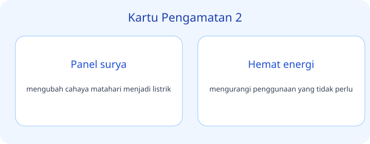
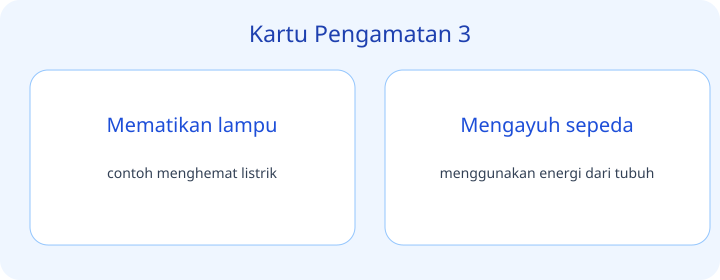
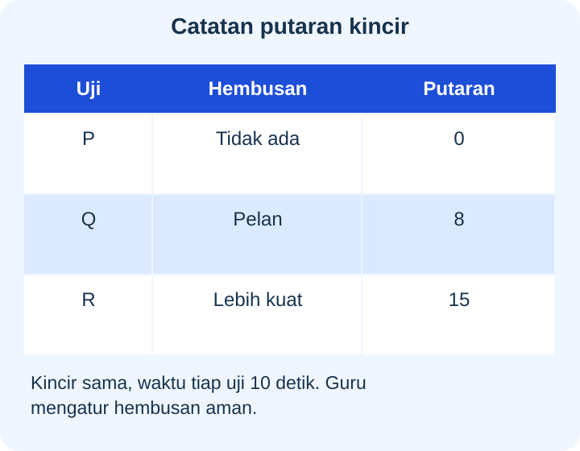
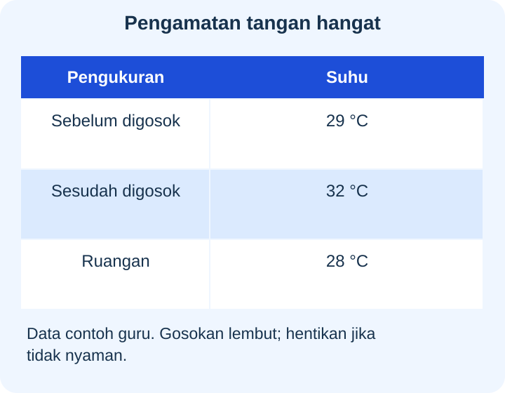
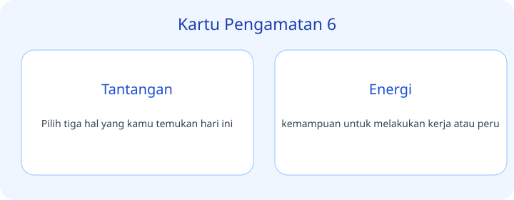
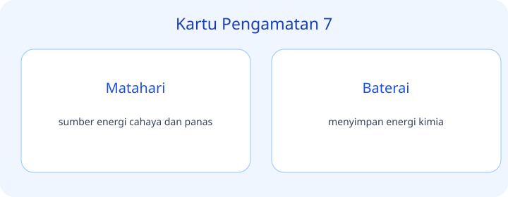
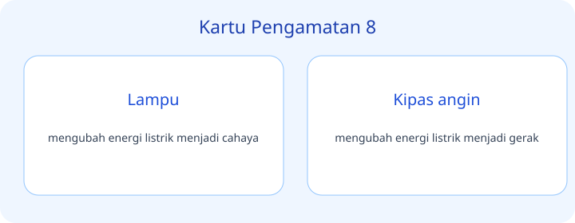
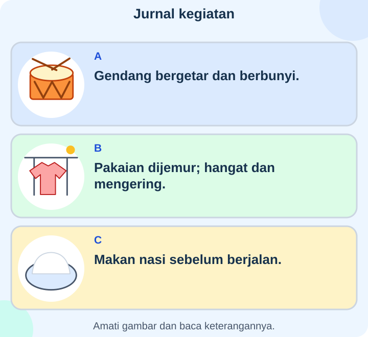
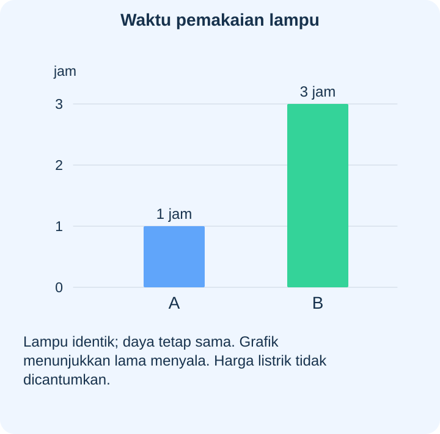

# IPAS Kelas 3 — Bab 6: Energi, sang Pemberi Kekuatan — 20 Soal Bergambar

## Soal 51 — K03-IPAS-B06-M01-051

**Pertanyaan:** Alat berlabel mana terutama digunakan untuk mengeluarkan suara?

**Pilihan jawaban:**
- A
- C
- B
- A dan C saja

**Kunci Jawaban:** B

**Pembahasan:** B memperlihatkan pengeras suara; A merupakan lampu, C kipas. Bunyi pada kipas adalah keluaran tambahan, bukan fungsi utamanya.

---

## Soal 52 — K03-IPAS-B06-M01-052

**Pertanyaan:** Pada C, dua bentuk energi yang ditunjukkan keterangannya ialah ...

**Pilihan jawaban:**
- Hanya kimia dan cahaya
- Hanya panas dan kimia
- Hanya cahaya dan gravitasi
- Gerak dan bunyi

**Kunci Jawaban:** Gerak dan bunyi

**Pembahasan:** Keterangan C menyebut putaran dan suara; keduanya menjadi bukti gerak dan bunyi pada alat yang sama.

---

## Soal 53 — K03-IPAS-B06-M01-053

**Pertanyaan:** Bagian awal berlabel mana menyimpan energi kimia untuk senter?

**Pilihan jawaban:**
- A
- B
- C
- B dan C

**Kunci Jawaban:** A

**Pembahasan:** A menunjuk baterai; sambungan B menyalurkan listrik dan lampu C menghasilkan cahaya serta panas.

---

## Soal 54 — K03-IPAS-B06-M01-054

**Pertanyaan:** Bentuk energi yang disalurkan melalui B menuju C ialah ...

**Pilihan jawaban:**
- Bensin
- Listrik
- Makanan
- Angin

**Kunci Jawaban:** Listrik

**Pembahasan:** Panah menunjukkan energi dari baterai menuju lampu melalui sambungan kabel; pada bagian itu energi disalurkan secara listrik.

---

## Soal 55 — K03-IPAS-B06-M01-055

**Pertanyaan:** Perubahan yang terjadi ketika panel ditutup pada uji itu ialah ...

**Pilihan jawaban:**
- Lampu makin terang
- Panel berubah menjadi baterai
- Lampu yang semula menyala menjadi padam
- Kedua keadaan menunjukkan lampu menyala

**Kunci Jawaban:** Lampu yang semula menyala menjadi padam

**Pembahasan:** A menunjukkan lampu menyala, sedangkan B padam setelah panel tertutup dari cahaya pada model tanpa baterai.

---

## Soal 56 — K03-IPAS-B06-M01-056

**Pertanyaan:** Kesimpulan yang sesuai dengan uji model ini ialah ...

**Pilihan jawaban:**
- Semua lampu hanya dapat menyala siang hari
- Semua alat listrik mempunyai panel surya
- Panel itu menghasilkan listrik sama banyak ketika tertutup
- Cahaya yang diterima panel memengaruhi nyala lampu

**Kunci Jawaban:** Cahaya yang diterima panel memengaruhi nyala lampu

**Pembahasan:** Data berasal dari model panel tanpa baterai; tidak menunjukkan cara kerja semua lampu atau semua alat listrik.

---

## Soal 57 — K03-IPAS-B06-M01-057

**Pertanyaan:** Uji mana menunjukkan putaran paling banyak dalam waktu pengamatan yang sama?

**Pilihan jawaban:**
- R
- P
- Q
- Semua sama

**Kunci Jawaban:** R

**Pembahasan:** R mencatat lima belas putaran, lebih banyak daripada delapan di Q dan nol di P.

---

## Soal 58 — K03-IPAS-B06-M01-058

**Pertanyaan:** Mengapa waktu tiap uji pada catatan dibuat sama?

**Pilihan jawaban:**
- Agar hembusan tidak perlu dicatat
- Agar jumlah putaran dapat dibandingkan secara lebih adil
- Agar ukuran kincir boleh diganti sesuka hati
- Agar hasil pasti sama pada semua uji

**Kunci Jawaban:** Agar jumlah putaran dapat dibandingkan secara lebih adil

**Pembahasan:** Jika lamanya berbeda, jumlah putaran bisa berubah karena waktu, bukan hanya hembusan; tabel menyamakan waktu untuk membantu perbandingan.

---

## Soal 59 — K03-IPAS-B06-M01-059

**Pertanyaan:** Pada catatan, kenaikan suhu tangan ialah ...

**Pilihan jawaban:**
- $1\ ^\circ\text{C}$
- $4\ ^\circ\text{C}$
- $3\ ^\circ\text{C}$
- $61\ ^\circ\text{C}$

**Kunci Jawaban:** $3\ ^\circ\text{C}$

**Pembahasan:** Suhu berubah dari $29\ ^\circ\text{C}$ menjadi $32\ ^\circ\text{C}$; kenaikannya $(32-29)\ ^\circ\text{C}=3\ ^\circ\text{C}$.

---

## Soal 60 — K03-IPAS-B06-M01-060

**Pertanyaan:** Perbandingan mana mendukung bahwa tangan menjadi lebih hangat setelah kegiatan?

**Pilihan jawaban:**
- Suhu ruangan naik pada catatan
- Suhu tangan sesudah lebih rendah
- Tidak ada perbedaan angka suhu tangan
- Suhu tangan sesudah lebih tinggi daripada sebelum

**Kunci Jawaban:** Suhu tangan sesudah lebih tinggi daripada sebelum

**Pembahasan:** Angka suhu tangan meningkat, sedangkan angka suhu ruangan yang dicatat tetap; data ini menunjukkan pemanasan pada tangan selama kegiatan.

---

## Soal 61 — K03-IPAS-B06-M01-061

**Pertanyaan:** Keadaan mana menunjukkan senar sedang bergetar dan terdengar bunyi?

**Pilihan jawaban:**
- Q
- P
- R
- P dan R

**Kunci Jawaban:** Q

**Pembahasan:** Pada Q, senar dipetik dan getaran tampak; P serta R tidak menunjukkan getaran yang menghasilkan bunyi teramati.

---

## Soal 62 — K03-IPAS-B06-M01-062

**Pertanyaan:** Hubungan yang didukung perubahan Q ke R ialah ...

**Pilihan jawaban:**
- Bunyi makin kuat meski getaran berhenti
- Ketika getaran dihentikan, bunyi senar juga berhenti
- Bunyi selalu ada walaupun senar diam
- Petikan tidak mempunyai hubungan dengan bunyi senar

**Kunci Jawaban:** Ketika getaran dihentikan, bunyi senar juga berhenti

**Pembahasan:** Q bergetar dan berbunyi, lalu R berhenti bergetar serta tidak berbunyi; pengamatan menghubungkan bunyi dengan getaran.

---

## Soal 63 — K03-IPAS-B06-M01-063

**Pertanyaan:** Bagian mana pada bagan menerima gerakan turbin lalu menghasilkan listrik?

**Pilihan jawaban:**
- A
- B
- C
- D

**Kunci Jawaban:** C

**Pembahasan:** C adalah generator yang terhubung setelah turbin B dan sebelum lampu D.

---

## Soal 64 — K03-IPAS-B06-M01-064

**Pertanyaan:** Urutan aliran energi sesuai panah ialah ...

**Pilihan jawaban:**
- Lampu → turbin → air → generator
- Generator → air → lampu → turbin
- Turbin → lampu → air → generator
- Air bergerak → turbin → generator → lampu

**Kunci Jawaban:** Air bergerak → turbin → generator → lampu

**Pembahasan:** Panah pada bagan bergerak berurutan A ke B ke C ke D; air menggerakkan turbin sebelum generator memasok lampu.

---

## Soal 65 — K03-IPAS-B06-M01-065

**Pertanyaan:** Alat mana dapat dimatikan sesuai keadaan pada gambar?

**Pilihan jawaban:**
- B dan C
- D saja
- B dan D
- C dan D

**Kunci Jawaban:** B dan C

**Pembahasan:** Lampu B tidak diperlukan karena cahaya cukup dan kipas C juga tidak diperlukan; kulkas D masih mempunyai fungsi penyimpanan.

---

## Soal 66 — K03-IPAS-B06-M01-066

**Pertanyaan:** Mengapa tidak tepat langsung mematikan D untuk menghemat pada keadaan ini?

**Pilihan jawaban:**
- Kulkas pada gambar tidak mempunyai kegunaan
- Makanan di dalamnya masih memerlukan pendinginan
- Semua alat menyala harus dipertahankan meski tidak diperlukan
- Cahaya jendela dapat menggantikan pendinginan makanan

**Kunci Jawaban:** Makanan di dalamnya masih memerlukan pendinginan

**Pembahasan:** D menyimpan makanan yang perlu tetap dingin; penghematan mempertimbangkan kebutuhan dan keamanan makanan.

---

## Soal 67 — K03-IPAS-B06-M01-067

**Pertanyaan:** Kegiatan yang menunjukkan manfaat panas Matahari berlabel ...

**Pilihan jawaban:**
- A
- C
- B
- A dan C

**Kunci Jawaban:** B

**Pembahasan:** B menyebut pakaian menghangat dan mengering ketika dijemur; A berfokus getaran bunyi dan C makanan.

---

## Soal 68 — K03-IPAS-B06-M01-068

**Pertanyaan:** Pada kegiatan mana tubuh memperoleh bahan yang menyimpan energi kimia untuk bergerak?

**Pilihan jawaban:**
- A
- B
- A dan B
- C

**Kunci Jawaban:** C

**Pembahasan:** C menunjukkan makan nasi sebelum berjalan; zat gizi nasi menyediakan energi kimia bagi tubuh.

---

## Soal 69 — K03-IPAS-B06-M01-069

**Pertanyaan:** Lampu mana menggunakan listrik lebih sedikit dalam keadaan pada grafik?

**Pilihan jawaban:**
- A
- B
- Keduanya pasti sama
- Waktu tidak berpengaruh jika lampu identik

**Kunci Jawaban:** A

**Pembahasan:** Lampu identik dengan daya sama menggunakan listrik lebih sedikit saat waktu menyalanya lebih singkat; A satu jam dan B tiga jam.

---

## Soal 70 — K03-IPAS-B06-M01-070

**Pertanyaan:** Informasi apa yang belum dapat ditentukan dari grafik saja?

**Pilihan jawaban:**
- Lampu mana menyala lebih lama
- Biaya listrik tepat dalam rupiah
- Lama pemakaian A
- Lama pemakaian B

**Kunci Jawaban:** Biaya listrik tepat dalam rupiah

**Pembahasan:** Grafik berisi waktu dan kesamaan daya, tetapi tidak mencantumkan nilai daya serta tarif untuk menghitung biaya tepat.

---
