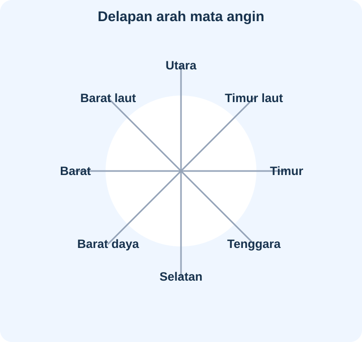
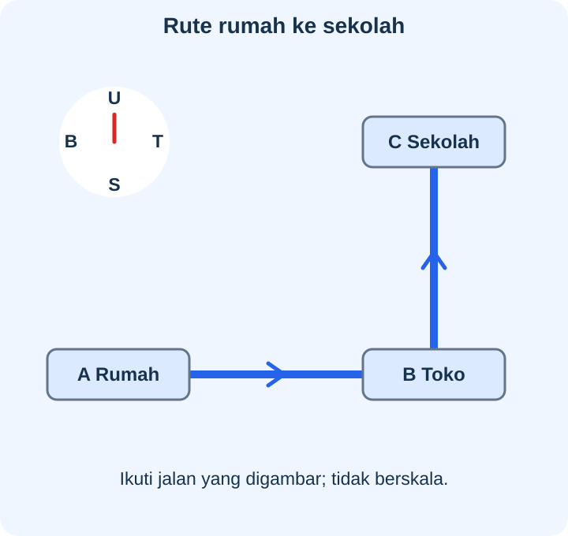

# IPAS Kelas 3 — Bab 7: Jejak Penjelajah

## K03-IPAS-B07-MOD-01 — Membaca Arah dan Merencanakan Rute

### Arah yang menjadi acuan bersama

Empat arah utama ialah **utara, timur, selatan, dan barat**. Di antaranya ada **timur laut, tenggara, barat daya, dan barat laut**. Utara berlawanan dengan selatan; timur dengan barat; timur laut dengan barat daya; tenggara dengan barat laut.

Kanan dan kiri mengikuti **arah hadap tubuh**. Jika menghadap utara, kananmu timur dan kirimu barat. Jika menghadap timur, belakangmu barat. Dua orang berhadapan dapat mempunyai kanan berbeda, tetapi arah mata angin tidak berubah mengikuti putaran tubuh mereka.

Matahari terbit secara umum di sisi timur dan terbenam di sisi barat. Letak tepatnya dapat bergeser sepanjang tahun; gunakan sebagai perkiraan arah, bukan pengukuran tepat. Kenali sisi langitnya tanpa menatap Matahari langsung. Saat petunjuk langit tidak tampak, gunakan alat bantu dengan benar.

### Kompas dan alat bantu

Kompas magnet memakai jarum magnet yang merespons medan magnet Bumi. Kedua ujung menunjuk arah berlawanan, mendekati garis utara–selatan. Kenali ujung utara sesuai penanda/panduan kompas. Jauhkan dari magnet mainan atau benda yang mengganggu, letakkan dengan benar, dan tunggu jarum tenang.

Kompas magnet sederhana tidak membutuhkan baterai; aplikasi kompas atau peta di ponsel memerlukan daya. Peta dan GPS juga membantu perjalanan, tetapi bukan jaminan semua jalur dapat dilewati. Anak tetap bersama pendamping dan mengikuti keadaan serta aturan lokasi. Percobaan kompas dengan jarum tajam tidak dikerjakan anak sendiri.

### Denah, simbol, dan orientasi

Denah menggambarkan letak ruangan, tempat, atau jalur secara sederhana, biasanya seolah dilihat dari atas. Peta menggambarkan wilayah. Keduanya dapat menggunakan simbol; **legenda** menjelaskan artinya.

Periksa judul, nama tempat, legenda, petunjuk utara, titik awal, tujuan, dan jalan. Utara tidak harus berada di atas halaman: jika panah utara mengarah ke kiri, ikuti panah itu. Jangan mengartikan kanan halaman sebagai timur tanpa memeriksa orientasi.

Simbol persegi bisa berarti sekolah pada satu denah dan tempat lain pada denah berbeda. Warna ruang bukan bukti warna dinding sebenarnya. Ukuran gambar sekolah yang besar juga tidak otomatis membuktikan bangunannya lebih luas. Jika tidak ada skala atau keterangan panjang, jarak sebenarnya dalam meter belum dapat dihitung tepat.

### Letak dan perjalanan

Kalimat “toko di timur” perlu acuan: **di timur sekolah**, misalnya. Patokan tetap seperti gedung perpustakaan membantu mengenali lokasi lebih baik daripada kendaraan yang sedang lewat.

Pada contoh, dari A ke B bergerak ke timur, lalu dari B ke C ke utara. Pulang lewat jalan sama berarti dari C ke B ke selatan, kemudian B ke A ke barat. Rute pulang membalik **urutan ruas dan arahnya**. Teman dengan titik awal berbeda dapat memerlukan petunjuk berbeda meskipun tujuan sama.

Petunjuk yang jelas memuat titik awal, urutan ruas atau belokan, patokan, dan tujuan. “Belok kiri” memerlukan informasi arah datang atau hadap. “Ke tempat yang bagus” belum menunjukkan lokasi pasti karena penilaian orang dapat berbeda.

### Kenampakan alam dan buatan

**Kenampakan alam** terbentuk melalui proses alam: gunung, sungai alami, gumuk pasir yang dibentuk angin. **Kenampakan buatan** sengaja dibuat manusia: sekolah, rumah, jalan, jembatan, kantor pos, waduk, dan saluran beton.

Air yang mengalir tidak otomatis berarti sungai alami; kanal dapat dibuat manusia. Tumpukan pasir untuk bangunan berbeda asal dari gumuk alami. Dataran tinggi dan rendah dibandingkan berdasarkan ketinggian wilayah dari permukaan laut, bukan jumlah toko atau warna bangunan.

### Rute aman dan catatan teliti

Rute pendek belum tentu aman atau diizinkan. Jangan melewati jembatan rusak, penutupan jalan, pagar pribadi, atau tepi sungai berbahaya. Periksa tanggal denah dan informasi terbaru. Jika denah berbeda dengan tanda keselamatan di lokasi, berhenti bersama pendamping dan periksa jalur lain.

Sebelum menjelajah, sepakati area, rute, dan cara tetap bersama guru. Bila terpisah di tempat umum, tetap di tempat aman dan minta bantuan petugas resmi menghubungi pendamping; jangan pergi sendiri ke tempat sepi. Hormati warga dan izin masuk, jangan merusak tanaman, dan bawa kembali sampah.

Catat fakta yang diamati, misalnya “ada jembatan di atas sungai”, bukan menganggap semua orang pasti merasa tempat itu paling indah. Bandingkan catatan dengan keadaan nyata. Untuk denah yang dipajang, gunakan lokasi rekaan agar tidak membuka alamat pribadi atau jadwal keluarga.

**Latihan:** Buat denah rekaan, lengkap dengan judul, arah, simbol/legenda, dan jalur yang diizinkan. Minta teman mencoba menceritakan rutenya, lalu perbaiki informasi yang belum jelas.

## K03-IPAS-B07-MOD-02 — Misi Menuju Perpustakaan

### Menyamakan acuan sebelum berangkat

Dua teman berdiri berhadapan di gerbang. Ketika keduanya menunjuk ke kanan masing-masing, tangan mereka mengarah berbeda. Guru menjelaskan bahwa kanan mengikuti arah hadap, sedangkan **utara, timur, selatan, dan barat** menjadi acuan bersama.

Jika menghadap utara, kanan adalah timur. Jika menghadap timur, belakang adalah barat. Di antara arah utama terdapat **timur laut, tenggara, barat daya, dan barat laut**. Timur laut berhadapan dengan barat daya; tenggara berhadapan dengan barat laut.

Matahari terbit secara umum di sisi timur dan terbenam di sisi barat, tetapi letak tepatnya dapat bergeser sepanjang tahun. Anak tidak menatap Matahari langsung untuk memeriksa arah. Jika langit berawan, guru membantu menggunakan kompas.

Jarum kompas magnet merespons medan magnet Bumi dan mengarah mendekati utara–selatan. Mereka mengenali ujung utara dari penanda kompas, menjauhkan magnet mainan, lalu menunggu jarum tenang. Kompas magnet sederhana dapat bekerja tanpa baterai, berbeda dari aplikasi ponsel yang memerlukan daya. Penggunaan jarum tajam untuk percobaan ditangani guru.

### Membuka denah

Denah mereka menggambar tempat secara sederhana dari atas. Peta menggambarkan wilayah dan juga dapat memakai simbol. Legenda memberi arti simbol. Simbol yang sama pada denah lain belum tentu bermakna sama.

Guru meminta mereka membaca judul dan panah utara dahulu. Pada contoh lain, utara mengarah ke kiri halaman. Mereka tidak boleh selalu menganggap atas adalah utara. Warna pada denah dapat menjadi kode, bukan warna asli bangunan. Besar simbol juga bukan ukuran nyata jika tidak berskala.

Mereka menemukan titik awal dan tujuan. Kalimat “perpustakaan di timur” baru jelas jika disebut **di timur taman**. Patokan yang relatif tetap seperti gedung lebih berguna daripada kendaraan lewat. Tanpa skala atau panjang jalan, mereka belum tahu jarak tepat dalam meter.

### Mengikuti ruas secara berurutan

Guru menunjukkan contoh A–B–C: ke timur dahulu, lalu utara. Jika pulang lewat ruas sama, urutannya selatan lalu barat. Mereka tidak sekadar mengulang urutan pergi. Anak dari lokasi awal lain dapat memiliki rute lain walau tujuannya sama.

“Dari gerbang ke utara sampai taman, lalu ke timur menuju perpustakaan” lebih jelas daripada daftar “taman, perpustakaan” tanpa urutan. Jika memakai “belok kiri”, sebutkan dari arah mana orang datang. Hindari petunjuk “tempat yang bagus” tanpa nama karena selera berbeda.

### Mengenali yang dilewati

Mereka menggambar sungai alami dan bukit sebagai contoh bentang alam. Gunung serta gumuk pasir yang dibentuk angin juga terbentuk melalui proses alam. Jembatan, jalan, sekolah, rumah, dan kantor pos sengaja dibangun manusia. Waduk yang dibuat dengan bendungan dan saluran beton merupakan kenampakan buatan walau berisi air.

Mereka tidak menentukan alam/buatan hanya dari warna atau keberadaan air. Dataran tinggi dan rendah dibandingkan dari ketinggian terhadap permukaan laut; bukan dari banyak toko. Catatan menyebut hal yang terlihat seperti “ada jembatan”, bukan menyatakan bahwa semua orang pasti menyukai pemandangannya.

### Memperbarui rencana

Jalan yang terbuka pada denah pekan lalu ternyata ditutup hari ini untuk perbaikan. Mereka berhenti bersama pendamping dan mencari jalur resmi lain. Denah dan GPS membantu, tetapi tidak memberi izin melintasi pagar terkunci atau pekarangan pribadi. Jalan paling pendek bukan pilihan baik jika berbahaya.

Sebelum berangkat, kelompok telah menyepakati batas area serta rute dan tetap bersama guru. Bila terpisah di tempat umum, anak berhenti di tempat aman dan meminta bantuan petugas resmi menghubungi pendamping, bukan pergi mengikuti orang asing ke tempat sepi.

Mereka mengamati dari tempat yang diizinkan, bertanya sopan, tidak masuk rumah atau merekam percakapan pribadi tanpa izin, dan tidak menghalangi jalan. Tanaman tidak dirusak, sampah dibawa kembali.

### Memeriksa hasil gambar

Sesudah kembali, mereka membandingkan denah dengan pengamatan terkini. Judul, nama tempat, orientasi, legenda, dan jalan diperiksa konsistensinya. Tanggal pembaruan membantu mengetahui kemungkinan perubahan; kertas baru atau warna cerah bukan bukti bahwa isi selalu benar.

Untuk dipajang, mereka memakai lokasi rekaan tanpa alamat rumah, nomor telepon, atau jadwal keluarga. Belajar rute tidak perlu membuka informasi pribadi.

**Coba bersama teman:** Buat petunjuk dari awal ke tujuan pada denah rekaan, lalu jelaskan jalan pulangnya. Minta teman menyebut bagian yang belum jelas dan perbaiki sesuai bukti, arah, serta izin melintas.

---

**Acuan kedua modul:** *Ilmu Pengetahuan Alam dan Sosial untuk SD/MI Kelas III (Edisi Revisi)*, Aldilla Kusumawardhani dkk., 2025, Bab 7 halaman 145–164: arah mata angin, alat bantu, denah, rute, dan kenampakan alam/buatan. Contoh lingkungan adalah rekaan dan tidak berskala. Keterangan Matahari merupakan perkiraan arah umum; kompas mengikuti medan magnet dan dapat terganggu magnet di dekatnya.

Buku: https://static.sc.cloudapp.web.id/content/pdf/bukuteks/kurikulum21/IPAS_BS_KLS_III.pdf
