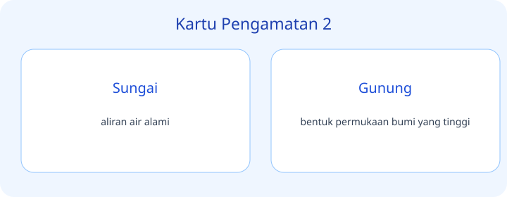
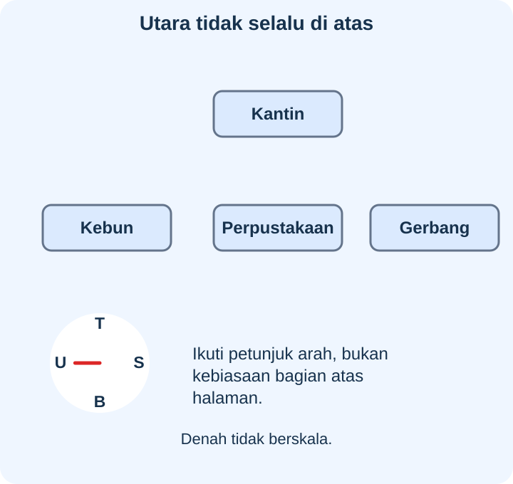
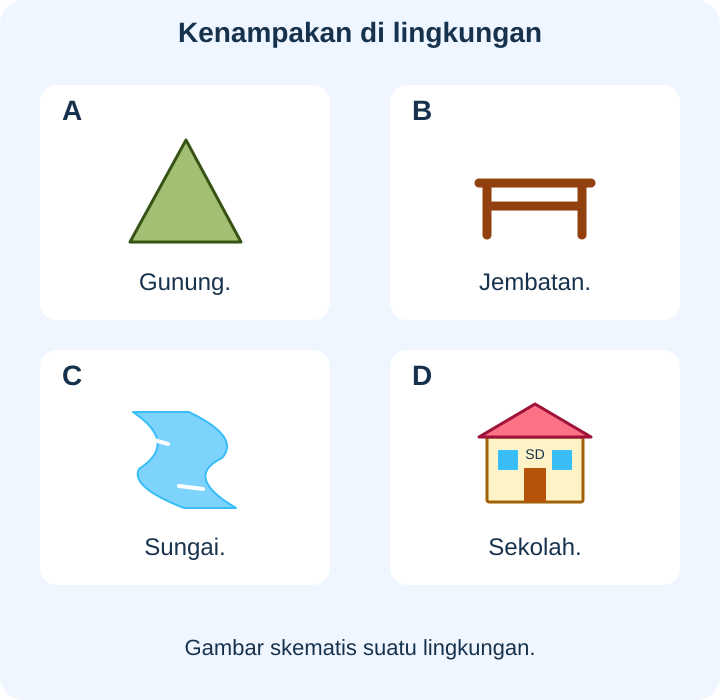

# IPAS Kelas 3 — Bab 7: Jejak Penjelajah — 20 Soal Bergambar

## Soal 51 — K03-IPAS-B07-M01-051

**Pertanyaan:** Berdasarkan kartu pengamatan, pernyataan yang tepat tentang **Sekolah** adalah ...

**Pilihan jawaban:**
- contoh lokasi pada denah
- bentuk permukaan bumi yang tinggi
- mengumpulkan informasi dengan indra
- tidak merusak tempat yang dikunjungi

**Kunci Jawaban:** contoh lokasi pada denah

**Pembahasan:** Sekolah: contoh lokasi pada denah.

---

## Soal 52 — K03-IPAS-B07-M01-052

**Pertanyaan:** Berdasarkan kartu pengamatan, pernyataan yang tepat tentang **Jalan** adalah ...

**Pilihan jawaban:**
- wilayah berketinggian relatif rendah
- jalur penghubung tempat
- membantu mengingat hasil penjelajahan
- Pilih tiga hal yang kamu temukan hari ini

**Kunci Jawaban:** jalur penghubung tempat

**Pembahasan:** Jalan: jalur penghubung tempat.

---

## Soal 53 — K03-IPAS-B07-M01-053

**Pertanyaan:** Berdasarkan kartu pengamatan, pernyataan yang tepat tentang **Sungai** adalah ...

**Pilihan jawaban:**
- wilayah yang relatif tinggi
- diutamakan saat menjelajah
- aliran air alami
- gambaran suatu wilayah

**Kunci Jawaban:** aliran air alami

**Pembahasan:** Sungai: aliran air alami.

---

## Soal 54 — K03-IPAS-B07-M01-054

**Pertanyaan:** Berdasarkan kartu pengamatan, pernyataan yang tepat tentang **Gunung** adalah ...

**Pilihan jawaban:**
- mengumpulkan informasi dengan indra
- tidak merusak tempat yang dikunjungi
- gambaran letak tempat secara sederhana
- bentuk permukaan bumi yang tinggi

**Kunci Jawaban:** bentuk permukaan bumi yang tinggi

**Pembahasan:** Gunung: bentuk permukaan bumi yang tinggi.

---

## Soal 55 — K03-IPAS-B07-M01-055

**Pertanyaan:** Berdasarkan kartu pengamatan, pernyataan yang tepat tentang **Dataran rendah** adalah ...

**Pilihan jawaban:**
- wilayah berketinggian relatif rendah
- membantu mengingat hasil penjelajahan
- Pilih tiga hal yang kamu temukan hari ini
- penjelasan simbol pada peta

**Kunci Jawaban:** wilayah berketinggian relatif rendah

**Pembahasan:** Dataran rendah: wilayah berketinggian relatif rendah.

---

## Soal 56 — K03-IPAS-B07-M01-056

**Pertanyaan:** Berdasarkan kartu pengamatan, pernyataan yang tepat tentang **Dataran tinggi** adalah ...

**Pilihan jawaban:**
- diutamakan saat menjelajah
- wilayah yang relatif tinggi
- gambaran suatu wilayah
- tanda yang mewakili objek

**Kunci Jawaban:** wilayah yang relatif tinggi

**Pembahasan:** Dataran tinggi: wilayah yang relatif tinggi.

---

## Soal 57 — K03-IPAS-B07-M01-057

**Pertanyaan:** Berdasarkan kartu pengamatan, pernyataan yang tepat tentang **Pengamatan** adalah ...

**Pilihan jawaban:**
- tidak merusak tempat yang dikunjungi
- gambaran letak tempat secara sederhana
- mengumpulkan informasi dengan indra
- berlawanan dengan selatan

**Kunci Jawaban:** mengumpulkan informasi dengan indra

**Pembahasan:** Pengamatan: mengumpulkan informasi dengan indra.

---

## Soal 58 — K03-IPAS-B07-M01-058

**Pertanyaan:** Berdasarkan kartu pengamatan, pernyataan yang tepat tentang **Mencatat temuan** adalah ...

**Pilihan jawaban:**
- Pilih tiga hal yang kamu temukan hari ini
- penjelasan simbol pada peta
- arah matahari terbit secara umum
- membantu mengingat hasil penjelajahan

**Kunci Jawaban:** membantu mengingat hasil penjelajahan

**Pembahasan:** Mencatat temuan: membantu mengingat hasil penjelajahan.

---

## Soal 59 — K03-IPAS-B07-M01-059

**Pertanyaan:** Berdasarkan kartu pengamatan, pernyataan yang tepat tentang **Keselamatan** adalah ...

**Pilihan jawaban:**
- diutamakan saat menjelajah
- gambaran suatu wilayah
- tanda yang mewakili objek
- arah matahari terbenam secara umum

**Kunci Jawaban:** diutamakan saat menjelajah

**Pembahasan:** Keselamatan: diutamakan saat menjelajah.

---

## Soal 60 — K03-IPAS-B07-M01-060

**Pertanyaan:** Berdasarkan kartu pengamatan, pernyataan yang tepat tentang **Menjaga alam** adalah ...

**Pilihan jawaban:**
- gambaran letak tempat secara sederhana
- tidak merusak tempat yang dikunjungi
- berlawanan dengan selatan
- alat penunjuk arah

**Kunci Jawaban:** tidak merusak tempat yang dikunjungi

**Pembahasan:** Menjaga alam: tidak merusak tempat yang dikunjungi.

---

## Soal 61 — K03-IPAS-B07-M01-061

**Pertanyaan:** Berdasarkan kartu pengamatan, pernyataan yang tepat tentang **Tantangan** adalah ...

**Pilihan jawaban:**
- penjelasan simbol pada peta
- arah matahari terbit secara umum
- Pilih tiga hal yang kamu temukan hari ini
- jalur menuju tujuan

**Kunci Jawaban:** Pilih tiga hal yang kamu temukan hari ini

**Pembahasan:** Tantangan: Pilih tiga hal yang kamu temukan hari ini.

---

## Soal 62 — K03-IPAS-B07-M01-062

**Pertanyaan:** Berdasarkan kartu pengamatan, pernyataan yang tepat tentang **Peta** adalah ...

**Pilihan jawaban:**
- tanda yang mewakili objek
- arah matahari terbenam secara umum
- contoh lokasi pada denah
- gambaran suatu wilayah

**Kunci Jawaban:** gambaran suatu wilayah

**Pembahasan:** Peta: gambaran suatu wilayah.

---

## Soal 63 — K03-IPAS-B07-M01-063

**Pertanyaan:** Berdasarkan kartu pengamatan, pernyataan yang tepat tentang **Denah** adalah ...

**Pilihan jawaban:**
- gambaran letak tempat secara sederhana
- berlawanan dengan selatan
- alat penunjuk arah
- jalur penghubung tempat

**Kunci Jawaban:** gambaran letak tempat secara sederhana

**Pembahasan:** Denah: gambaran letak tempat secara sederhana.

---

## Soal 64 — K03-IPAS-B07-M01-064

**Pertanyaan:** Berdasarkan kartu pengamatan, pernyataan yang tepat tentang **Legenda** adalah ...

**Pilihan jawaban:**
- arah matahari terbit secara umum
- penjelasan simbol pada peta
- jalur menuju tujuan
- aliran air alami

**Kunci Jawaban:** penjelasan simbol pada peta

**Pembahasan:** Legenda: penjelasan simbol pada peta.

---

## Soal 65 — K03-IPAS-B07-M01-065

**Pertanyaan:** Berdasarkan kartu pengamatan, pernyataan yang tepat tentang **Simbol** adalah ...

**Pilihan jawaban:**
- arah matahari terbenam secara umum
- contoh lokasi pada denah
- tanda yang mewakili objek
- bentuk permukaan bumi yang tinggi

**Kunci Jawaban:** tanda yang mewakili objek

**Pembahasan:** Simbol: tanda yang mewakili objek.

---

## Soal 66 — K03-IPAS-B07-M01-066

**Pertanyaan:** Berdasarkan kartu pengamatan, pernyataan yang tepat tentang **Arah utara** adalah ...

**Pilihan jawaban:**
- alat penunjuk arah
- jalur penghubung tempat
- wilayah berketinggian relatif rendah
- berlawanan dengan selatan

**Kunci Jawaban:** berlawanan dengan selatan

**Pembahasan:** Arah utara: berlawanan dengan selatan.

---

## Soal 67 — K03-IPAS-B07-M01-067

**Pertanyaan:** Berdasarkan kartu pengamatan, pernyataan yang tepat tentang **Arah timur** adalah ...

**Pilihan jawaban:**
- arah matahari terbit secara umum
- jalur menuju tujuan
- aliran air alami
- wilayah yang relatif tinggi

**Kunci Jawaban:** arah matahari terbit secara umum

**Pembahasan:** Arah timur: arah matahari terbit secara umum.

---

## Soal 68 — K03-IPAS-B07-M01-068

**Pertanyaan:** Berdasarkan kartu pengamatan, pernyataan yang tepat tentang **Arah barat** adalah ...

**Pilihan jawaban:**
- contoh lokasi pada denah
- arah matahari terbenam secara umum
- bentuk permukaan bumi yang tinggi
- mengumpulkan informasi dengan indra

**Kunci Jawaban:** arah matahari terbenam secara umum

**Pembahasan:** Arah barat: arah matahari terbenam secara umum.

---

## Soal 69 — K03-IPAS-B07-M01-069

**Pertanyaan:** Berdasarkan kartu pengamatan, pernyataan yang tepat tentang **Kompas** adalah ...

**Pilihan jawaban:**
- jalur penghubung tempat
- wilayah berketinggian relatif rendah
- alat penunjuk arah
- membantu mengingat hasil penjelajahan

**Kunci Jawaban:** alat penunjuk arah

**Pembahasan:** Kompas: alat penunjuk arah.

---

## Soal 70 — K03-IPAS-B07-M01-070

**Pertanyaan:** Berdasarkan kartu pengamatan, pernyataan yang tepat tentang **Rute** adalah ...

**Pilihan jawaban:**
- aliran air alami
- wilayah yang relatif tinggi
- diutamakan saat menjelajah
- jalur menuju tujuan

**Kunci Jawaban:** jalur menuju tujuan

**Pembahasan:** Rute: jalur menuju tujuan.

---
