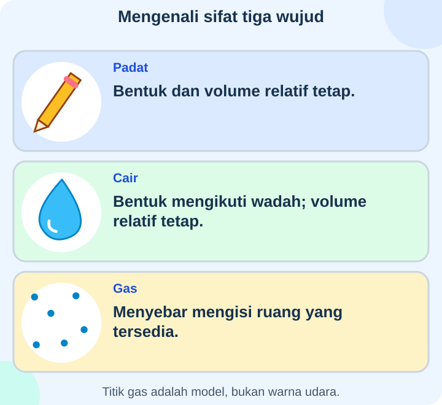
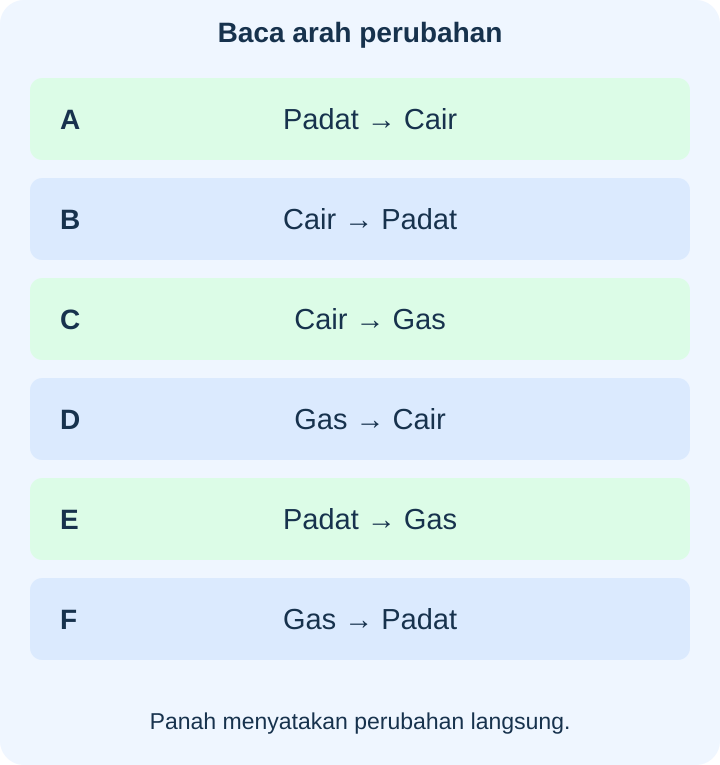

# IPAS Kelas 3 — Bab 8: Rahasia Tiga Wujud Zat

## K03-IPAS-B08-MOD-01 — Mengamati Sifat dan Perubahan Wujud

### Padat, cair, dan gas

Zat menempati ruang. **Volume** menyatakan ruang yang ditempatinya, sedangkan **massa** berkaitan dengan banyak materi yang ditimbang. Volume tidak sama dengan tinggi permukaan pada satu wadah.

- **Padat:** pensil, batu, es, dan butir beras mempunyai bentuk serta volume relatif tetap pada pemindahan biasa. Padat tidak harus keras: plastisin dapat dibentuk dengan gaya, karet dapat dibengkokkan, tetapi tidak otomatis menjadi cair.
- **Cair:** air dan minyak mengalir mengikuti bentuk bagian wadah yang ditempati. Jika dipindahkan tanpa tumpah dan suhu sama, volumenya relatif tetap. Air $200\ \text{mL}$ di gelas sempit dan mangkuk lebar dapat mempunyai tinggi berbeda meski volume sama.
- **Gas:** udara menyebar mengisi ruang yang tersedia dan dapat menekan dinding wadah. Udara dalam balon yang dipompa guru menempati ruang; gas lebih mudah dimampatkan daripada cairan pada kondisi biasa. Gelas yang tampak kosong biasanya tetap berisi udara.

Beras dapat dituang sebagai kumpulan, tetapi setiap butir tetap padat. Tidak semua hal yang dapat dituang adalah cairan. Udara dan uap air gas biasanya tidak terlihat; warna biru dalam diagram hanya model.

Partikel merupakan penyusun zat yang sangat kecil. Dalam padat, partikel berdekatan dan dapat **bergetar**, bukan diam mutlak. Dalam cairan, partikel dapat saling melewati; dalam gas lebih tersebar dan bergerak mengisi ruang. Titik-titik model bukan ukuran nyata partikel yang terlihat oleh mata.

### Mengenali arah perubahan

- **Mencair:** padat → cair; es menerima panas dari sekitar lalu menjadi air.
- **Membeku:** cair → padat; air melepaskan panas sampai menjadi es. Penjual es memanfaatkannya untuk membekukan minuman.
- **Menguap:** cair → gas; air pada pakaian basah berpindah ke udara sebagai uap air. Penguapan tidak harus menunggu mendidih.
- **Mengembun:** gas → cair; uap air udara bertemu permukaan dingin dan dapat membentuk titik air di luar gelas yang utuh. Uap dari air hangat juga dapat membentuk titik pada tutup yang lebih dingin.
- **Menyublim:** padat → gas langsung; kamper tertentu dapat mengecil tanpa menjadi cair dahulu. Pelajari melalui gambar/catatan guru tanpa memegang atau mencium bahan dekat.
- **Deposisi atau mengkristal pada bagan perubahan wujud:** gas → padat langsung, tanpa tahap cair. Ini berbeda dari mengembun yang berakhir cair.

Mencair dan membeku dapat bergantian pada air: es mencair, lalu air dapat dibekukan lagi. Es dan air cair tetap zat yang sama dengan wujud berbeda. Benda yang dipanaskan tidak selalu langsung berubah wujud; air dapat lebih hangat tetapi masih cair.

**Penting:** uap air gas tidak terlihat. Kabut putih yang tampak dekat air panas terutama tetes cair sangat kecil setelah pengembunan, bukan gas murni berwarna putih atau asap pembakaran air. Saat air sudah mendidih, gelembung yang terus terbentuk terutama berisi uap air. Penguapan permukaan juga terjadi pada air yang tidak mendidih.

### Perubahan lain tidak selalu perubahan wujud

Gula yang diaduk dalam air dapat **larut**: gula masih ada dalam larutan walau butir tidak tampak. Itu berbeda dari es mencair. Memotong kertas mengubah ukuran, bukan wujud padatnya. Lilin meleleh merupakan pencairan, sedangkan pembakaran sumbu/bahan lilin adalah proses lain.

Campuran maizena dan air atau oobleck dapat terasa lebih sukar mengalir ketika ditekan cepat. Perilaku alir karena gaya ini dikenal pada fluida non-Newtonian; tidak sama dengan air membeku karena pelepasan panas dan tidak dijadikan alasan menambah “wujud keempat” pada bab ini.

### Membandingkan dan memanfaatkan

Untuk membandingkan waktu es mencair, samakan ukuran es, suhu awal, wadah atau kondisi lain, dan aturan mulai–akhir pencatatan. Ubah hal yang ingin dipelajari, ulangi, serta catat hasil jujur. Satu data logam dengan waktu tertentu bukan aturan untuk semua logam dan semua ukuran es.

Luas permukaan terbuka, aliran udara, suhu, dan kelembapan memengaruhi penguapan. Kain yang dibentangkan dapat lebih cepat kering daripada dilipat pada kondisi lain sama. Udara sangat lembap dapat memperlambat pengeringan; ventilasi yang sesuai membantu mengurangi kelembapan ruangan. Piring lebar dapat mempercepat penguapan air karena permukaan terbukanya lebih luas.

Kotak berinsulasi membantu es bertahan dengan memperlambat masuknya panas, bukan menciptakan zat dingin atau menjaga es selamanya. Bagian pendingin biasa belum tentu cukup dingin untuk membekukan minuman. Suhu, jenis cairan, dan waktu perlu diperhatikan.

Bila es mencair dalam kantong tertutup tanpa bocor, **massa total tetap** jika tidak ada materi masuk/keluar. Ini bukan berarti volume es dan air pasti sama. Air dapat memuai ketika membeku; gunakan wadah pembeku yang sesuai dan jangan mengisinya terlalu penuh menurut arahan orang dewasa.

### Pengamatan aman

Guru menangani pemanas dan air panas; anak memakai gambar/data atau melihat dari jarak aman. Jangan mencicipi, mencium dekat, mencampur, atau memanaskan bahan tak dikenal. Bahan mudah menyublim bukan bahan percobaan mandiri anak. Tumpahan tetap perlu dibersihkan karena lantai dapat licin sebelum air sempat menguap.

**Latihan:** Pilih satu pengamatan aman dari materi. Tulis keadaan awal, akhir, bukti yang terlihat, serta hal yang belum dapat dipastikan. Gunakan alat ukur sesuai arahan jika ingin membandingkan volume atau waktu.

## K03-IPAS-B08-MOD-02 — Buku Catatan Tiga Sahabat

### Catatan meja belajar

Lila memindahkan pensil dari meja ke kotak. Bentuk pensil tetap: contoh benda **padat**. Plastisin yang ditekan dapat berubah bentuk tetapi tetap padat, sama seperti karet yang ditekuk tidak otomatis mencair. Beras bisa dituang sebagai kumpulan; tiap butir tetap mempunyai bentuk sendiri.

Ia menuang air dari gelas sempit ke mangkuk lebar tanpa tumpah. Tinggi air turun, tetapi label ukur menunjukkan volume sama, yaitu $200\ \text{mL}$. Cairan mengikuti bentuk wadah; tinggi permukaan saja tidak cukup untuk membandingkan volume. Alat ukur volume memberi bukti lebih baik.

Guru menunjukkan udara masuk ke balon melalui pompa sehingga balon membesar. Udara adalah **gas** yang menempati ruang dan menekan dinding. Gas juga lebih mudah dimampatkan daripada cairan pada kondisi biasa, tetapi alat percobaan tertutup ditangani guru. Gelas tampak kosong bukan berarti tidak ada zat di dalamnya.

Model partikel membantu memahami sifat: partikel padat berdekatan dan tetap bergetar; partikel cair dapat saling melewati; gas lebih tersebar. Titik model berwarna tidak berarti udara sebenarnya tampak biru atau penyusunnya sebesar titik cetakan. Volume adalah ruang yang ditempati; massa adalah besaran yang diperiksa dengan penimbangan, bukan tinggi air.

### Catatan dari es ke air

Es di ruangan hangat menerima panas dan **mencair**. Air di pembeku melepaskan panas lalu **membeku**. “Dingin” bukan zat baru yang masuk. Air yang masih menerima panas dari tempat hangat akan sulit menjadi es tanpa pendinginan cukup.

Penjual es memakai pembekuan untuk membuat minuman padat dan kotak berinsulasi untuk memperlambat pencairan. Insulasi memperlambat perpindahan panas; tidak menciptakan dingin tanpa batas. Minuman yang hanya berada pada bagian pendingin biasa belum tentu beku. Jenis cairan, suhu, dan lamanya juga memengaruhi hasil.

Es dapat menjadi air lalu dibekukan lagi; perubahan wujud tidak harus menghasilkan zat berbeda. Pemanasan juga bisa hanya menaikkan suhu air yang tetap cair. Dalam kantong tertutup tak bocor, massa total es beserta kantong sama sebelum dan setelah mencair, asalkan tidak ada materi masuk/keluar. Volume es dan air tidak harus sama; air dapat mengembang saat membeku. Orang dewasa memilih wadah pembeku sesuai dan tidak mengisi terlalu penuh.

### Catatan pakaian dan gelas dingin

Pakaian basah mengering karena sebagian air **menguap** ke udara. Air tidak musnah. Menguap dapat terjadi dari permukaan pada suhu di bawah mendidih. Bila air sudah mendidih, gelembung yang terus muncul terutama berisi uap air.

Uap air gas tidak terlihat. Kabut putih dekat air panas terutama tetes cair kecil yang terbentuk saat uap mendingin dan **mengembun**. Titik air di tutup yang lebih dingin maupun luar gelas es utuh juga contoh pengembunan. Air luar gelas berasal dari uap air sekitar, bukan menembus kaca yang tidak bocor.

Guru menambahkan dua proses: padat langsung ke gas disebut **menyublim**, seperti kamper tertentu pada catatan guru. Gas langsung ke padat disebut **deposisi**, atau mengkristal dalam bagan perubahan wujud. Gas ke cair adalah mengembun, sehingga tidak semua proses menuju permukaan dingin berhenti pada wujud yang sama.

### Catatan yang mirip tetapi berbeda

Gula yang diaduk dalam air tak lagi tampak sebagai butir, tetapi masih berada dalam larutan. Ini **pelarutan**, berbeda dari es padat menjadi cair. Kertas yang dipotong tetap padat. Lilin yang meleleh menunjukkan pencairan, sedangkan bahan terbakar mengalami proses lain juga.

Oobleck, campuran maizena dan air, dapat lebih sukar mengalir ketika ditekan cepat. Ini perubahan perilaku alir karena gaya pada fluida non-Newtonian, bukan pembekuan menjadi es. Tidak setiap benda yang berubah bentuk atau tak tampak lagi telah berubah wujud dengan proses yang sama.

### Catatan percobaan adil

Untuk membandingkan es, guru menyamakan ukuran dan suhu awal serta kondisi lain, lalu mengubah satu hal yang ingin dipelajari. Waktu mulai dan habis mencair didefinisikan sama. Pengamatan diulang; angka yang berbeda tetap dicatat dan dicari kemungkinan penyebabnya. Hasil satu alas logam tidak berlaku otomatis untuk semua ukuran es dan semua lingkungan.

Untuk pengeringan, luas permukaan terbuka, suhu, aliran udara, dan kelembapan diperhatikan. Membentangkan kain dapat membantu dibanding melipatnya pada kondisi sama. Aliran udara membawa uap air, sedangkan udara sangat lembap dapat memperlambat penguapan. Ventilasi sesuai dapat mengurangi kaca basah di ruangan lembap. Permukaan air yang lebih lebar juga dapat mempercepat penguapan.

Anak tidak menyiapkan pemanas atau memegang panci panas. Bahan tidak dikenal tidak dicicipi, dihirup dekat, atau dicampur sembarangan. Kamper dipelajari lewat data/gambar guru, bukan dipanaskan atau dicium anak. Tumpahan dibersihkan aman karena menunggu penguapan dapat membiarkan lantai licin.

**Coba ceritakan:** Bandingkan satu perubahan wujud dan satu perubahan bentuk/pelarutan. Jelaskan bukti, keadaan yang disamakan jika membandingkan, dan cara mengamatinya dengan aman.

---

**Acuan kedua modul:** *Ilmu Pengetahuan Alam dan Sosial untuk SD/MI Kelas III (Edisi Revisi)*, Aldilla Kusumawardhani dkk., 2025, Bab 8 halaman 165–186. Pembahasan mencakup tiga wujud, sifat, model partikel, enam arah perubahan, pemanfaatan, dan penyelidikan.

Buku: https://static.sc.cloudapp.web.id/content/pdf/bukuteks/kurikulum21/IPAS_BS_KLS_III.pdf

Pendamping ketepatan uap/tetes air: USGS, https://www.usgs.gov/glossary/glossary-water-cycle-terms dan NASA, https://science.nasa.gov/kids/earth/how-do-clouds-form/

Pendamping perilaku oobleck: NIST, https://www.nist.gov/news-events/news/2016/05/crack-mystery-oobleck-friction-thickens-fluids

Catatan untuk pendamping: model partikel padat tidak diajarkan diam mutlak; uap air gas dibedakan dari kabut tetes cair; perubahan perilaku alir oobleck tidak disamakan dengan perubahan fase air; deposisi pada bagan gas–padat dibedakan dari pelarutan/pengkristalan zat terlarut.
