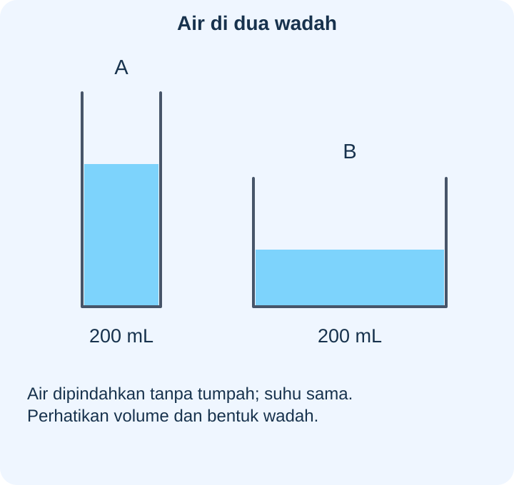
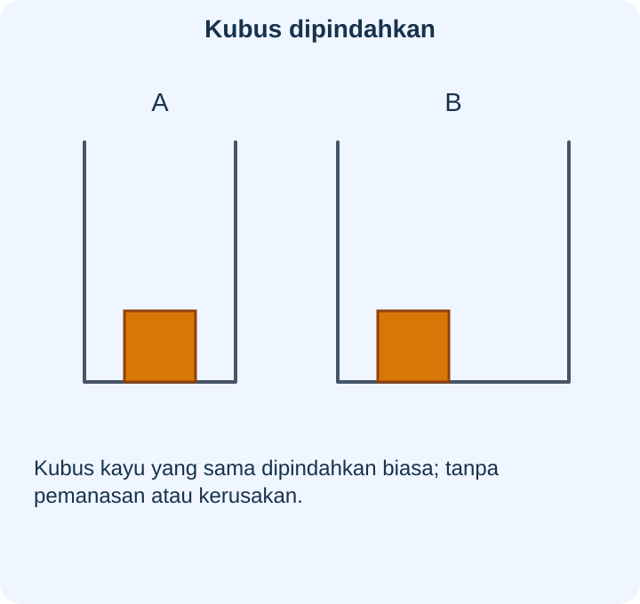
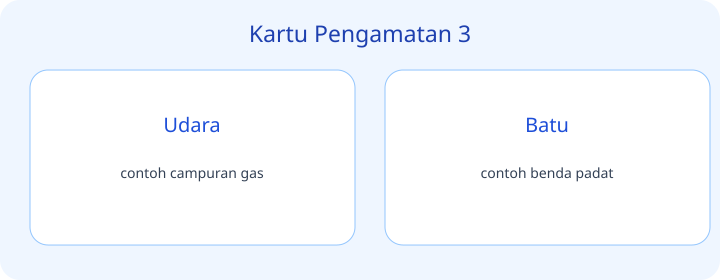
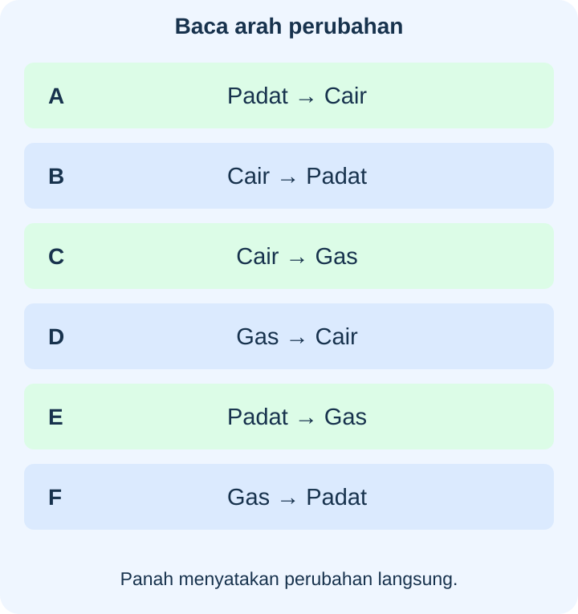
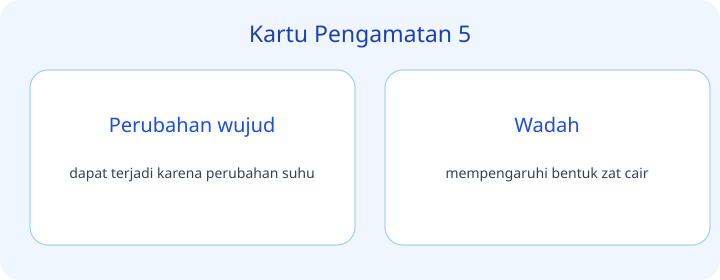
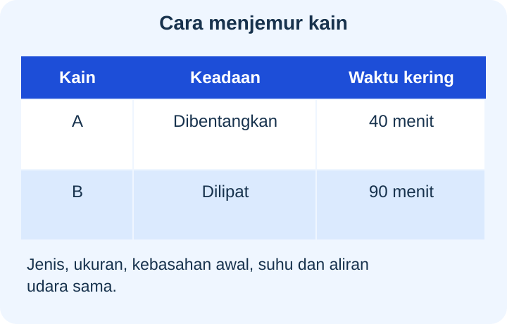
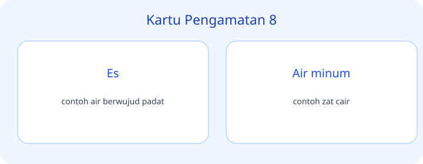
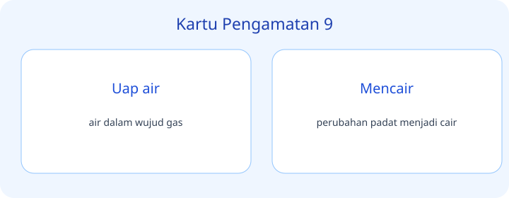
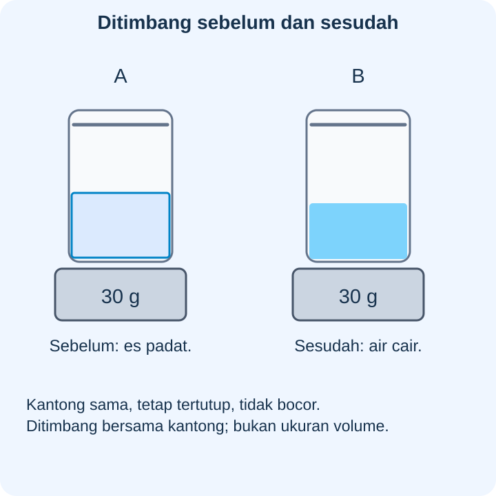

# IPAS Kelas 3 — Bab 8: Rahasia Tiga Wujud Zat — 20 Soal Bergambar

## Soal 51 — K03-IPAS-B08-M01-051

**Pertanyaan:** Berdasarkan kartu pengamatan, pernyataan yang tepat tentang **Es dipanaskan** adalah ...

**Pilihan jawaban:**
- dapat mencair
- dapat terbentuk karena pengembunan
- contoh zat cair
- mempengaruhi bentuk zat cair

**Kunci Jawaban:** dapat mencair

**Pembahasan:** Es dipanaskan: dapat mencair.

---

## Soal 52 — K03-IPAS-B08-M01-052

**Pertanyaan:** Berdasarkan kartu pengamatan, pernyataan yang tepat tentang **Air didinginkan hingga membeku** adalah ...

**Pilihan jawaban:**
- contoh campuran gas
- menjadi es
- menunjukkan gas menempati ruang
- Pilih tiga hal yang kamu temukan hari ini

**Kunci Jawaban:** menjadi es

**Pembahasan:** Air didinginkan hingga membeku: menjadi es.

---

## Soal 53 — K03-IPAS-B08-M01-053

**Pertanyaan:** Berdasarkan kartu pengamatan, pernyataan yang tepat tentang **Air dipanaskan** adalah ...

**Pilihan jawaban:**
- contoh benda padat
- dapat terjadi karena perubahan suhu
- dapat menguap
- memiliki bentuk dan volume relatif tetap

**Kunci Jawaban:** dapat menguap

**Pembahasan:** Air dipanaskan: dapat menguap.

---

## Soal 54 — K03-IPAS-B08-M01-054

**Pertanyaan:** Berdasarkan kartu pengamatan, pernyataan yang tepat tentang **Tetes air di gelas dingin** adalah ...

**Pilihan jawaban:**
- contoh zat cair
- mempengaruhi bentuk zat cair
- mengikuti bentuk wadah dengan volume relatif tetap
- dapat terbentuk karena pengembunan

**Kunci Jawaban:** dapat terbentuk karena pengembunan

**Pembahasan:** Tetes air di gelas dingin: dapat terbentuk karena pengembunan.

---

## Soal 55 — K03-IPAS-B08-M01-055

**Pertanyaan:** Berdasarkan kartu pengamatan, pernyataan yang tepat tentang **Udara** adalah ...

**Pilihan jawaban:**
- contoh campuran gas
- menunjukkan gas menempati ruang
- Pilih tiga hal yang kamu temukan hari ini
- mengisi ruang yang tersedia

**Kunci Jawaban:** contoh campuran gas

**Pembahasan:** Udara: contoh campuran gas.

---

## Soal 56 — K03-IPAS-B08-M01-056

**Pertanyaan:** Berdasarkan kartu pengamatan, pernyataan yang tepat tentang **Batu** adalah ...

**Pilihan jawaban:**
- dapat terjadi karena perubahan suhu
- contoh benda padat
- memiliki bentuk dan volume relatif tetap
- contoh air berwujud padat

**Kunci Jawaban:** contoh benda padat

**Pembahasan:** Batu: contoh benda padat.

---

## Soal 57 — K03-IPAS-B08-M01-057

**Pertanyaan:** Berdasarkan kartu pengamatan, pernyataan yang tepat tentang **Minyak goreng** adalah ...

**Pilihan jawaban:**
- mempengaruhi bentuk zat cair
- mengikuti bentuk wadah dengan volume relatif tetap
- contoh zat cair
- perubahan cair menjadi padat

**Kunci Jawaban:** contoh zat cair

**Pembahasan:** Minyak goreng: contoh zat cair.

---

## Soal 58 — K03-IPAS-B08-M01-058

**Pertanyaan:** Berdasarkan kartu pengamatan, pernyataan yang tepat tentang **Balon berisi udara** adalah ...

**Pilihan jawaban:**
- Pilih tiga hal yang kamu temukan hari ini
- mengisi ruang yang tersedia
- air dalam wujud gas
- menunjukkan gas menempati ruang

**Kunci Jawaban:** menunjukkan gas menempati ruang

**Pembahasan:** Balon berisi udara: menunjukkan gas menempati ruang.

---

## Soal 59 — K03-IPAS-B08-M01-059

**Pertanyaan:** Berdasarkan kartu pengamatan, pernyataan yang tepat tentang **Perubahan wujud** adalah ...

**Pilihan jawaban:**
- dapat terjadi karena perubahan suhu
- memiliki bentuk dan volume relatif tetap
- contoh air berwujud padat
- perubahan padat menjadi cair

**Kunci Jawaban:** dapat terjadi karena perubahan suhu

**Pembahasan:** Perubahan wujud: dapat terjadi karena perubahan suhu.

---

## Soal 60 — K03-IPAS-B08-M01-060

**Pertanyaan:** Berdasarkan kartu pengamatan, pernyataan yang tepat tentang **Wadah** adalah ...

**Pilihan jawaban:**
- mengikuti bentuk wadah dengan volume relatif tetap
- mempengaruhi bentuk zat cair
- contoh zat cair
- perubahan cair menjadi padat

**Kunci Jawaban:** mempengaruhi bentuk zat cair

**Pembahasan:** Wadah: mempengaruhi bentuk zat cair.

---

## Soal 61 — K03-IPAS-B08-M01-061

**Pertanyaan:** Berdasarkan kartu pengamatan, pernyataan yang tepat tentang **Tantangan** adalah ...

**Pilihan jawaban:**
- mengisi ruang yang tersedia
- air dalam wujud gas
- Pilih tiga hal yang kamu temukan hari ini
- perubahan cair menjadi gas

**Kunci Jawaban:** Pilih tiga hal yang kamu temukan hari ini

**Pembahasan:** Tantangan: Pilih tiga hal yang kamu temukan hari ini.

---

## Soal 62 — K03-IPAS-B08-M01-062

**Pertanyaan:** Berdasarkan kartu pengamatan, pernyataan yang tepat tentang **Padat** adalah ...

**Pilihan jawaban:**
- contoh air berwujud padat
- perubahan padat menjadi cair
- dapat mencair
- memiliki bentuk dan volume relatif tetap

**Kunci Jawaban:** memiliki bentuk dan volume relatif tetap

**Pembahasan:** Padat: memiliki bentuk dan volume relatif tetap.

---

## Soal 63 — K03-IPAS-B08-M01-063

**Pertanyaan:** Berdasarkan kartu pengamatan, pernyataan yang tepat tentang **Cair** adalah ...

**Pilihan jawaban:**
- mengikuti bentuk wadah dengan volume relatif tetap
- contoh zat cair
- perubahan cair menjadi padat
- menjadi es

**Kunci Jawaban:** mengikuti bentuk wadah dengan volume relatif tetap

**Pembahasan:** Cair: mengikuti bentuk wadah dengan volume relatif tetap.

---

## Soal 64 — K03-IPAS-B08-M01-064

**Pertanyaan:** Berdasarkan kartu pengamatan, pernyataan yang tepat tentang **Gas** adalah ...

**Pilihan jawaban:**
- air dalam wujud gas
- mengisi ruang yang tersedia
- perubahan cair menjadi gas
- dapat menguap

**Kunci Jawaban:** mengisi ruang yang tersedia

**Pembahasan:** Gas: mengisi ruang yang tersedia.

---

## Soal 65 — K03-IPAS-B08-M01-065

**Pertanyaan:** Berdasarkan kartu pengamatan, pernyataan yang tepat tentang **Es** adalah ...

**Pilihan jawaban:**
- perubahan padat menjadi cair
- dapat mencair
- contoh air berwujud padat
- dapat terbentuk karena pengembunan

**Kunci Jawaban:** contoh air berwujud padat

**Pembahasan:** Es: contoh air berwujud padat.

---

## Soal 66 — K03-IPAS-B08-M01-066

**Pertanyaan:** Berdasarkan kartu pengamatan, pernyataan yang tepat tentang **Air minum** adalah ...

**Pilihan jawaban:**
- perubahan cair menjadi padat
- menjadi es
- contoh campuran gas
- contoh zat cair

**Kunci Jawaban:** contoh zat cair

**Pembahasan:** Air minum: contoh zat cair.

---

## Soal 67 — K03-IPAS-B08-M01-067

**Pertanyaan:** Berdasarkan kartu pengamatan, pernyataan yang tepat tentang **Uap air** adalah ...

**Pilihan jawaban:**
- air dalam wujud gas
- perubahan cair menjadi gas
- dapat menguap
- contoh benda padat

**Kunci Jawaban:** air dalam wujud gas

**Pembahasan:** Uap air: air dalam wujud gas.

---

## Soal 68 — K03-IPAS-B08-M01-068

**Pertanyaan:** Berdasarkan kartu pengamatan, pernyataan yang tepat tentang **Mencair** adalah ...

**Pilihan jawaban:**
- dapat mencair
- perubahan padat menjadi cair
- dapat terbentuk karena pengembunan
- contoh zat cair

**Kunci Jawaban:** perubahan padat menjadi cair

**Pembahasan:** Mencair: perubahan padat menjadi cair.

---

## Soal 69 — K03-IPAS-B08-M01-069

**Pertanyaan:** Berdasarkan kartu pengamatan, pernyataan yang tepat tentang **Membeku** adalah ...

**Pilihan jawaban:**
- menjadi es
- contoh campuran gas
- perubahan cair menjadi padat
- menunjukkan gas menempati ruang

**Kunci Jawaban:** perubahan cair menjadi padat

**Pembahasan:** Membeku: perubahan cair menjadi padat.

---

## Soal 70 — K03-IPAS-B08-M01-070

**Pertanyaan:** Berdasarkan kartu pengamatan, pernyataan yang tepat tentang **Menguap** adalah ...

**Pilihan jawaban:**
- dapat menguap
- contoh benda padat
- dapat terjadi karena perubahan suhu
- perubahan cair menjadi gas

**Kunci Jawaban:** perubahan cair menjadi gas

**Pembahasan:** Menguap: perubahan cair menjadi gas.

---
