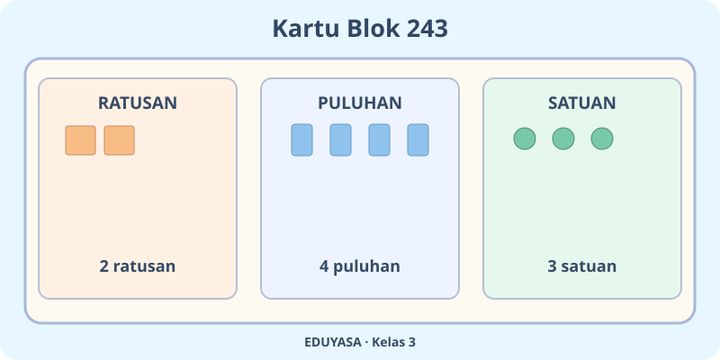
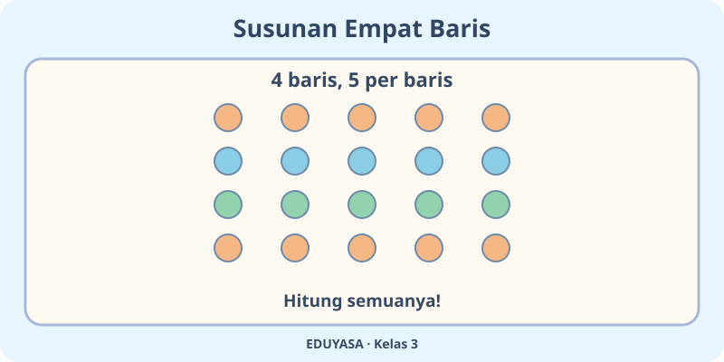

# Bilangan Cacah sampai 1.000 — Dua Modul

**Kelas:** $3$ SD | **Mata pelajaran:** Matematika | **Chapter ID:** K03-MTK-B01

**Acuan:** *Matematika untuk SD/MI Kelas III*, Susanto dkk., Pusat Perbukuan (2022), Bab 1, subbab A–G. Edisi buku 1, Kurikulum Merdeka.

**Cakupan:** Bilangan cacah sampai $1.000$; membaca, menulis, nilai tempat, membandingkan dan mengurutkan; operasi $+,-,\times,\div$ sampai $100$.

**MathJax wajib:** semua notasi matematis tetap dalam pembatas `$...$` untuk inline dan `$$...$$` untuk display. Markdown menyimpan LaTeX asli; hanya Codex yang nanti meng-escape backslash ketika mengonversi JSON. Pertahankan dua ilustrasi di tengah masing-masing modul.

---

## K03-MTK-B01-MOD-01

# Si Detektif Bilangan

Halo! Bayangkan kita sedang menghitung koleksi kartu di perpustakaan. Bilangan cacah dimulai dari $0,1,2,3,\ldots$. Kali ini kita belajar mengenali bilangan sampai $1.000$.

## Tiga rumah angka

Lihat bilangan $243$. Angka $2$ menempati ratusan, angka $4$ puluhan, dan angka $3$ satuan. Jadi $243=200+40+3$. Dibaca **dua ratus empat puluh tiga**. Jangan lupa, angka nol juga penting: $407=400+0+7$.

**Ayo tebak:** Pada $365$, berapa nilai angka $6$? Betul, $60$, karena berada di puluhan!

## Mana yang lebih besar?

Bandingkan mulai dari ratusan, kemudian puluhan, lalu satuan. Contohnya, $526>519$. Urutan kecil ke besar $205<250<502$. Tanda $<$ berarti kurang dari, $>$ lebih dari, dan $=$ sama dengan.

## Empat operasi hitung

Kita dapat menghitung $28+15=43$, lalu $43-17=26$. Jika ada empat kelompok masing-masing lima benda, jumlahnya $4\times5=20$.

Jika $20$ benda dibagi sama rata menjadi $4$ kelompok, setiap kelompok mendapat $20\div4=5$ benda. Pada latihan bab ini, penjumlahan, pengurangan, perkalian, dan pembagian memakai bilangan dalam cakupan sampai $100$.

**Misi akhir:** Tulis bentuk panjang $703$, lalu coba $6\times4$ dan $24\div6$. Jelaskan caramu, bukan hanya hasilnya!

---

## K03-MTK-B01-MOD-02

# Petualangan Lima Laci Angka

Hai, Penjelajah! Kamu masuk ke ruang misteri dengan lima laci: *membaca, nilai tempat, urutan, tambah-kurang, kali-bagi.* Ayo buka satu per satu.

## Laci baca dan nilai tempat

Kartu $709$ dibaca **tujuh ratus sembilan**. Di kartu ini ada $7$ ratusan, $0$ puluhan, dan $9$ satuan: $709=700+0+9$.

Lihat juga $243$. Nilai angka $4$ bukan hanya empat, melainkan $40$. Posisi angka menentukan nilainya. Sekarang bayangkan kamu menukar posisi puluhan dan satuan. Apakah nilainya tetap? **Tidak!**

## Laci urutan bilangan

Ada kartu $318$, $381$, dan $183$. Susun dari terkecil: $183<318<381$. Periksa ratusan dulu, setelah itu puluhan dan satuannya.

## Laci operasi

Alya punya $37$ stiker, lalu diberi $25$. Maka $37+25=62$. Jika ia meminjamkan $18$ stiker, tinggal $62-18=44$.

Empat baris masing-masing $5$ bulatan adalah $4\times5=20$. Jika dibagi sama banyak ke $4$ baris, setiap baris punya $20\div4=5$ bulatan. Perkalian menggabungkan kelompok sama banyak, pembagian membagi sama rata.

**Tantangan laci terakhir:** Apa angka paling besar dari $408$, $480$, dan $804$? Setelah itu, jelaskan mengapa $9\times3=27$ memakai kelompok yang sama banyak.
