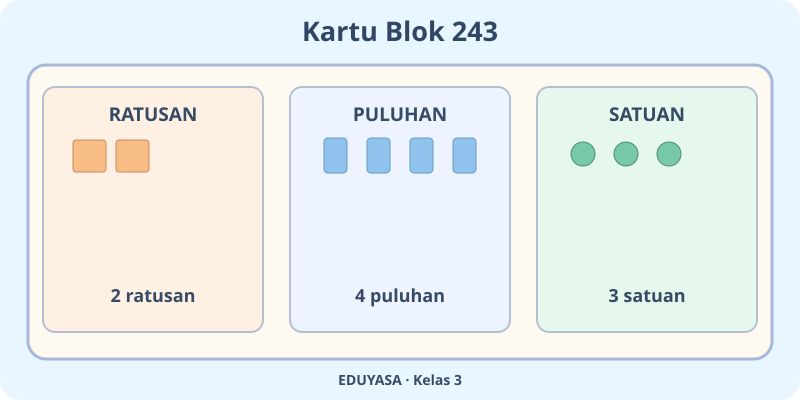
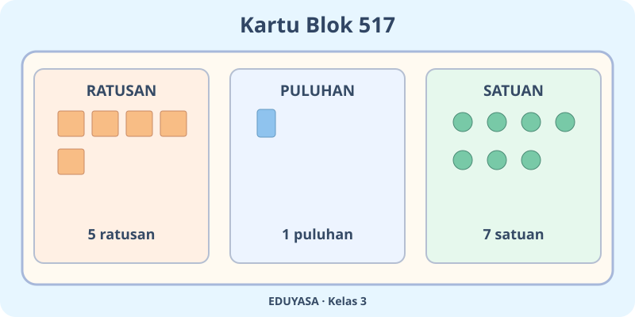
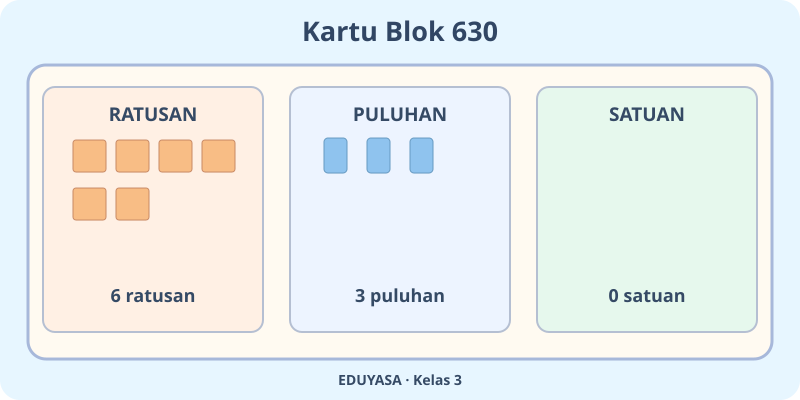
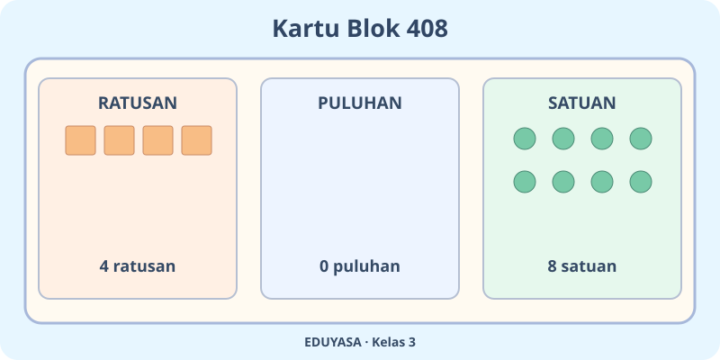
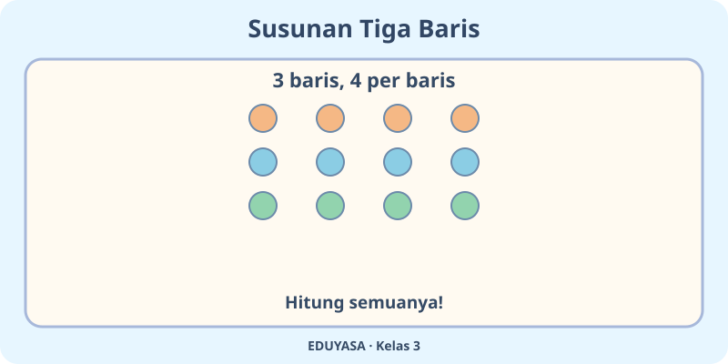
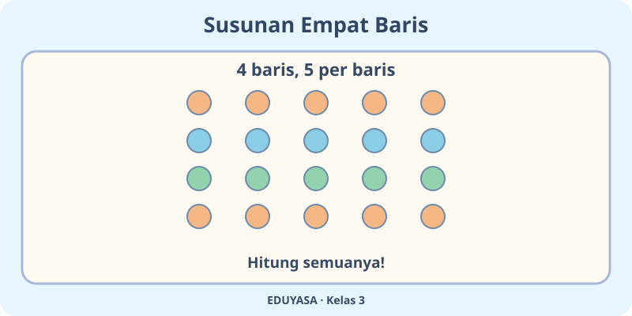
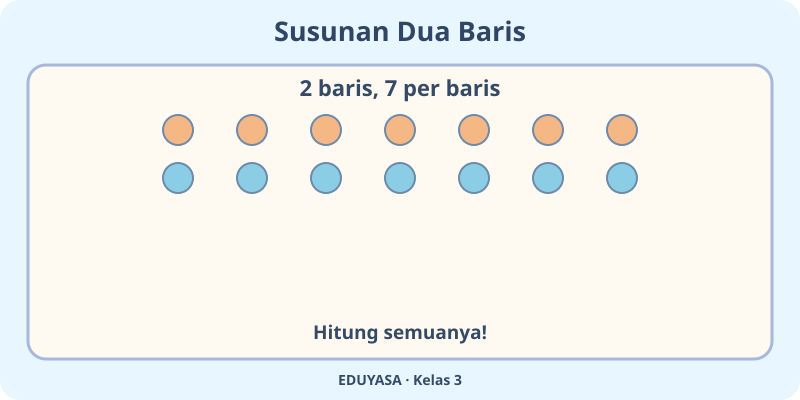
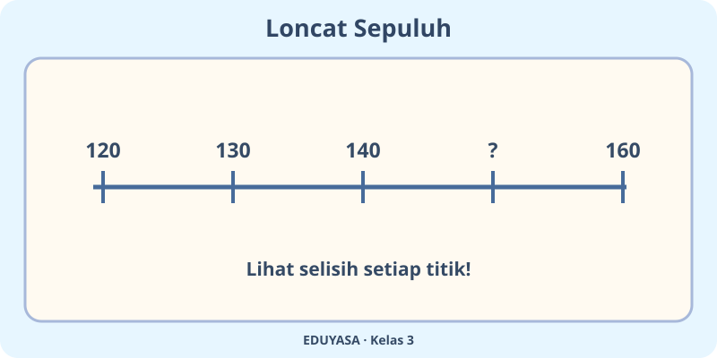
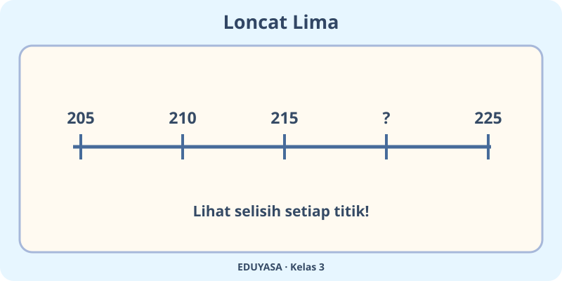
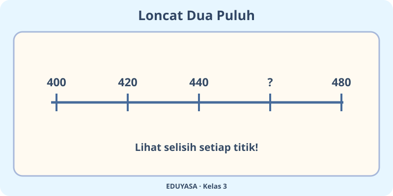

# Bilangan Cacah sampai 1.000 — 20 Soal Bergambar

**Kelas:** 3 | **Mapel:** MTK | **Bab:** K03-MTK-B01 | **MathJax:** `$...$`

Bank stimulus terpisah agar soal dapat diacak.

## Soal 51 — K03-MTK-B01-M01-051

**Pertanyaan:** Berapakah bilangan yang ditunjukkan blok ratusan, puluhan, dan satuan pada gambar?

**Pilihan jawaban:**
- $243$
- $244$
- $242$
- $253$

**Kunci Jawaban:** $243$

**Pembahasan:** Nilainya $200+40+3=243$.

---

## Soal 52 — K03-MTK-B01-M01-052

**Pertanyaan:** Berapa nilai dari blok puluhan pada gambar?

**Pilihan jawaban:**
- $41$
- $40$
- $50$
- $30$

**Kunci Jawaban:** $40$

**Pembahasan:** $4$ batang puluhan memiliki nilai $40$.

---

## Soal 53 — K03-MTK-B01-M01-053

**Pertanyaan:** Berapakah bilangan yang ditunjukkan blok ratusan, puluhan, dan satuan pada gambar?

**Pilihan jawaban:**
- $516$
- $527$
- $517$
- $518$

**Kunci Jawaban:** $517$

**Pembahasan:** Nilainya $500+10+7=517$.

---

## Soal 54 — K03-MTK-B01-M01-054

**Pertanyaan:** Berapa nilai dari blok puluhan pada gambar?

**Pilihan jawaban:**
- $20$
- $0$
- $11$
- $10$

**Kunci Jawaban:** $10$

**Pembahasan:** $1$ batang puluhan memiliki nilai $10$.

---

## Soal 55 — K03-MTK-B01-M01-055

**Pertanyaan:** Berapakah bilangan yang ditunjukkan blok ratusan, puluhan, dan satuan pada gambar?

**Pilihan jawaban:**
- $631$
- $629$
- $640$
- $630$

**Kunci Jawaban:** $630$

**Pembahasan:** Nilainya $600+30+0=630$.

---

## Soal 56 — K03-MTK-B01-M01-056

**Pertanyaan:** Berapa nilai dari blok puluhan pada gambar?

**Pilihan jawaban:**
- $30$
- $40$
- $20$
- $31$

**Kunci Jawaban:** $30$

**Pembahasan:** $3$ batang puluhan memiliki nilai $30$.

---

## Soal 57 — K03-MTK-B01-M01-057

**Pertanyaan:** Berapakah bilangan yang ditunjukkan blok ratusan, puluhan, dan satuan pada gambar?

**Pilihan jawaban:**
- $418$
- $408$
- $409$
- $407$

**Kunci Jawaban:** $408$

**Pembahasan:** Nilainya $400+0+8=408$.

---

## Soal 58 — K03-MTK-B01-M01-058

**Pertanyaan:** Berapa nilai dari blok puluhan pada gambar?

**Pilihan jawaban:**
- $1$
- $20$
- $0$
- $10$

**Kunci Jawaban:** $0$

**Pembahasan:** $0$ batang puluhan memiliki nilai $0$.

---

## Soal 59 — K03-MTK-B01-M01-059

**Pertanyaan:** Berapakah jumlah semua bulatan pada gambar?

**Pilihan jawaban:**
- $11$
- $16$
- $12$
- $13$

**Kunci Jawaban:** $12$

**Pembahasan:** $3\times4=12$ bulatan.

---

## Soal 60 — K03-MTK-B01-M01-060

**Pertanyaan:** Berapa bulatan dalam satu baris pada gambar?

**Pilihan jawaban:**
- $5$
- $3$
- $6$
- $4$

**Kunci Jawaban:** $4$

**Pembahasan:** Semua $12$ bulatan dibagi ke $3$ baris: $12\div3=4$.

---

## Soal 61 — K03-MTK-B01-M01-061

**Pertanyaan:** Berapakah jumlah semua bulatan pada gambar?

**Pilihan jawaban:**
- $20$
- $21$
- $19$
- $25$

**Kunci Jawaban:** $20$

**Pembahasan:** $4\times5=20$ bulatan.

---

## Soal 62 — K03-MTK-B01-M01-062

**Pertanyaan:** Berapa bulatan dalam satu baris pada gambar?

**Pilihan jawaban:**
- $7$
- $5$
- $6$
- $4$

**Kunci Jawaban:** $5$

**Pembahasan:** Semua $20$ bulatan dibagi ke $4$ baris: $20\div4=5$.

---

## Soal 63 — K03-MTK-B01-M01-063

**Pertanyaan:** Berapakah jumlah semua bulatan pada gambar?

**Pilihan jawaban:**
- $21$
- $14$
- $15$
- $13$

**Kunci Jawaban:** $14$

**Pembahasan:** $2\times7=14$ bulatan.

---

## Soal 64 — K03-MTK-B01-M01-064

**Pertanyaan:** Berapa bulatan dalam satu baris pada gambar?

**Pilihan jawaban:**
- $6$
- $9$
- $7$
- $8$

**Kunci Jawaban:** $7$

**Pembahasan:** Semua $14$ bulatan dibagi ke $2$ baris: $14\div2=7$.

---

## Soal 65 — K03-MTK-B01-M01-065

**Pertanyaan:** Tanda tanya pada garis bilangan bernilai ...

**Pilihan jawaban:**
- $160$
- $140$
- $151$
- $150$

**Kunci Jawaban:** $150$

**Pembahasan:** Mulai dari $120$, tambah $10$ tiap langkah, sampai $150$.

---

## Soal 66 — K03-MTK-B01-M01-066

**Pertanyaan:** Berapakah selisih dua titik bersebelahan pada garis bilangan itu?

**Pilihan jawaban:**
- $10$
- $11$
- $9$
- $20$

**Kunci Jawaban:** $10$

**Pembahasan:** Setiap perpindahan pada garis bernilai $10$.

---

## Soal 67 — K03-MTK-B01-M01-067

**Pertanyaan:** Tanda tanya pada garis bilangan bernilai ...

**Pilihan jawaban:**
- $220$
- $225$
- $215$
- $221$

**Kunci Jawaban:** $220$

**Pembahasan:** Mulai dari $205$, tambah $5$ tiap langkah, sampai $220$.

---

## Soal 68 — K03-MTK-B01-M01-068

**Pertanyaan:** Berapakah selisih dua titik bersebelahan pada garis bilangan itu?

**Pilihan jawaban:**
- $15$
- $5$
- $6$
- $4$

**Kunci Jawaban:** $5$

**Pembahasan:** Setiap perpindahan pada garis bernilai $5$.

---

## Soal 69 — K03-MTK-B01-M01-069

**Pertanyaan:** Tanda tanya pada garis bilangan bernilai ...

**Pilihan jawaban:**
- $440$
- $461$
- $460$
- $480$

**Kunci Jawaban:** $460$

**Pembahasan:** Mulai dari $400$, tambah $20$ tiap langkah, sampai $460$.

---

## Soal 70 — K03-MTK-B01-M01-070

**Pertanyaan:** Berapakah selisih dua titik bersebelahan pada garis bilangan itu?

**Pilihan jawaban:**
- $21$
- $19$
- $30$
- $20$

**Kunci Jawaban:** $20$

**Pembahasan:** Setiap perpindahan pada garis bernilai $20$.
