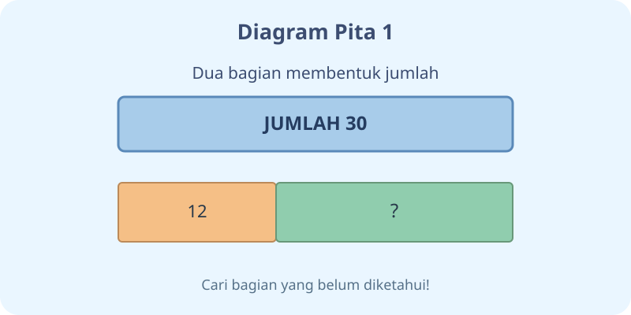
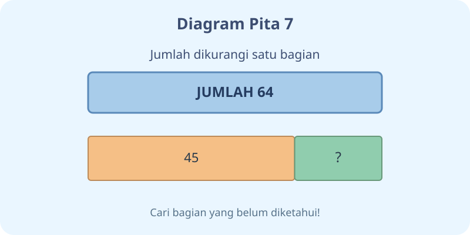

# Kalimat Matematika — Dua Modul

**Kelas:** 3 SD | **Bab:** K03-MTK-B02 | **Kurikulum:** Merdeka

**Rujukan:** Buku Siswa Matematika SD/MI Kelas III, Susanto dkk., 2022, Bab 2 (kalimat matematika penjumlahan dan pengurangan).

**Standar:** Gunakan LaTeX MathJax `$...$` dan `$$...$$` untuk seluruh penulisan matematika. Jangan mengganti rumus selama konversi JSON; Codex menangani escape backslash.

---

## K03-MTK-B02-MOD-01

# Kotak Misteri Matematika

Halo, Penemu! Kadang kita tahu jumlah seluruh benda, tetapi belum tahu salah satu bagiannya. Di sinilah **kalimat matematika** membantu. Kotak kosong $\square$ menyimpan bilangan yang harus dicari.

## Kotak penjumlahan

Contoh: Ada $17$ buku cerita dan beberapa buku komik. Seluruhnya $45$ buku. Kalimatnya $17+\square=45$. Untuk menemukan yang hilang, hitung $45-17=28$. Jadi $\square=28$.

**Coba jawab:** Mengapa kita tidak menjumlahkan $45$ dengan $17$? Karena $45$ sudah jumlah keseluruhan. Kita mencari *selisihnya*.

## Kotak pengurangan

Ada $68$ apel. Setelah sebagian dibagikan, tersisa $29$. Kalimatnya $68-\square=29$. Berapakah apel dibagikan? Hitung $68-29=39$. Jadi $\square=39$.

Jika yang belum diketahui justru bilangan mula-mula, misalnya $\square-18=25$, cari dengan $25+18=43$. Kita bisa memeriksa: $43-18=25$.

## Rahasia memeriksa jawaban

Hubungan penjumlahan dan pengurangan saling membantu: dari $24+16=40$, kita tahu $40-24=16$ dan $40-16=24$.

**Misi akhir:** Tuliskan kalimat matematika dari cerita: Nara memiliki $32$ kelereng, lalu diberi lagi hingga $57$. Berapa tambahan kelereng? Jelaskan langkahnya!

---

## K03-MTK-B02-MOD-02

# Penyelidik Bagian Hilang

Selamat datang di toko mainan khayalan! Ada dua kantong mainan; satu kantong tidak memiliki label. Kamu perlu membantu penjaga toko mencari **bilangan yang hilang**.

## Penyelidikan pertama: benda bertambah

Di meja ada $26$ mobil mainan. Setelah kotak misteri dibuka, semuanya menjadi $63$. Tuliskan $26+\square=63$. Karena kita ingin mencari bagian yang ditambahkan, hitung $63-26=37$. Hasilnya $\square=37$.

**Pertanyaan:** Jika hasil hitungmu benar, berapa $26+37$? Jawab: $63$. Jadi jawabanmu cocok.

## Penyelidikan kedua: benda berkurang

Ada $74$ balok. Sebagiannya dipinjam teman, sehingga tersisa $48$. Bentuk kalimatnya $74-\square=48$. Maka bagian dipinjam adalah $74-48=26$.

Bagaimana bila yang hilang bilangan awal? Contoh $\square-23=19$. Jumlahkan kembali $19+23=42$. Periksa $42-23=19$.

## Tiga pertanyaan penting

Saat membaca soal cerita, tanyakan: **(1)** Apa yang sudah diketahui? **(2)** Apa yang belum diketahui? **(3)** Apakah ceritanya bertambah atau berkurang? Setelah itu pilih kalimat yang tepat. Tidak semua cerita langsung selesai dengan menjumlahkan angka-angkanya.

**Tantangan detektif:** Ciptakan cerita yang sesuai dengan $18+\square=52$. Minta teman menyelesaikannya, kemudian bandingkan caramu.
