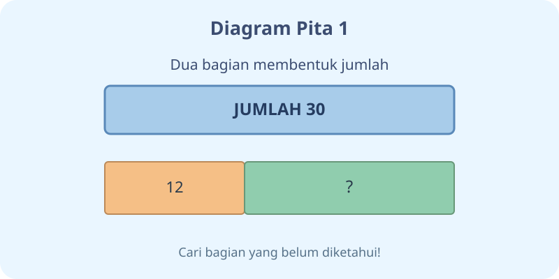
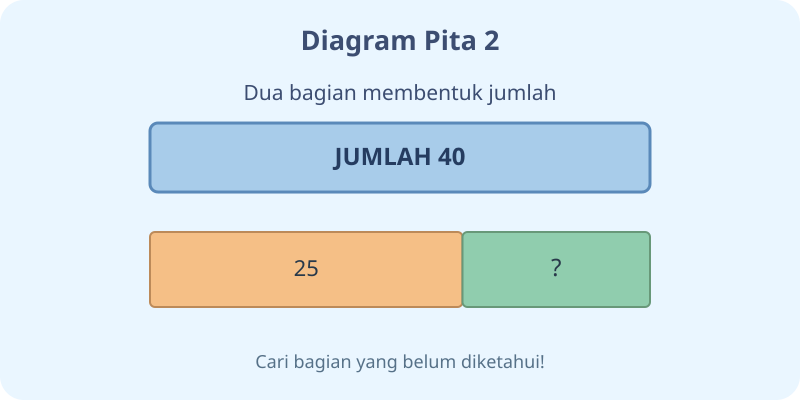
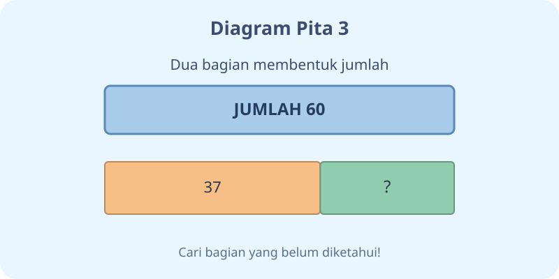
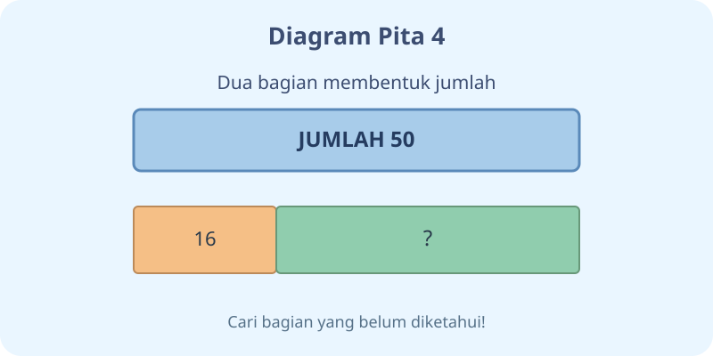
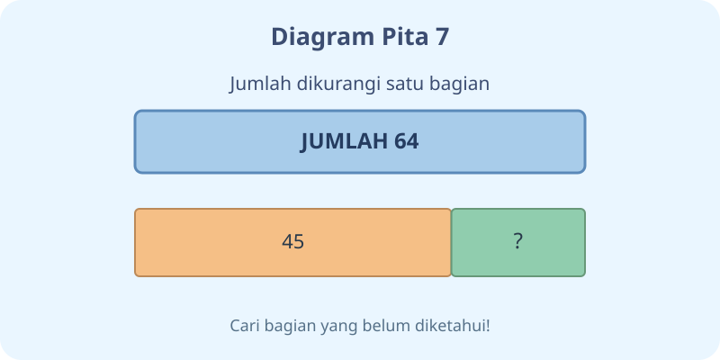
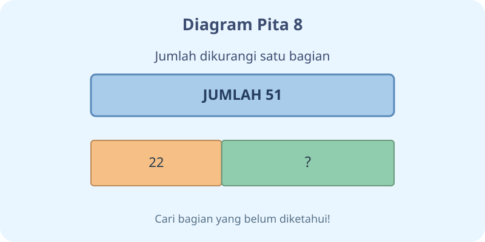
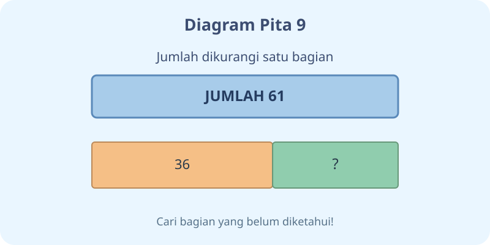
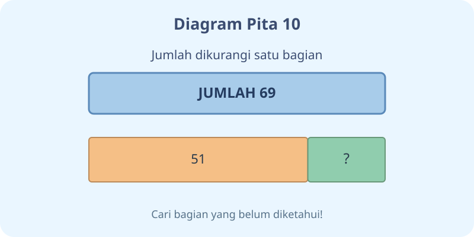

# Kalimat Matematika — 20 Soal Bergambar

Kelas 3 · Matematika · K03-MTK-B02 · MathJax

## Soal 51 — K03-MTK-B02-M01-051

**Pertanyaan:** Berapakah nilai bagian bertanda $\square$ pada diagram pita?

**Pilihan jawaban:**
- $18$
- $19$
- $17$
- $28$

**Kunci Jawaban:** $18$

**Pembahasan:** $30-12=18$ karena jumlah sama dengan seluruh bagiannya.

---

## Soal 52 — K03-MTK-B02-M01-052

**Pertanyaan:** Kalimat penjumlahan yang sesuai dengan gambar adalah ...

**Pilihan jawaban:**
- $12-18=30$
- $12+18=30$
- $12+30=18$
- $30+18=12$

**Kunci Jawaban:** $12+18=30$

**Pembahasan:** Jumlah $30$, bagian pertama $12$, dan bagian kedua $18$; maka $12+18=30$.

---

## Soal 53 — K03-MTK-B02-M01-053

**Pertanyaan:** Berapakah nilai bagian bertanda $\square$ pada diagram pita?

**Pilihan jawaban:**
- $14$
- $25$
- $15$
- $16$

**Kunci Jawaban:** $15$

**Pembahasan:** $40-25=15$ karena jumlah sama dengan seluruh bagiannya.

---

## Soal 54 — K03-MTK-B02-M01-054

**Pertanyaan:** Kalimat penjumlahan yang sesuai dengan gambar adalah ...

**Pilihan jawaban:**
- $25+40=15$
- $40+15=25$
- $25-15=40$
- $25+15=40$

**Kunci Jawaban:** $25+15=40$

**Pembahasan:** Jumlah $40$, bagian pertama $25$, dan bagian kedua $15$; maka $25+15=40$.

---

## Soal 55 — K03-MTK-B02-M01-055

**Pertanyaan:** Berapakah nilai bagian bertanda $\square$ pada diagram pita?

**Pilihan jawaban:**
- $24$
- $22$
- $33$
- $23$

**Kunci Jawaban:** $23$

**Pembahasan:** $60-37=23$ karena jumlah sama dengan seluruh bagiannya.

---

## Soal 56 — K03-MTK-B02-M01-056

**Pertanyaan:** Kalimat penjumlahan yang sesuai dengan gambar adalah ...

**Pilihan jawaban:**
- $37+23=60$
- $37+60=23$
- $60+23=37$
- $37-23=60$

**Kunci Jawaban:** $37+23=60$

**Pembahasan:** Jumlah $60$, bagian pertama $37$, dan bagian kedua $23$; maka $37+23=60$.

---

## Soal 57 — K03-MTK-B02-M01-057

**Pertanyaan:** Berapakah nilai bagian bertanda $\square$ pada diagram pita?

**Pilihan jawaban:**
- $44$
- $34$
- $35$
- $33$

**Kunci Jawaban:** $34$

**Pembahasan:** $50-16=34$ karena jumlah sama dengan seluruh bagiannya.

---

## Soal 58 — K03-MTK-B02-M01-058

**Pertanyaan:** Kalimat penjumlahan yang sesuai dengan gambar adalah ...

**Pilihan jawaban:**
- $50+34=16$
- $16-34=50$
- $16+34=50$
- $16+50=34$

**Kunci Jawaban:** $16+34=50$

**Pembahasan:** Jumlah $50$, bagian pertama $16$, dan bagian kedua $34$; maka $16+34=50$.

---

## Soal 59 — K03-MTK-B02-M01-059

**Pertanyaan:** Berapakah nilai bagian bertanda $\square$ pada diagram pita?

**Pilihan jawaban:**
- $26$
- $37$
- $27$
- $28$

**Kunci Jawaban:** $27$

**Pembahasan:** $69-42=27$ karena jumlah sama dengan seluruh bagiannya.

---

## Soal 60 — K03-MTK-B02-M01-060

**Pertanyaan:** Kalimat penjumlahan yang sesuai dengan gambar adalah ...

**Pilihan jawaban:**
- $42+69=27$
- $69+27=42$
- $42-27=69$
- $42+27=69$

**Kunci Jawaban:** $42+27=69$

**Pembahasan:** Jumlah $69$, bagian pertama $42$, dan bagian kedua $27$; maka $42+27=69$.

---

## Soal 61 — K03-MTK-B02-M01-061

**Pertanyaan:** Berapakah nilai bagian bertanda $\square$ pada diagram pita?

**Pilihan jawaban:**
- $17$
- $18$
- $16$
- $27$

**Kunci Jawaban:** $17$

**Pembahasan:** $48-31=17$ karena jumlah sama dengan seluruh bagiannya.

---

## Soal 62 — K03-MTK-B02-M01-062

**Pertanyaan:** Kalimat pengurangan yang sesuai dengan gambar adalah ...

**Pilihan jawaban:**
- $17-31=48$
- $48-31=17$
- $31-48=17$
- $48+31=17$

**Kunci Jawaban:** $48-31=17$

**Pembahasan:** Jumlah $48$, bagian pertama $31$, dan bagian kedua $17$; maka $48-31=17$.

---

## Soal 63 — K03-MTK-B02-M01-063

**Pertanyaan:** Berapakah nilai bagian bertanda $\square$ pada diagram pita?

**Pilihan jawaban:**
- $29$
- $19$
- $20$
- $18$

**Kunci Jawaban:** $19$

**Pembahasan:** $64-45=19$ karena jumlah sama dengan seluruh bagiannya.

---

## Soal 64 — K03-MTK-B02-M01-064

**Pertanyaan:** Kalimat pengurangan yang sesuai dengan gambar adalah ...

**Pilihan jawaban:**
- $64+45=19$
- $19-45=64$
- $64-45=19$
- $45-64=19$

**Kunci Jawaban:** $64-45=19$

**Pembahasan:** Jumlah $64$, bagian pertama $45$, dan bagian kedua $19$; maka $64-45=19$.

---

## Soal 65 — K03-MTK-B02-M01-065

**Pertanyaan:** Berapakah nilai bagian bertanda $\square$ pada diagram pita?

**Pilihan jawaban:**
- $30$
- $28$
- $39$
- $29$

**Kunci Jawaban:** $29$

**Pembahasan:** $51-22=29$ karena jumlah sama dengan seluruh bagiannya.

---

## Soal 66 — K03-MTK-B02-M01-066

**Pertanyaan:** Kalimat pengurangan yang sesuai dengan gambar adalah ...

**Pilihan jawaban:**
- $51-22=29$
- $22-51=29$
- $51+22=29$
- $29-22=51$

**Kunci Jawaban:** $51-22=29$

**Pembahasan:** Jumlah $51$, bagian pertama $22$, dan bagian kedua $29$; maka $51-22=29$.

---

## Soal 67 — K03-MTK-B02-M01-067

**Pertanyaan:** Berapakah nilai bagian bertanda $\square$ pada diagram pita?

**Pilihan jawaban:**
- $25$
- $26$
- $24$
- $35$

**Kunci Jawaban:** $25$

**Pembahasan:** $61-36=25$ karena jumlah sama dengan seluruh bagiannya.

---

## Soal 68 — K03-MTK-B02-M01-068

**Pertanyaan:** Kalimat pengurangan yang sesuai dengan gambar adalah ...

**Pilihan jawaban:**
- $25-36=61$
- $61-36=25$
- $36-61=25$
- $61+36=25$

**Kunci Jawaban:** $61-36=25$

**Pembahasan:** Jumlah $61$, bagian pertama $36$, dan bagian kedua $25$; maka $61-36=25$.

---

## Soal 69 — K03-MTK-B02-M01-069

**Pertanyaan:** Berapakah nilai bagian bertanda $\square$ pada diagram pita?

**Pilihan jawaban:**
- $17$
- $28$
- $18$
- $19$

**Kunci Jawaban:** $18$

**Pembahasan:** $69-51=18$ karena jumlah sama dengan seluruh bagiannya.

---

## Soal 70 — K03-MTK-B02-M01-070

**Pertanyaan:** Kalimat pengurangan yang sesuai dengan gambar adalah ...

**Pilihan jawaban:**
- $51-69=18$
- $69+51=18$
- $18-51=69$
- $69-51=18$

**Kunci Jawaban:** $69-51=18$

**Pembahasan:** Jumlah $69$, bagian pertama $51$, dan bagian kedua $18$; maka $69-51=18$.
