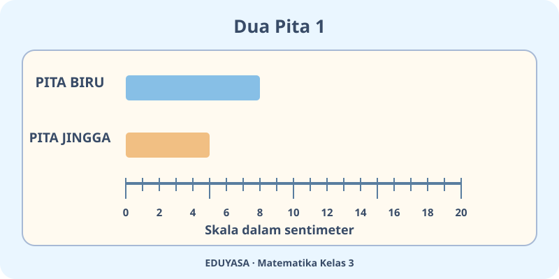
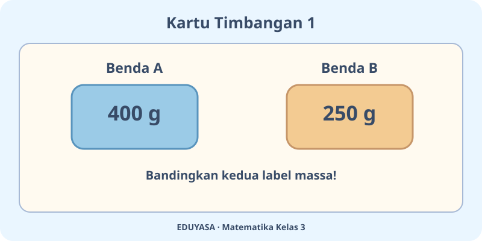

# Pengukuran Panjang dan Berat — Dua Modul

**Kelas:** 3 SD | **ID bab:** K03-MTK-B03

**Acuan:** Matematika untuk SD/MI Kelas III, Susanto dkk., Pusat Perbukuan, 2022, Bab 3 subbab A–D. 

**Standar:** notasi matematika LaTeX/MathJax `$...$` dan `$$...$$`; satuan di dalam rumus menggunakan `\text{cm}`, `\text{m}`, `\text{g}`, dan `\text{kg}`. Simpan Markdown biasa, tanpa konversi JSON.

---

## K03-MTK-B03-MOD-01

# Laboratorium Ukur yang Seru!

Halo, Peneliti Cilik! Pernah mengukur pensil, tinggi pintu, atau menimbang sebungkus beras? Agar semua orang memperoleh hasil yang sama, kita memakai **satuan baku**.

## Panjang: ayo mulai dari nol

Panjang pensil bisa diukur dengan penggaris, sedangkan panjang meja lebih mudah dengan meteran. Tempelkan ujung benda tepat di angka $0$ dan baca skala di ujung lainnya. Untuk benda kecil gunakan sentimeter atau $\text{cm}$; untuk yang lebih besar, meter atau $\text{m}$.

Ingat hubungan $1\ \text{m}=100\ \text{cm}$. Jadi $3\ \text{m}=300\ \text{cm}$. Untuk jarak antar-kota, kita dapat memakai kilometer; $1\ \text{km}=1000\ \text{m}$.

## Berat atau massa benda

Di pasar, beras dan buah ditimbang dengan timbangan. Dalam pelajaran sehari-hari, kita menyebutnya berat benda; alat ukur menunjukkan massa dalam gram ($\text{g}$) atau kilogram ($\text{kg}$).

Satu kilogram sama dengan $1000\ \text{g}$. Jika sebuah paket berisi $2\ \text{kg}$, itu berarti $2000\ \text{g}$. Kamu bisa membandingkan paket tanpa menebak dari ukuran kemasannya.

**Tantangan:** Ukur pensilmu dengan penggaris, lalu catat dalam $\text{cm}$. Diskusikan mengapa orang harus memakai satuan yang sama. Jangan mengangkat benda berat sendirian!

---

## K03-MTK-B03-MOD-02

# Agen Ukur: Misi Pita dan Timbangan

Selamat datang, Agen Ukur! Di meja ada penggaris, meteran, serta timbangan. Pilih alat yang tepat: **penggaris untuk pensil**, **meteran untuk meja**, dan **timbangan untuk bahan makanan**.

## Misi pertama: dua pita

Pita biru panjangnya $8\ \text{cm}$ dan pita jingga $5\ \text{cm}$. Pita mana lebih panjang? Ya, pita biru! Selisihnya $8-5=3\ \text{cm}$. Perhatikan gambar, pastikan pengukuran dimulai dari $0$.

Jika kamu punya pita sepanjang $2\ \text{m}$, berapa sentimeter? Karena $1\ \text{m}=100\ \text{cm}$, panjangnya $200\ \text{cm}$. Jarak jauh bisa ditulis dalam $\text{km}$ dan $1\ \text{km}=1000\ \text{m}$.

## Misi kedua: menimbang belanjaan

Berapa gram dalam $1\ \text{kg}$? Betul, $1000\ \text{g}$. Dua bungkus beras masing-masing $1\ \text{kg}$ memiliki jumlah $2\ \text{kg}$ atau $2000\ \text{g}$.

**Jebakan detektif:** Kotak besar belum tentu lebih berat daripada kotak kecil. Yang menentukan adalah hasil timbangan, bukan rupa kemasannya.

## Coba sendiri

Catat dua panjang benda di kelas dan hitung selisihnya dengan satuan yang sama. Lalu pilih satu benda di rumah yang biasa ditimbang dengan gram dan satu lagi dengan kilogram. Jelaskan pilihanmu kepada keluarga.

**Catatan keamanan:** Pengukuran dan penimbangan dilakukan dengan alat yang aman, bersama pendamping jika diperlukan.
