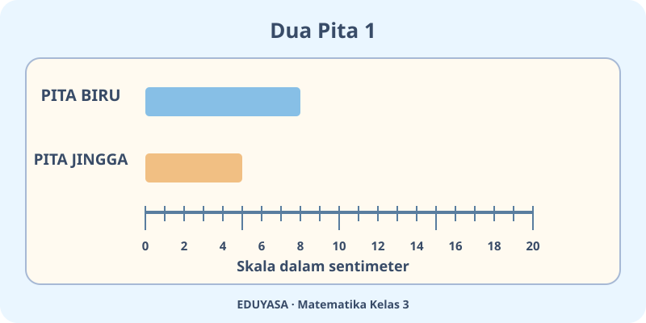
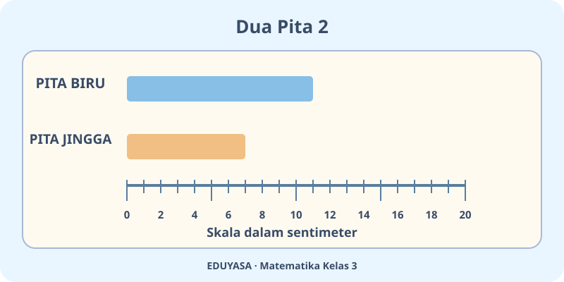
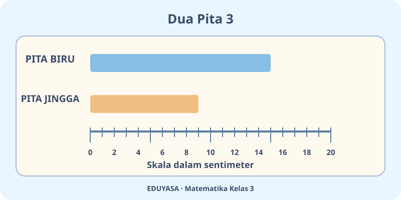
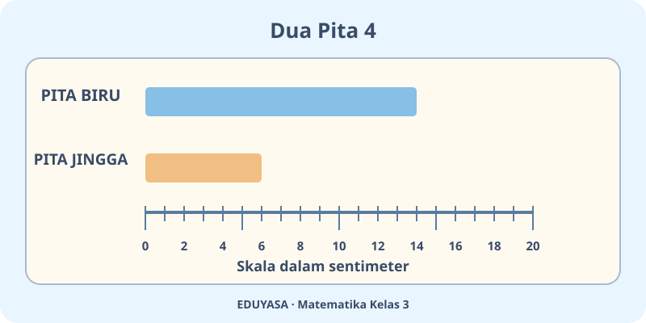
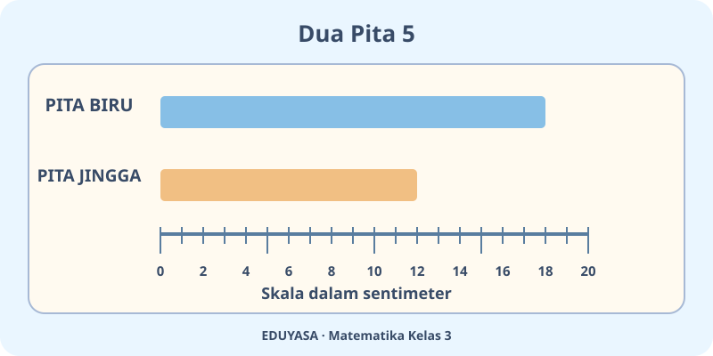
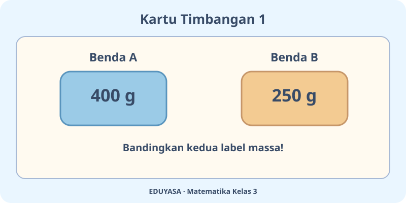
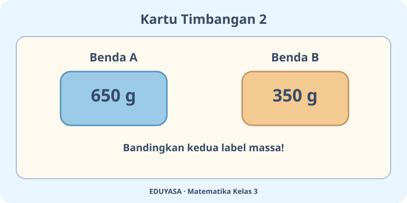
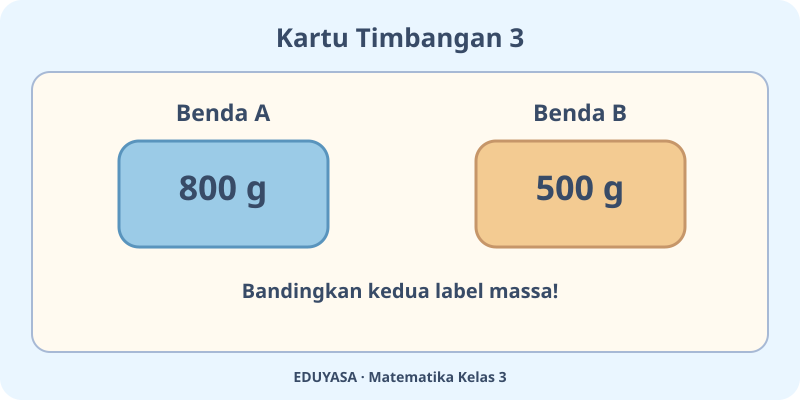
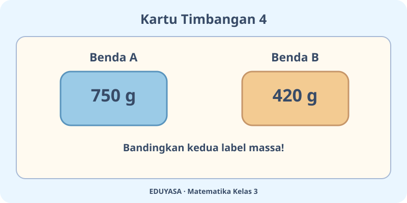

# Pengukuran Panjang dan Berat — 20 Soal Bergambar

ID bab K03-MTK-B03 | Matematika Kelas 3 | LaTeX/MathJax

## Soal 51 — K03-MTK-B03-M01-051

**Pertanyaan:** Menurut gambar, panjang pita biru adalah ...

**Pilihan jawaban:**
- $8\ \text{cm}$
- $9\ \text{cm}$
- $7\ \text{cm}$
- $10\ \text{cm}$

**Kunci Jawaban:** $8\ \text{cm}$

**Pembahasan:** Pita biru berakhir di tanda $8\ \text{cm}$.

---

## Soal 52 — K03-MTK-B03-M01-052

**Pertanyaan:** Berapa selisih panjang kedua pita pada gambar?

**Pilihan jawaban:**
- $5\ \text{cm}$
- $3\ \text{cm}$
- $4\ \text{cm}$
- $2\ \text{cm}$

**Kunci Jawaban:** $3\ \text{cm}$

**Pembahasan:** $8-5=3$ sentimeter.

---

## Soal 53 — K03-MTK-B03-M01-053

**Pertanyaan:** Menurut gambar, panjang pita biru adalah ...

**Pilihan jawaban:**
- $10\ \text{cm}$
- $13\ \text{cm}$
- $11\ \text{cm}$
- $12\ \text{cm}$

**Kunci Jawaban:** $11\ \text{cm}$

**Pembahasan:** Pita biru berakhir di tanda $11\ \text{cm}$.

---

## Soal 54 — K03-MTK-B03-M01-054

**Pertanyaan:** Berapa selisih panjang kedua pita pada gambar?

**Pilihan jawaban:**
- $5\ \text{cm}$
- $3\ \text{cm}$
- $6\ \text{cm}$
- $4\ \text{cm}$

**Kunci Jawaban:** $4\ \text{cm}$

**Pembahasan:** $11-7=4$ sentimeter.

---

## Soal 55 — K03-MTK-B03-M01-055

**Pertanyaan:** Menurut gambar, panjang pita biru adalah ...

**Pilihan jawaban:**
- $16\ \text{cm}$
- $14\ \text{cm}$
- $17\ \text{cm}$
- $15\ \text{cm}$

**Kunci Jawaban:** $15\ \text{cm}$

**Pembahasan:** Pita biru berakhir di tanda $15\ \text{cm}$.

---

## Soal 56 — K03-MTK-B03-M01-056

**Pertanyaan:** Berapa selisih panjang kedua pita pada gambar?

**Pilihan jawaban:**
- $6\ \text{cm}$
- $7\ \text{cm}$
- $5\ \text{cm}$
- $8\ \text{cm}$

**Kunci Jawaban:** $6\ \text{cm}$

**Pembahasan:** $15-9=6$ sentimeter.

---

## Soal 57 — K03-MTK-B03-M01-057

**Pertanyaan:** Menurut gambar, panjang pita biru adalah ...

**Pilihan jawaban:**
- $16\ \text{cm}$
- $14\ \text{cm}$
- $15\ \text{cm}$
- $13\ \text{cm}$

**Kunci Jawaban:** $14\ \text{cm}$

**Pembahasan:** Pita biru berakhir di tanda $14\ \text{cm}$.

---

## Soal 58 — K03-MTK-B03-M01-058

**Pertanyaan:** Berapa selisih panjang kedua pita pada gambar?

**Pilihan jawaban:**
- $7\ \text{cm}$
- $10\ \text{cm}$
- $8\ \text{cm}$
- $9\ \text{cm}$

**Kunci Jawaban:** $8\ \text{cm}$

**Pembahasan:** $14-6=8$ sentimeter.

---

## Soal 59 — K03-MTK-B03-M01-059

**Pertanyaan:** Menurut gambar, panjang pita biru adalah ...

**Pilihan jawaban:**
- $17\ \text{cm}$
- $20\ \text{cm}$
- $18\ \text{cm}$
- $19\ \text{cm}$

**Kunci Jawaban:** $18\ \text{cm}$

**Pembahasan:** Pita biru berakhir di tanda $18\ \text{cm}$.

---

## Soal 60 — K03-MTK-B03-M01-060

**Pertanyaan:** Berapa selisih panjang kedua pita pada gambar?

**Pilihan jawaban:**
- $7\ \text{cm}$
- $5\ \text{cm}$
- $8\ \text{cm}$
- $6\ \text{cm}$

**Kunci Jawaban:** $6\ \text{cm}$

**Pembahasan:** $18-12=6$ sentimeter.

---

## Soal 61 — K03-MTK-B03-M01-061

**Pertanyaan:** Berapakah massa benda A menurut gambar?

**Pilihan jawaban:**
- $400\ \text{g}$
- $410\ \text{g}$
- $390\ \text{g}$
- $450\ \text{g}$

**Kunci Jawaban:** $400\ \text{g}$

**Pembahasan:** Label benda A menunjukkan $400\ \text{g}$.

---

## Soal 62 — K03-MTK-B03-M01-062

**Pertanyaan:** Berapa selisih massa benda A dan benda B?

**Pilihan jawaban:**
- $200\ \text{g}$
- $150\ \text{g}$
- $160\ \text{g}$
- $140\ \text{g}$

**Kunci Jawaban:** $150\ \text{g}$

**Pembahasan:** $400-250=150$ gram.

---

## Soal 63 — K03-MTK-B03-M01-063

**Pertanyaan:** Berapakah massa benda A menurut gambar?

**Pilihan jawaban:**
- $700\ \text{g}$
- $650\ \text{g}$
- $660\ \text{g}$
- $640\ \text{g}$

**Kunci Jawaban:** $650\ \text{g}$

**Pembahasan:** Label benda A menunjukkan $650\ \text{g}$.

---

## Soal 64 — K03-MTK-B03-M01-064

**Pertanyaan:** Berapa selisih massa benda A dan benda B?

**Pilihan jawaban:**
- $290\ \text{g}$
- $350\ \text{g}$
- $300\ \text{g}$
- $310\ \text{g}$

**Kunci Jawaban:** $300\ \text{g}$

**Pembahasan:** $650-350=300$ gram.

---

## Soal 65 — K03-MTK-B03-M01-065

**Pertanyaan:** Berapakah massa benda A menurut gambar?

**Pilihan jawaban:**
- $810\ \text{g}$
- $790\ \text{g}$
- $850\ \text{g}$
- $800\ \text{g}$

**Kunci Jawaban:** $800\ \text{g}$

**Pembahasan:** Label benda A menunjukkan $800\ \text{g}$.

---

## Soal 66 — K03-MTK-B03-M01-066

**Pertanyaan:** Berapa selisih massa benda A dan benda B?

**Pilihan jawaban:**
- $300\ \text{g}$
- $310\ \text{g}$
- $290\ \text{g}$
- $350\ \text{g}$

**Kunci Jawaban:** $300\ \text{g}$

**Pembahasan:** $800-500=300$ gram.

---

## Soal 67 — K03-MTK-B03-M01-067

**Pertanyaan:** Berapakah massa benda A menurut gambar?

**Pilihan jawaban:**
- $750\ \text{g}$
- $760\ \text{g}$
- $740\ \text{g}$
- $800\ \text{g}$

**Kunci Jawaban:** $750\ \text{g}$

**Pembahasan:** Label benda A menunjukkan $750\ \text{g}$.

---

## Soal 68 — K03-MTK-B03-M01-068

**Pertanyaan:** Berapa selisih massa benda A dan benda B?

**Pilihan jawaban:**
- $380\ \text{g}$
- $330\ \text{g}$
- $340\ \text{g}$
- $320\ \text{g}$

**Kunci Jawaban:** $330\ \text{g}$

**Pembahasan:** $750-420=330$ gram.

---

## Soal 69 — K03-MTK-B03-M01-069

**Pertanyaan:** Berapakah massa benda A menurut gambar?

**Pilihan jawaban:**
- $890\ \text{g}$
- $950\ \text{g}$
- $900\ \text{g}$
- $910\ \text{g}$

**Kunci Jawaban:** $900\ \text{g}$

**Pembahasan:** Label benda A menunjukkan $900\ \text{g}$.

---

## Soal 70 — K03-MTK-B03-M01-070

**Pertanyaan:** Berapa selisih massa benda A dan benda B?

**Pilihan jawaban:**
- $310\ \text{g}$
- $290\ \text{g}$
- $350\ \text{g}$
- $300\ \text{g}$

**Kunci Jawaban:** $300\ \text{g}$

**Pembahasan:** $900-600=300$ gram.
