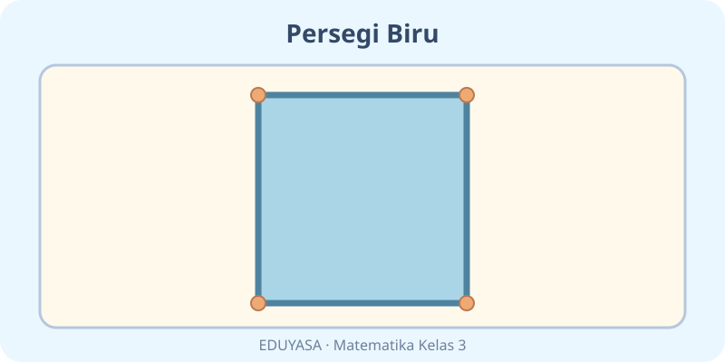
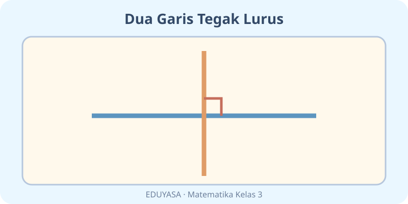

# Unsur-Unsur Bangun Datar — Dua Modul

**Kelas:** 3 SD | **ID Bab:** K03-MTK-B04 | **Acuan:** Matematika untuk SD/MI Kelas III, 2022, Bab 4 sisi, sudut, garis sejajar, garis tegak lurus.

Gunakan `$...$` dan `$$...$$` untuk semua notasi matematika. Pertahankan teks serta posisi ilustrasi ketika Codex mengonversi Markdown menjadi JSON.

---

## K03-MTK-B04-MOD-01

# Kota Bentuk: Berburu Sisi dan Sudut

Halo, Arsitek Cilik! Lihatlah papan tulis, jendela, atau ubin. Semuanya dapat mengingatkan kita pada **bangun datar**, yaitu bentuk pada bidang yang mempunyai panjang dan lebar.

## Sisi dan titik sudut

**Segitiga** mempunyai $3$ sisi dan $3$ titik sudut. **Persegi** dan **persegi panjang** sama-sama memiliki $4$ sisi serta $4$ titik sudut. Persegi punya sisi-sisi sama panjang, sedangkan pada persegi panjang sisi-sisi yang berhadapan sama panjang.

Ruas garis memiliki **dua titik ujung**. Sinar garis memiliki satu titik awal dan memanjang satu arah. Garis lurus dapat diperpanjang ke kedua arah. Benda nyata biasanya menunjukkan **ruas garis**, misalnya tepi penggaris.

## Sudut bisa dibuka lebar

Sudut terbentuk oleh dua kaki sudut yang bertemu. Sudut **lancip** lebih kecil dari $90^{\circ}$; **siku-siku** tepat $90^{\circ}$; **tumpul** di antara $90^{\circ}$ dan $180^{\circ}$; **lurus** tepat $180^{\circ}$.

## Sejajar atau tegak lurus?

Tepi atas dan bawah persegi panjang **sejajar** karena jika diperpanjang tidak bertemu. Sisi atas dan sampingnya **tegak lurus**, sebab berpotongan membentuk sudut $90^{\circ}$.

**Misi pengamat:** Temukan satu contoh ruas garis, satu sudut siku-siku, dan sepasang garis sejajar di kelas. Jelaskan pilihanmu kepada teman!

---

## K03-MTK-B04-MOD-02

# Permainan Bangun Datar — Siapa Aku?

Selamat datang di **Museum Bentuk Mini**. Setiap bangun punya kartu rahasia. Kamu harus menebaknya dari jumlah sisi, sudut, dan bentuk garisnya. Ayo mulai!

## Kartu pertama: hitung sisi

Kartu berbunyi: “Aku punya $3$ ruas garis sebagai sisi.” Jawabannya **segitiga**. Kartu lain: “Aku punya $4$ sisi yang sama panjang dan $4$ sudut siku-siku.” Jawabannya **persegi**.

Perhatikan setiap pojok yang mempertemukan dua sisi. Itulah titik sudut. Pada persegi panjang ada $4$ titik sudut. Berbeda dengan lingkaran, yang tidak dibatasi oleh sisi lurus seperti segi banyak.

## Kartu kedua: buka sudut!

Buat sudut dari dua batang sedotan dengan ujung yang disatukan (dibantu orang dewasa). Buka sedikit: kamu mendapat sudut lancip, lebih kecil dari $90^{\circ}$. Bentuk pojok huruf L: sudut siku-siku, tepat $90^{\circ}$. Buka lebih lebar dari siku-siku tapi kurang dari lurus: sudut tumpul.

## Kartu ketiga: pasangan garis

Bayangkan dua garis pada buku tulis yang sejajar. Keduanya tak berpotongan walau diperpanjang. Sekarang bayangkan bingkai jendela: garis atas dan samping bertemu tegak lurus. Ruas garis punya dua ujung; sinar garis satu titik awal; garis lurus tidak punya ujung dalam gambaran matematika.

**Tantangan mini:** Gambarlah persegi panjang. Lingkari semua titik sudutnya. Pilih dua sisi sejajar dan dua sisi tegak lurus, lalu jelaskan bagaimana kamu tahu.
