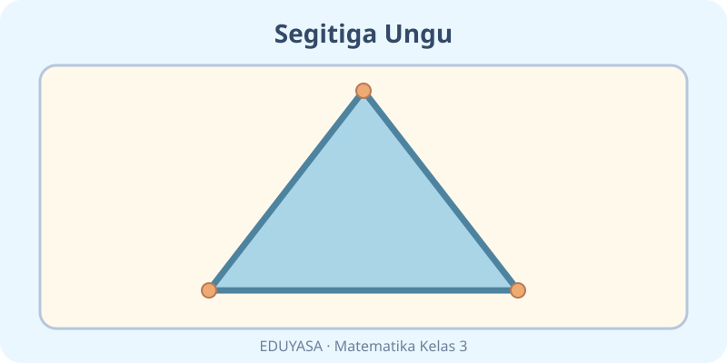
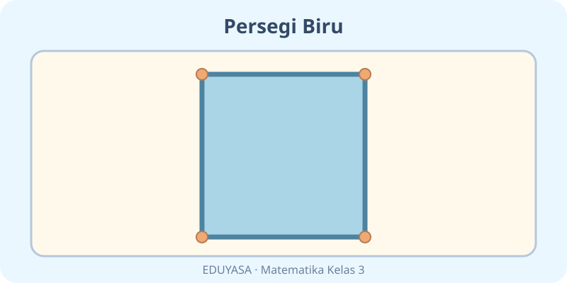
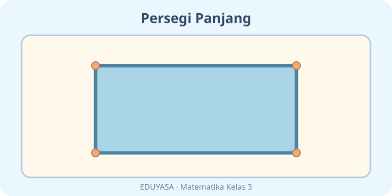
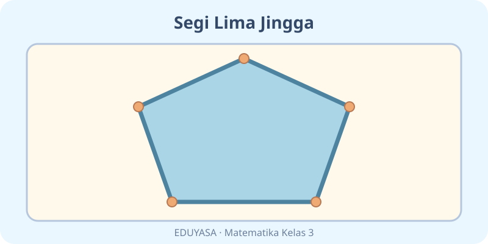
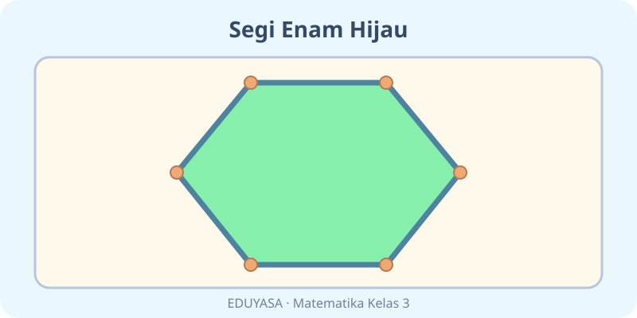
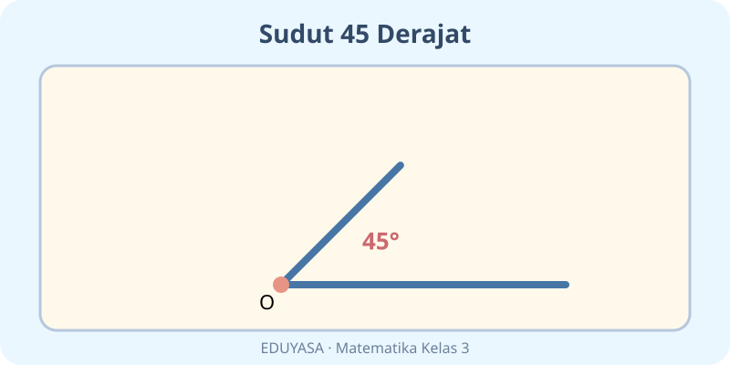
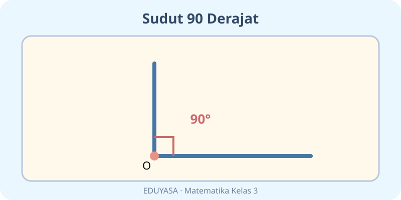
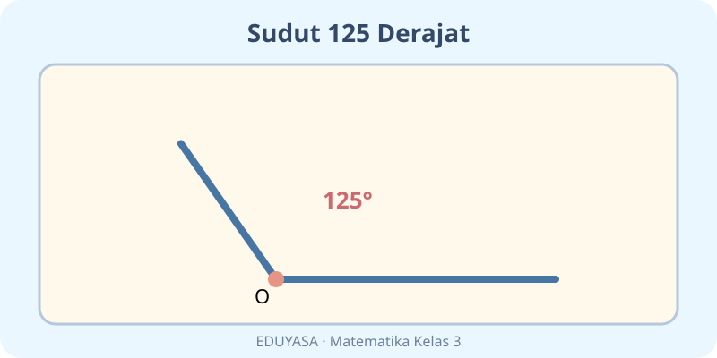
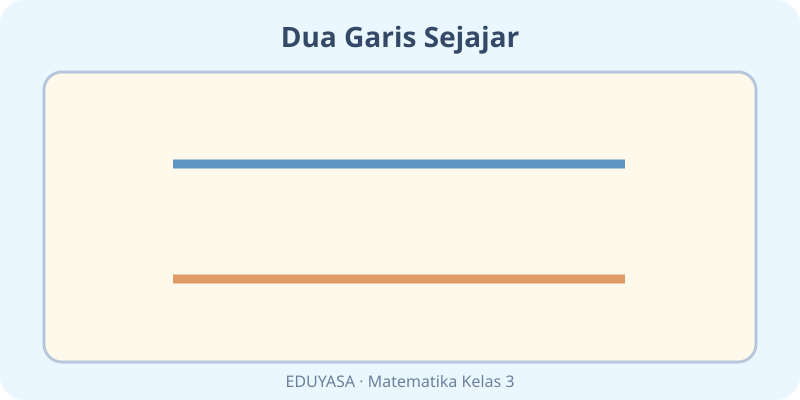
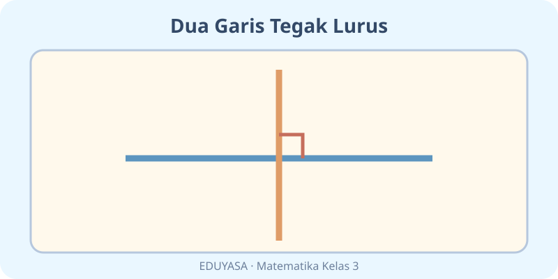

# Unsur-Unsur Bangun Datar — 20 Soal Bergambar

K03-MTK-B04 · Kelas 3 · Kurikulum Merdeka · MathJax

## Soal 51 — K03-MTK-B04-M01-051

**Pertanyaan:** Banyak sisi pada bangun yang terlihat adalah ...

**Pilihan jawaban:**
- $3$
- $4$
- $2$
- $5$

**Kunci Jawaban:** $3$

**Pembahasan:** Bangun segitiga memiliki $3$ sisi.

---

## Soal 52 — K03-MTK-B04-M01-052

**Pertanyaan:** Nama bangun pada gambar adalah ...

**Pilihan jawaban:**
- segi lima
- segitiga
- persegi
- persegi panjang

**Kunci Jawaban:** segitiga

**Pembahasan:** Gambar menunjukkan bangun segitiga.

---

## Soal 53 — K03-MTK-B04-M01-053

**Pertanyaan:** Banyak sisi pada bangun yang terlihat adalah ...

**Pilihan jawaban:**
- $3$
- $6$
- $4$
- $5$

**Kunci Jawaban:** $4$

**Pembahasan:** Bangun persegi memiliki $4$ sisi.

---

## Soal 54 — K03-MTK-B04-M01-054

**Pertanyaan:** Nama bangun pada gambar adalah ...

**Pilihan jawaban:**
- segitiga
- persegi panjang
- segi lima
- persegi

**Kunci Jawaban:** persegi

**Pembahasan:** Gambar menunjukkan bangun persegi.

---

## Soal 55 — K03-MTK-B04-M01-055

**Pertanyaan:** Banyak sisi pada bangun yang terlihat adalah ...

**Pilihan jawaban:**
- $5$
- $3$
- $6$
- $4$

**Kunci Jawaban:** $4$

**Pembahasan:** Bangun persegi panjang memiliki $4$ sisi.

---

## Soal 56 — K03-MTK-B04-M01-056

**Pertanyaan:** Nama bangun pada gambar adalah ...

**Pilihan jawaban:**
- persegi panjang
- segitiga
- persegi
- segi lima

**Kunci Jawaban:** persegi panjang

**Pembahasan:** Gambar menunjukkan bangun persegi panjang.

---

## Soal 57 — K03-MTK-B04-M01-057

**Pertanyaan:** Banyak sisi pada bangun yang terlihat adalah ...

**Pilihan jawaban:**
- $7$
- $5$
- $6$
- $4$

**Kunci Jawaban:** $5$

**Pembahasan:** Bangun segi lima memiliki $5$ sisi.

---

## Soal 58 — K03-MTK-B04-M01-058

**Pertanyaan:** Nama bangun pada gambar adalah ...

**Pilihan jawaban:**
- persegi
- persegi panjang
- segi lima
- segitiga

**Kunci Jawaban:** segi lima

**Pembahasan:** Gambar menunjukkan bangun segi lima.

---

## Soal 59 — K03-MTK-B04-M01-059

**Pertanyaan:** Banyak sisi pada bangun yang terlihat adalah ...

**Pilihan jawaban:**
- $5$
- $8$
- $6$
- $7$

**Kunci Jawaban:** $6$

**Pembahasan:** Bangun segi enam memiliki $6$ sisi.

---

## Soal 60 — K03-MTK-B04-M01-060

**Pertanyaan:** Nama bangun pada gambar adalah ...

**Pilihan jawaban:**
- segitiga
- persegi
- persegi panjang
- segi enam

**Kunci Jawaban:** segi enam

**Pembahasan:** Gambar menunjukkan bangun segi enam.

---

## Soal 61 — K03-MTK-B04-M01-061

**Pertanyaan:** Jenis sudut yang terlihat pada gambar adalah ...

**Pilihan jawaban:**
- sudut lancip
- sudut siku-siku
- sudut tumpul
- sudut lurus

**Kunci Jawaban:** sudut lancip

**Pembahasan:** $45^{\circ}$ termasuk sudut lancip.

---

## Soal 62 — K03-MTK-B04-M01-062

**Pertanyaan:** Berapa ukuran sudut yang ditunjukkan?

**Pilihan jawaban:**
- $180^{\circ}$
- $45^{\circ}$
- $90^{\circ}$
- $125^{\circ}$

**Kunci Jawaban:** $45^{\circ}$

**Pembahasan:** Busur penanda menunjukkan $45^{\circ}$.

---

## Soal 63 — K03-MTK-B04-M01-063

**Pertanyaan:** Jenis sudut yang terlihat pada gambar adalah ...

**Pilihan jawaban:**
- sudut lurus
- sudut siku-siku
- sudut lancip
- sudut tumpul

**Kunci Jawaban:** sudut siku-siku

**Pembahasan:** $90^{\circ}$ termasuk sudut siku-siku.

---

## Soal 64 — K03-MTK-B04-M01-064

**Pertanyaan:** Berapa ukuran sudut yang ditunjukkan?

**Pilihan jawaban:**
- $125^{\circ}$
- $180^{\circ}$
- $90^{\circ}$
- $45^{\circ}$

**Kunci Jawaban:** $90^{\circ}$

**Pembahasan:** Busur penanda menunjukkan $90^{\circ}$.

---

## Soal 65 — K03-MTK-B04-M01-065

**Pertanyaan:** Jenis sudut yang terlihat pada gambar adalah ...

**Pilihan jawaban:**
- sudut lancip
- sudut siku-siku
- sudut lurus
- sudut tumpul

**Kunci Jawaban:** sudut tumpul

**Pembahasan:** $125^{\circ}$ termasuk sudut tumpul.

---

## Soal 66 — K03-MTK-B04-M01-066

**Pertanyaan:** Berapa ukuran sudut yang ditunjukkan?

**Pilihan jawaban:**
- $125^{\circ}$
- $45^{\circ}$
- $90^{\circ}$
- $180^{\circ}$

**Kunci Jawaban:** $125^{\circ}$

**Pembahasan:** Busur penanda menunjukkan $125^{\circ}$.

---

## Soal 67 — K03-MTK-B04-M01-067

**Pertanyaan:** Hubungan kedua garis pada gambar ialah ...

**Pilihan jawaban:**
- sejajar
- tegak lurus
- melengkung
- berimpit

**Kunci Jawaban:** sejajar

**Pembahasan:** Kedua garis tampak sejajar.

---

## Soal 68 — K03-MTK-B04-M01-068

**Pertanyaan:** Apa ciri yang membuktikan hubungan dua garis pada gambar?

**Pilihan jawaban:**
- Bertemu di satu ujung
- Tidak bertemu walau diperpanjang
- Berpotongan membentuk sudut siku-siku
- Membentuk garis melingkar

**Kunci Jawaban:** Tidak bertemu walau diperpanjang

**Pembahasan:** Pada gambar, garis sejajar mempunyai ciri itu.

---

## Soal 69 — K03-MTK-B04-M01-069

**Pertanyaan:** Hubungan kedua garis pada gambar ialah ...

**Pilihan jawaban:**
- melengkung
- berimpit
- tegak lurus
- sejajar

**Kunci Jawaban:** tegak lurus

**Pembahasan:** Kedua garis tampak tegak lurus.

---

## Soal 70 — K03-MTK-B04-M01-070

**Pertanyaan:** Apa ciri yang membuktikan hubungan dua garis pada gambar?

**Pilihan jawaban:**
- Tidak bertemu walau diperpanjang
- Membentuk lengkungan
- Tidak mempunyai titik pertemuan
- Berpotongan membentuk sudut siku-siku

**Kunci Jawaban:** Berpotongan membentuk sudut siku-siku

**Pembahasan:** Pada gambar, garis tegak lurus mempunyai ciri itu.
